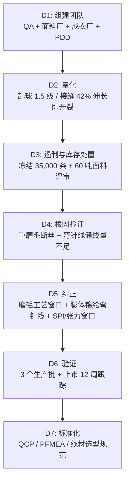

## 一、 案例背景

- **产品**: 女式高腰拼缝瑜伽紧身裤（Cut-and-Sew），成人运动服
- **客户**: 美国中高端运动生活方式品牌
- **面料**: 75% 锦纶 66 / 25% 氨纶，双面磨毛经编，220 GSM
- **参与方**: QA（主导）、PDD 版型与工艺、Raw Material、Sourcing、越南成衣厂、面料厂
- **订单**: 300,000 条，FOB $15，货值 $4,500,000
- **问题**:
  首批 50,000 条（美国 DC 发往门店与电商）上市 4 周、售出约 15,000 条后，该款电商退货率由品牌同类紧身裤的常态 **19%** 升至 **27%**。客服对退回实物按统一原因码复核：**经确认属于质量原因（起球、接缝开裂）的退货率由同类款的 1.1% 升至 7.4%**（占售出件数），1 星评价集中在两点：
  1. 大腿内侧穿 3 次左右即出现明显毛球；
  2. 深蹲时裆部十字缝和腰头四针六线接缝开裂。

> 口径说明：服装电商总退货率含尺码、偏好等原因，通常在 15–30%；本案的 KPI 是“经实物复核的质量原因退货率”，与总退货率分开报告。

---

## 二、 8D 过程

### D1: 团队
- **组长**: Senior QA Manager
- **成员**: 面料厂染整工程师、PDD 技术设计师、成衣厂 IE 经理、Sourcing、第三方实验室

### D2: 问题量化

| 项目 | 方法 | 客户要求 | 首批结果 | 判定 |
| :--- | :--- | :--- | :--- | :---: |
| 起球（马丁代尔） | ASTM D4970，3 次洗涤后，2,000 次摩擦 | ≥ 3.5 级 | **1.5 级** | Fail |
| 起球（乱翻式） | ASTM D3512，3 次洗涤后 | ≥ 3.5 级 | **2.0 级** | Fail |
| 接缝延伸 | 客户接缝延伸方法（规定试样宽度、夹距、拉伸速度，记录首次开裂伸长率） | 首次开裂伸长率 ≥ 120% | **42%**（面料断裂伸长约 180%） | Fail |
| 接缝断裂力 | 同一客户方法 | ≥ 40 lbf | **18.5 lbf** | Fail |

### D3: 遏制与库存处置
1. **冻结**：首批未售的 35,000 条中，美国 DC 31,800 条 WMS 冻结，门店在架 3,200 条下架撤回 DC；停止门店补货与电商销售。
2. **停产**：成衣厂暂停后续裁剪与缝制；面料仓 60 吨已整理面料封存。
3. **消费者**：客服对已售出产品开放无条件退换。已售 15,000 条按 27% 的总退货率约退回 4,050 条，其中质量原因约 1,110 条、尺码与偏好等其他原因约 2,940 条。其他原因退回的件来自同一批货，同样有起球与接缝缺陷，不再销售，随在库货一起去标回收。
4. **在库 35,000 条（DC 31,800 + 门店撤回 3,200）的处置**：按 AQL 抽样复检，起球与接缝问题在各批次普遍存在。起球是面料表面结构问题，无法返工；在美国拆缝重做绷缝的成本超过产品价值。品牌决定**不再销售**，由回收商去除品牌标识后做纤维回收，并取得处置证明。
5. **60 吨已整理面料**：已经重磨毛的面料无法“磨回去”。在留样上试加抗起球整理，起球只提升到 2.5–3.0 级，仍达不到 3.5 级，因此判定**整批拒收**，由面料厂承担。面料厂另有 18 吨尚未磨毛的坯布，按新工艺整理后可以使用。
6. **订单调整**：重新织造与整理需要 5–6 周，客户把剩余订单由 250,000 条调整为 180,000 条，交期顺延 7 周。

### D4: 根因分析（逐项验证）

#### 1. 起球
- **现象与验证**：同一坯布分别按“重磨毛”和“轻磨毛”整理后对比。显微镜下，重磨毛样表面断裂单丝明显增多，顶破强力下降 18%；轻磨毛样起球为 3.5 级，重磨毛样为 1.5 级。
- **机理**：为追求“裸感”手感，面料厂采用高压力、粗粒度砂辊重磨毛，打断了表层锦纶单丝，形成大量游离纤维端。摩擦时纤维端缠结成球，锦纶 66 强度高，毛球不易脱落，因此持续积累。
- **体系原因**：磨毛工艺参数（砂辊目数、压力、包角、车速）不在面料规格内，面料厂为改善手感自行调整，没有通知客户，也没有重测起球。

#### 2. 接缝开裂
- **机理**：绷缝（607 线迹）接缝能伸长多少，主要取决于线迹中储存的线量（弯针线量、SPI、张力、差动送料），而不是缝线本身的伸长率。本案弯针线用了普通涤纶短纤线（40s/2），且弯针张力过紧、SPI 只有 9–10，线迹储线量不足。面料被拉伸时，缝线很快被拉直，接缝在 42% 伸长时就开裂，而面料本身能伸长到约 180%。
- **验证**：在同一台车上，只换弯针线为膨体锦纶线、并把 SPI 提高到 13，接缝首次开裂伸长率提升到 140% 以上，证实主因是线迹设计而非面料。
- **体系原因**：Tech Pack 只写了 SPI，没有规定弯针线类型与接缝延伸验收；PP 样只做了外观确认。线材选型由工厂自行决定，**品牌 PDD 与工厂共同负有责任**，这也影响了后续的追偿比例。

### D5: 永久纠正措施

#### 1. 面料
- 磨毛工艺通过 DOE 确定窗口：砂辊目数、压力、包角、车速四个因子，以起球、顶破强力、克重与手感为响应；窗口写入面料规格，变更须重新测试。
- 锦纶/氨纶不适用纤维素酶抛光；游离毛羽靠机械参数控制、充分洗净与定型稳定。
- 抗起球整理（水性聚氨酯类）只作为辅助手段，须验证耐洗性与手感，不作为主要措施。
- 结果：3 次洗涤后 D4970 起球 **3.5–4.0 级**，D3512 **3.5 级**。

#### 2. 车缝
- **弯针线**：改为膨体锦纶弯针线（具体规格以线厂数据和来料测试为准）；面线用涤纶包芯线。
- **线迹参数**：SPI 12–14；弯针张力、差动送料比通过接缝延伸曲线确定窗口，并同时检查起皱与针孔。单纯提高 SPI 不能替代储线量控制。
- **机针**：65/9 轻圆头针（Groz-Beckert SES），避免刺断氨纶。
- 结果：接缝首次开裂伸长率均值 **145%**；断裂力由 18.5 lbf 提升至 **56.8 lbf**（约 +207%）；按客户方法拉伸至原长 2 倍（伸长率 100%）循环 10 次，无断线、无明显 seam grin。

### D6: 验证
- 新工艺的前 3 个生产批（共约 75,000 条）：每缸面料起球全部 ≥ 3.5 级；车间每班首件接缝延伸全部合格。
- **过程能力**：接缝断裂力是连续数据。测量系统 %GRR 为 9%，累计 60 个子组后计算 Cpk = **1.45**。起球是等级数据，**只报告合格率与等级分布，不计算 Cpk**。
- **上市跟踪 12 周**：该款总退货率回到 **19.5%**（品牌同类款常态 19%）；经复核的质量原因退货率降至 **0.9%**。

### D7: 标准化
1. 发布《高弹针织运动服线材选型与线迹规范》（SOP-ENG-089）：规定弯针线类型、SPI 窗口、接缝延伸验收方法。
2. QCP：每台绷缝机每班开机车缝 30 cm 试片，按客户方法拉伸至原长 2 倍（伸长率 100%）循环 10 次，判定开裂与针孔，结果记录在机台看板；试片不回流生产。
3. 面料规格增加磨毛参数窗口与起球验收；PFMEA 接缝爆线一项 RPN 由 200 降至 96（见 [FMEA 模板](doc:PB-FMEA)）。

### D8: 损失与追偿
- COPQ 约 **$1.44M**（实际成本：货物按 FOB 计，处理、测试等按实际支出）：在库 35,000 条报废 $525,000（FOB）；已售 15,000 条中质量原因退货约 1,110 条及客服、物流处理约 $55,000；其他原因退回、随库存回收的约 2,940 条 $44,100（FOB）；60 吨面料拒收约 $720,000（约 $12/kg）；测试、加急与管理成本约 $100,000（实际支出）。已售出且未退回的产品不计入损失。
- 责任：面料损失由面料厂承担；成品损失按“面料原因 60% / 线迹原因 40%”分摊，线迹部分由成衣厂与品牌（Tech Pack 缺项）协商分担。

---

## 三、 面试 STAR 讲稿

> **面试官提问**：“分享一个你处理过的最棘手的服装质量危机。”

- **Situation**：“一款 220 GSM 锦纶/氨纶瑜伽裤上市 4 周，经复核的质量原因退货率从同类款的 1.1% 升到 7.4%，原因是穿几次就起球，以及深蹲时接缝开裂。订单 30 万条，货值 450 万美元。”
- **Task**：“我负责在两周内用试验确认根因，决定在库货物和面料怎么处置，并让后续生产恢复正常。”
- **Action**：
  1. 用对比试验确认两个根因：面料厂擅自加重磨毛打断表层单丝；弯针线和线迹参数导致储线量不足，接缝在 42% 伸长就开裂。
  2. 做处置决策：3.5 万条在库无法返工，去标回收；60 吨已磨毛面料加抗起球整理后仍不达标，整批拒收；客户把剩余订单调到 18 万条。
  3. 纠正：用 DOE 确定磨毛窗口；弯针线换膨体锦纶线，用接缝延伸曲线锁定 SPI 和张力；把每班试片测试写进 QCP。
- **Result**：“接缝断裂力从 18.5 提升到 56.8 lbf，起球达到 3.5–4.0 级；再上市 12 周，质量原因退货率降到 0.9%，总退货率回到 19.5% 的品类常态。这次损失约 144 万美元（货物按 FOB，处理与测试按实际支出），按责任比例由面料厂、成衣厂和我们分担。之后线材和线迹要求固化成了全品类规范。”
