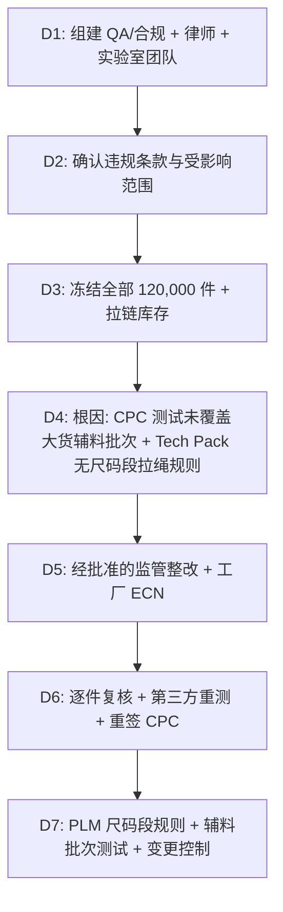

## 一、 案例背景

- **产品**: 4–12 码儿童抓绒拉链连帽卫衣（儿童产品，适用 CPSIA）
- **客户**: 美国大型零售连锁
- **参与方**: QA 与合规（总负责）、Sourcing、法务（外聘美国合规律师）、拉链厂、成衣厂、CPSC 认可第三方实验室
- **订单**: 120,000 件，FOB $15，货值 $1,800,000
- **事件**:
  事件发生在 2026 年下半年，16 CFR 1110 的证书电子申报已经生效（2026-07-08 起）。首批 40,000 件入境时已随报关电子提交了原 CPC 数据，在**长滩港**被 CPSC 抽样，CPSC 随后发出违规通知：
  1. **风帽拉绳**：风帽穿有涤纶拉绳，两端带塑料绳扣。对 2T–12 码儿童上身外衣，风帽/颈部拉绳本身即被 16 CFR 1120.3 认定为实质性产品危害，与长度无关。
  2. **涂层铅**：前中金属拉链头绿色涂层总铅 **240 ppm**，超过 CPSIA Sec.101(f) / 16 CFR 1303 的 **90 ppm** 限值。
  - **可能后果**：依 CPSA 第 17 条，不合格货物被拒绝入境，进口商可在期限内申请在监管下整改，否则须退运或销毁。货物尚未进入美国商业流通，法务评估后未触发市场召回；行政处罚不是扣留的自动结果。

---

## 二、 8D 处理

### D1: 团队
- **负责人**: Director of QA & Compliance
- **成员**: 美国合规律师、Sourcing VP、工厂总经理、CPSC 认可实验室技术负责人、报关行

### D2: 违规事实

| 项目 | 依据 | 要求 | 实测 | 严重度 |
| :--- | :--- | :--- | :--- | :---: |
| 风帽拉绳 | 16 CFR 1120.3(b)；ASTM F1816 | 2T–12 码上身外衣风帽/颈部不得有拉绳（腰部/下摆另有规则） | 风帽内穿 14 英寸拉绳，两端带硬质绳扣 | S = 10 |
| 涂层总铅 | CPSIA Sec.101(f)；16 CFR 1303；方法 CPSC-CH-E1003 | ≤ 90 ppm | 绿色拉链头涂层 **240 ppm** | S = 10 |

- **范围**：40,000 件在港；40,000 件已在工厂装箱；40,000 件在产。三批使用同一款式和同一批绿色拉链头。

### D3: 遏制
1. **口岸**：律师在 CPSA 第 17 条规定的期限内提交整改申请（reconditioning），说明返工方法、地点、人员、复核与重测方案；货物在海关监管仓存放，等待批准。
2. **工厂**：已装箱的 40,000 件停止出运，挂红牌隔离；在产 40,000 件停线。
3. **辅料**：封存同批绿色拉链头 150,000 个，向拉链厂发出质量通知并保全证据。
4. **市场排查**：确认同款没有其他批次已入境销售；同一拉链厂供应的其他童装款式全部送测。

### D4: 根因分析

#### 1. 拉绳为什么会出现在童装上？
- **Why 1**: 童装纸样直接由同系列成人款（亲子装）缩放，保留了风帽穿绳结构。
- **Why 2**: PDD 没有为童装单独开 Tech Pack，规格表沿用成人款。
- **Why 3**: PP 样由商品部门确认外观，没有合规人员参与。
- **Why 4（体系根因）**: PLM 没有按“产品类型 + 尺码段”触发拉绳规则；Tech Pack 签发流程中没有合规签核。

#### 2. 涂层铅为什么超标？
- **Why 1**: 拉链头绿色涂层颜料含铅（实验室成分分析指向铬黄类颜料）。
- **Why 2**: 主拉链厂在旺季把绿色拉链头的喷涂工序**未经报备外包**给一家小喷涂厂。
- **Why 3**: CPC 依据的第三方测试是在产前用主拉链厂自产的同色样品做的，**测试样品与大货辅料不是同一批次、同一加工厂**。
- **Why 4（体系根因）**: 没有规定“大货辅料按颜色/批次送测”，供应商变更与外包没有通知条款；成衣厂 IQC 没有 XRF 筛查。也就是说，CPC 签发的依据与实际大货不一致，这是比“外协小作坊”更根本的漏洞。

### D5: 纠正措施

#### 1. 监管仓内 40,000 件整改（获 CPSC 书面同意后执行，约 4 周后获批）
- **拉绳**：逐件抽出拉绳和绳扣并隔离销毁；按批准方案封闭穿绳孔，确保不能再穿入拉绳。
- **拉链头**：拉链链齿（黄铜基材）经测试合格，只更换拉链头。专业返工团队拆下上止、更换经第三方测试合格的新拉链头、重新压装上止；先在 200 件上试做，验证往复开合、上止拉力与外观后再批量执行。
- **复核**：每件由独立复核员逐件确认并记录；ANSI/ASQ Z1.4 抽样只用于审核返工质量，不代替逐件确认。

#### 2. 工厂 80,000 件
- PDD 发布 ECN：童装风帽改为松紧包边风帽，取消穿绳结构。
- 更换为经第三方测试合格的同色拉链头（新供应商批次逐色送测）。
- 已装箱的 40,000 件开箱返工；在产 40,000 件按新结构生产。

### D6: 验证与放行
1. 按颜色、拉链头批次和代表性成衣抽样，由 CPSC 认可实验室测试：涂层铅 **< 10 ppm**（低于方法报告限）；拉链功能与上止拉力合格。
2. 以新的测试报告为依据**重新签发 CPC**，并更新追溯标签信息。证书电子申报（16 CFR 1110）：在港 40,000 件按 CBP/CPSC 的指示更新已申报的证书数据；后续 80,000 件出运时随入境申报电子提交新 CPC 数据，报关行确认受理后才安排放行。具体操作以 CBP/CPSC 当时的指示与实际文书为准。
3. 律师向 CBP/CPSC 提交整改记录、测试报告与 CPC；获书面同意后，在港 40,000 件在被扣留约 7 周后放行。文件名称以实际文书为准。
4. 工厂 80,000 件按新 CPC 出运，比原计划晚 3 周。

### D7: 防再发
1. **PLM 规则**：按产品类型与尺码段触发：2T–12 码（含 12 码与 L 码；标注尺码区间只要覆盖其中任一尺码，整件按此处理）上身外衣禁用风帽/颈部拉绳；2T–16 码腰/下摆拉绳进入 ASTM F1816 审查；14–16 码风帽/颈部拉绳不在 16 CFR 1120.3 与 F1816 的规定范围内，按客户要求与内部规则处理（本客户手册同样禁用）。16 CFR 1615/1616 只对儿童睡衣触发。
2. **辅料测试**：童装涂层辅料**每颜色、每生产批**送 CPSC 认可实验室测试；成衣厂 IQC 用 XRF 做风险筛查，XRF 阳性或临界结果必须用 CPSC 方法确认。
3. **变更控制**：辅料供应商合同增加“工序外包须事先书面批准”与违约赔偿条款；任何辅料变更都要评估是否需要重测与重签 CPC。
4. **签核**：Tech Pack 与 PP 样增加合规签核栏。

### D8: 损失
- 监管仓整改、空运拉链头、仓储与滞港费、测试、律师费合计约 **$250,000**；工厂返工与延误约 $90,000。
- 在港货物错过首波上架，客户同意延后上架，部分以促销价销售。
- 喷涂外包相关损失按合同由拉链厂承担。

---

## 三、 面试 STAR 讲稿

> **面试官提问**：“你是否处理过涉及法规或海关扣留的质量危机？你的处理逻辑是什么？”

- **Situation**：“一批 4–12 码儿童连帽卫衣，首批 4 万件在长滩港被 CPSC 抽样，发现两项违规：风帽有拉绳，属于 16 CFR 1120.3 认定的实质性产品危害；拉链头涂层铅 240 ppm，超过 90 ppm 限值。”
- **Task**：“我是 QA 与合规负责人，要在法定期限内拿出处置方案，并分别找出两个漏洞：CPC 为什么没挡住涂层铅；设计和签核流程为什么没挡住拉绳。拉绳是 16 CFR 1120.3 的 15(j) 规则，不在第三方测试和 CPC 的覆盖范围内，只能靠设计规则和实物检查来拦。”
- **Action**：
  1. 和律师一起提交整改申请，获批后在监管仓逐件拆除拉绳、封闭穿绳孔、更换拉链头，独立人员逐件复核；
  2. 根因上发现 CPC 依据的测试样品与大货辅料不是同一批次，拉链厂把喷涂外包了；童装 Tech Pack 是从成人款缩放来的；
  3. 体系上，在 PLM 按尺码段设拉绳规则，童装涂层辅料按颜色和批次送测，供应商外包须书面批准。
- **Result**：“在港货物在扣留约 7 周后经批准放行，重测铅含量低于 10 ppm 并重签 CPC；货物没有进入市场，因此没有召回。直接成本约 34 万美元，喷涂外包相关部分由拉链厂承担。之后 18 个月，童装的第三方测试与口岸抽样中没有再出现拉绳和涂层铅问题。”
