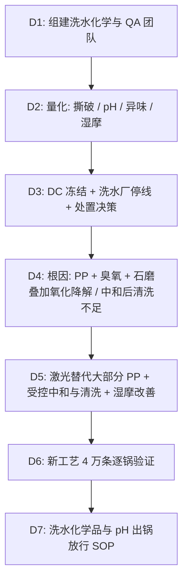

## 一、 案例背景

- **产品**: 男士重磅复古破洞锥形牛仔裤
- **客户**: 美国青年潮流牛仔品牌
- **面料**: 13.5 oz、100% 棉环锭纺右斜牛仔布，绳状靛蓝染色
- **洗水工艺**: 酵素石磨 + 局部高锰酸钾喷马骝（PP Spray）+ 臭氧脱色 + 亚硫酸氢钠中和
- **参与方**: QA（主导）、洗水厂工程师、面料部、Sourcing、第三方实验室
- **订单**: 60,000 条，FOB $28，货值 $1,680,000
- **问题**: 货物到达美国 DC 后，客户委托的第三方实验室到货抽检不合格：
  1. **撕破强力**（ASTM D1424）：膝部破坏区 **1.3 lbf**（客户要求破坏区 ≥ 2.0 lbf），大身 **3.0 lbf**（要求 ≥ 3.5 lbf），试穿时破洞边缘一扯就裂；
  2. **异味**：开袋有明显硫磺/酸味，按客户感官评定程序（训练嗅辨员 3 人，0–4 级）评为 **3.5 级**，要求 ≤ 2 级；
  3. **pH**（AATCC 81）：**4.2**，客户规格 5.5–7.5（这是客户放行标准，不是美国法定限值）；
  4. **湿摩擦**（AATCC 8）：**1.5 级**，客户要求 ≥ 2.0 级（靛蓝牛仔常用的放宽要求）。

---

## 二、 8D 过程

### D2: 数据

| 项目 | 方法 | 客户要求 | 到货抽检 | 严重度 |
| :--- | :--- | :--- | :--- | :---: |
| 撕破强力（破坏区） | ASTM D1424 | ≥ 2.0 lbf | **1.3 lbf** | S = 8 |
| 撕破强力（大身纬向） | ASTM D1424 | ≥ 3.5 lbf | **3.0 lbf** | S = 7 |
| pH | AATCC 81 | 5.5–7.5 | **4.2** | S = 7 |
| 异味 | 客户感官评定程序（0–4 级） | ≤ 2 级 | **3.5 级** | S = 7 |
| 湿摩擦 | AATCC 8 | ≥ 2.0 级 | **1.5 级** | S = 6 |

### D3: 遏制与处置
1. **冻结**：DC 冻结 60,000 条；洗水厂停用该工艺，在洗的 PO 全部暂停。
2. **按洗水批复测**：原工艺的“洗水批”按 PO 与色号划分，每批约 7,500 条（含多个洗水锅次），8 个洗水批全部抽测，破坏区撕破 1.1–1.6 lbf、大身 2.8–3.2 lbf，**所有批次都不合格**。
3. **为什么不能返修**：pH 与异味可以通过重新清洗改善，但撕破强力下降是纤维素被氧化降解，**无法通过返工恢复**。在美国重新洗水也无法解决强力问题。
4. **处置**：客户拒收 60,000 条并按合同扣款；货物在第三方监督下去除品牌标识后做纤维回收，取得处置证明。客户把补单数量调为 40,000 条，从客户确认补单起约 9 周到达美国 DC。补单面料来自面料厂的现货：同款 13.5 oz 牛仔布是品牌常年款，面料厂常备约 70,000 码，补单需要约 60,000 码，不需要重新纺纱染色织造。时间安排：第 1 周调布、复测面料，并在面料小样上做激光窗口与撕破验证；第 2–4 周裁剪缝制；第 4–5 周按新工艺洗水并逐批测试；第 6–9 周海运、清关与入 DC。
5. **损失**：拒收货值 $1,680,000 + 处置与物流约 $60,000，合计约 $1,740,000；依据合同，由负责洗水的成衣供应商承担，分 4 期从后续货款中抵扣（经 Sourcing、财务与法务批准）。

### D4: 根因分析

#### 1. 为什么破坏区和大身都脆化？（多个氧化工序叠加）
- **高锰酸钾**：PP 喷液浓度达 5.5%（工艺卡为 2.5%），作用时间长。高锰酸钾在氧化靛蓝的同时把纤维素氧化为氧化纤维素（羰基、羧基增加），聚合度下降。
- **臭氧**：臭氧脱色在湿态下同样会氧化纤维素；本批臭氧处理时间比工艺卡长 40%，用于弥补 PP 不均匀。
- **重石磨**：在已经被氧化削弱的纤维上进一步造成机械损伤，破坏区本来就被磨薄，所以下降最多。
- **验证**：同一面料分别只做石磨、石磨 + PP、石磨 + PP + 臭氧三组，PP 浓度与臭氧时间都用大货实际参数（5.5%、工艺卡时间 +40%），大身撕破分别为 4.6、3.8、3.0 lbf，叠加效应与大货结果吻合。
- **对照组（工艺卡参数）**：石磨 + PP 2.5% + 工艺卡臭氧时间，大身撕破 3.9 lbf、破坏区 2.2 lbf，都满足要求。说明主因是洗水厂超量使用 PP 和延长臭氧；但工艺卡本身的余量也偏小（破坏区只高出要求 0.2 lbf），所以纠正措施改用激光替代大部分 PP。责任认定不变：按工艺卡生产本可满足要求，超量是洗水厂擅自变更。

#### 2. 为什么 pH 低、有异味？
- PP 处理后的残留（二氧化锰）用**亚硫酸氢钠在酸性条件下还原清除**，这一步本身会带入酸性和亚硫酸盐。
- 洗水厂把中和时间从 20 分钟缩短到 8 分钟，之后只过一道冷水，没有充分清洗，也没有在最后一缸调节 pH。
- 残留的亚硫酸盐和酸性物质在密封包装、海运高温下产生刺激性硫系/酸性气味。不能只凭嗅觉断定是 SO₂ 或 H₂S；本案用残留亚硫酸盐测试与顶空 GC-MS 确认了含硫挥发物。

#### 3. 为什么湿摩擦差？
- 重度洗水后表面残留大量松动的靛蓝和磨下的纤维屑，最后清洗不足；靛蓝牛仔的湿摩本身偏低，清洗不足进一步拉低了等级。

#### 4. 体系原因
- 洗水配方（PP 浓度、臭氧时间、中和时间）没有作为受控参数，洗水厂为追效果自行加大，未通知客户，也没有开船前测试撕破强力。

### D5: 永久纠正措施
1. **减少化学氧化**：大部分马骝与猫须改用激光完成（激光通过烧蚀表层靛蓝显色，也会造成局部碳化与强力损失，因此激光能量与图案密度同样要通过撕破测试确定窗口）；保留的 PP 喷涂浓度锁定 ≤ 2.5%，喷涂量用称重控制。
2. **臭氧**：时间与浓度按工艺卡锁定，设备记录每缸参数。
3. **中和与清洗**：PP 残留改用过氧化氢在弱酸条件下还原清除（过氧化氢在此处的作用是还原二氧化锰，用量与温度须控制，过量会进一步损伤纤维）；之后两道热水清洗，最后一缸用弱碱/缓冲剂把 pH 调到 6–7，并用试纸确认无残留过氧化物和亚硫酸盐。
4. **湿摩擦**：增加一道皂洗去除浮色，柔软剂选用不降低湿摩的品种。
5. **酶洗**：中性纤维素酶 45℃，处理时间按撕破测试结果设定上限。

### D6: 验证（新工艺 40,000 条，逐锅控制）
- 每锅出水测 pH，每个洗水批测撕破与湿摩。
- 结果：破坏区撕破 **2.6–3.0 lbf**、大身 **4.2–4.6 lbf**；pH **6.3–6.9**（均值 6.6）；异味 **≤ 1 级**；湿摩 **2.0–2.5 级**。
- 能力评价：新工艺把“洗水批”重新定义为同一班次、同一配方的连续 10 锅（约 1,300 条），便于追溯，40,000 条共 30 个洗水批。pH 为连续数据：pH 计测量系统 %GRR 为 6%；以每个洗水批 2 个出锅读数为一个子组，30 个子组，过程稳定，均值 6.6，Cpk = **1.9**。撕破为破坏性测试，样本量有限，不计算 Cpk，先按“每批全部合格 + 最小值”放行。
- 补单到店后 12 周，经复核的质量原因退货率（全部质量原因）为 **0.7%**，其中与撕裂、气味相关的为 0.4%。

### D7: 标准化
1. 发布《牛仔洗水化学品与 pH/异味控制 SOP》（SOP-WASH-028）：PP 浓度、臭氧时间、中和与清洗步骤列为受控参数，变更须走 ECN。
2. 每锅出水 pH 试纸 + pH 计复核；每洗水批测撕破、湿摩，结果合格后才能包装。
3. 包装前样品做 24 h 密封袋异味评定。

---

## 三、 面试 STAR 讲稿

- **Situation**：“6 万条复古牛仔裤到美国 DC 后抽检，破洞区撕破强力只有 1.3 lbf，pH 4.2，还有明显硫磺味。”
- **Task**：“我要判断货物能否补救，找出根因，并让补单安全交付。”
- **Action**：“先按洗水批复测，确认所有批次强力都不合格；纤维已经被氧化降解，返工救不回来，所以说服客户和供应商按合同拒收、回收处理，而不是做无效的返洗。然后用三组对比试验证明是高锰酸钾、臭氧和重石磨叠加造成的，pH 和气味来自中和后清洗不足。纠正上，大部分马骝改成激光，锁定 PP 和臭氧参数，重建中和与清洗步骤，每锅出水测 pH。”
- **Result**：“补单 4 万条破坏区撕破 2.6–3.0 lbf，pH 稳定在 6.6 左右，异味 ≤ 1 级；上市 12 周质量原因退货率 0.7%，其中撕裂和气味相关的 0.4%。首批约 174 万美元的损失（拒收货值 168 万加处置与物流 6 万）按合同由供应商分期承担。”
