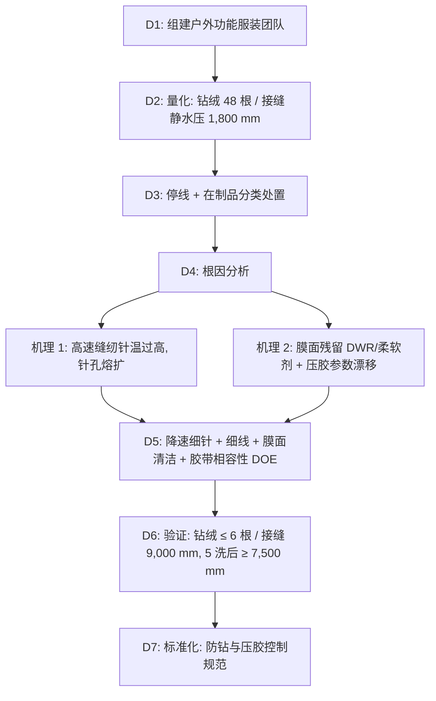

## 一、 案例背景

- **产品**: 防水羽绒服，结构为“防水外壳 + 可见绗缝的羽绒内胆”
  - **外壳**: 20D 锦纶 6 防撕格 + PU 微孔膜 2.5 层复合，面料静水压 10,000 mm；正面无氟 DWR；结构接缝（肩、侧缝、袖窿）13 mm 热风压胶
  - **内胆**: 20D 防绒锦纶，车缝绗缝；填充 90/10 白鹅绒，800 FP，RDS 认证
- **客户**: 美国户外品牌
- **参与方**: Technical QA（主导）、PDD、面料部（膜与 DWR）、羽绒供应商、成衣厂
- **订单**: 40,000 件，FOB $85，货值 $3,400,000
- **问题**（大货生产第 2 周的在线测试）：
  1. **钻绒**：成品内胆转笼防钻绒测试钻出 **48 根**（客户要求 ≤ 10 根），集中在袖窿和绗缝转角；
  2. **接缝静水压**：外壳肩部、后背压胶接缝初始只有 **1,800 mm**（客户要求接缝初始 ≥ 7,000 mm、5 次洗后 ≥ 5,000 mm）；洗 3 次后胶条翘边。

---

## 二、 8D 过程

### D2: 数据

| 项目 | 方法 | 客户要求 | 实测 | 严重度 |
| :--- | :--- | :--- | :--- | :---: |
| 成品防钻绒 | IDFB 转笼法（按客户指定版本、转数与计数规则） | ≤ 10 根 | **48 根** | S = 8 |
| 内胆面料防钻绒 | 同上，面料试样（无缝线） | ≤ 10 根 | 4 根 | 合格（说明问题在缝线处） |
| 接缝静水压（初始） | AATCC 127，按客户接缝试样制备 | ≥ 7,000 mm | **1,800 mm** | S = 8 |
| 接缝静水压（5 次洗后） | 同上，客户洗涤程序 | ≥ 5,000 mm | 洗 3 次已翘边，无法测试 | S = 8 |
| 羽绒清洁度/气味 | IDFB 浊度、气味（客户限值） | 浊度 ≥ 500 mm，气味 ≤ 2 级 | 浊度 > 500 mm，气味 1 级 | 合格 |

### D3: 遏制与在制品处置
1. 停止内胆绗缝和外壳压胶；已完成的在制品分类：
   - **已压胶外壳 12,000 件**：撕下胶条会损伤 PU 膜，无法重新压胶。按批次抽测，静水压全部不合格，**判定报废**（面料成本由面料厂与成衣厂按根因比例分担，见 D8）。
   - **已充绒内胆 9,000 件**：在专用回收设备上拆开内胆，负压回收羽绒；回收羽绒按回收批重新检测蓬松度、绒朵含量与清洁度：蓬松度 ≥ 800 FP 的批次（约 70%）重新用于本款新内胆；780–795 FP 的批次不能支持 800 FP 声明，转用于品牌其他标示 750 FP 的产品。
   - **未加工面料与羽绒**：继续使用，等新工艺验证后投产。
2. **替换外壳面料**：12,000 件外壳约需 2.5 层复合布 27,000 m，工厂余量只有约 3%。面料厂有一批同款 20D 防撕格已染色、尚未复合的坯布（原为品牌下一季补单预留，约 30,000 m），报废决定当周即按修订工艺（复合后不加柔软剂、DWR 只施加在正面）复合并做 DWR，约 4 周到厂、每卷测膜面达因值后放行；品牌补单所用坯布由面料厂另行投产，不影响本订单。订单数量不调整。
3. **时间线**：停线后约 3 周完成根因验证与压胶 DOE，用复测合格的在库面料恢复生产；替换面料第 5 周到厂，这 12,000 件排在最后一批缝制。客户同意整体交期顺延 5 周（最后一批出厂比原计划晚约 5 周）；前 8,000 件用合格在库面料生产并部分空运，按原定季初上架，其余分批到货。

### D4: 根因分析

#### 1. 为什么缝线处钻绒？
- **验证**：同一内胆面料，2,800 rpm 与 4,000 rpm 各缝 20 块试样。显微镜下 4,000 rpm 的针孔边缘有熔融扩孔，钻绒 41 根；2,800 rpm 针孔边缘完整，钻绒 9 根。热电偶测针温：4,000 rpm 时约 190℃，2,800 rpm 时约 120℃。
- **机理**：20D 锦纶 6 的熔点约 220℃，高速缝纫时机针与面料摩擦发热，针孔周围纤维软化熔融，针拔出后孔不能回缩，形成永久扩孔；65/9 针配较粗的面线也加大了针孔。
- **体系原因**：工艺单没有规定车速和针温控制，工厂为赶产量把车速提高到 4,000 rpm。

#### 2. 为什么压胶接缝漏水、洗后脱胶？
- **验证**：外壳膜面用达因笔与接触角测试，同一卷面料的膜面表面张力在 30–38 mN/m 之间波动；表面张力低的位置剥离强度只有正常的 30%。FTIR 检测到膜面有硅系柔软剂残留。
- **机理**：面料厂为改善手感在复合后加了柔软剂，并有部分 DWR 从正面渗到膜面。（无氟 DWR 的表面能高于氟系 DWR，但同样会降低胶的润湿。）热熔胶无法充分润湿膜面，形成“假粘”，初始静水压低，洗涤后翘边。
- **设备**：压胶机热风温度波动 ±25℃，转弯处操作工没有降速，胶层在压合点没有达到胶带厂推荐的活化温度。

### D5: 纠正措施
1. **内胆缝制**：车速降到 2,800 rpm；机针 60/8 细号针，加装针冷却风；面线改为 Tex 18 细涤纶包芯线；SPI 12。缝线本身不能“封住”针孔，最终以成品防钻绒测试验证。
2. **膜面管理**：面料厂取消复合后柔软剂，DWR 只施加在正面并控制渗透；每卷面料测膜面达因值，低于 36 mN/m 的卷不得用于压胶（阈值由剥离 DOE 确定）；在库面料中约 35% 的卷（120 卷）低于阈值，退回面料厂返洗：在连续平幅水洗机上用非离子表面活性剂、60℃ 洗两道并充分漂洗，低张力烘干（≤ 120℃）。硅系柔软剂与膜面结合较牢，普通水洗未必去得掉，强力洗涤又可能伤到正面 DWR 和复合牢度，所以每卷返洗后同时复测三项：膜面达因值 ≥ 36 mN/m、正面 AATCC 22 喷淋拒水达到客户等级、复合剥离强度达到客户要求。结果 104 卷三项合格后使用；16 卷达因值仍低于阈值或 DWR 下降，不再用于压胶外壳，退面料厂折价处理。返洗与复测费用由面料厂承担。
3. **胶带相容性 DOE**：与膜厂、胶带厂一起，对 3 种胶带 × 热风温度 × 压轮压力 × 车速做试验，响应为剥离强度与接缝静水压。最终窗口：热风风嘴设定 600℃（设备设定值，对应压合点胶层温度约 165℃）、压轮压力 0.4 MPa、车速 4 m/min；转弯处设备自动降速。
4. **设备**：热风加热器更换温控模块，温度波动降到 ±5℃；每班首件做剥离与静水压测试。

### D6: 验证
- 新工艺前 3 个生产批（每批约 4,000 件）：
  - 成品防钻绒 **3–6 根**；
  - 接缝静水压初始 **9,000–10,000 mm**（不超过面料自身的 10,000 mm），按客户洗涤程序 5 次洗后 **≥ 7,500 mm**（要求 ≥ 5,000 mm）；剥离强度满足客户要求，失效模式为面料破坏而非胶层界面破坏。
- 每 2 小时从每台压胶机取一段工艺试片（不是成品）测剥离；成品按客户抽样计划送第三方实验室测试，全部合格。
- 上市一个冬季后，经复核的全部质量原因退货（含保修退货）占销量 **1.0%**，其中与钻绒、漏水相关的为 0.6%。

### D7: 标准化
1. 发布《功能羽绒服防钻与压胶控制规范》：车速上限、针号、线号、膜面达因值、压胶窗口列为受控参数。
2. 面料规格增加“膜面不得有柔软剂与 DWR 迁移”，并在来料检验时测达因值。
3. PFMEA 增加“高速缝纫针孔熔扩”和“膜面污染导致假粘”两个失效模式。

### D8: 损失
- 报废外壳 12,000 件（面料与工时）约 $210,000；羽绒回收与重新检测约 $45,000；拆开的 9,000 件内胆，绗缝好的防绒面料与缝制工时无法再用，约 $81,000（面料约 $6/件、工时约 $3/件）；约 30% 的回收羽绒（约 540 kg）由 800 FP 转用于 750 FP 产品，按两种羽绒的采购价差约 $20/kg 计约 $10,800；延误与部分空运约 $60,000，合计约 $406,800（实际成本）。
- 外壳损失 60% 由面料厂（膜面污染）承担，40% 由成衣厂（压胶参数）承担；内胆返工、内胆面料与工时、羽绒降级价差由成衣厂承担（钻绒根因是车速与针温）。

---

## 三、 面试 STAR 讲稿

- **Situation**：“一款 20D 防水羽绒服在大货第二周在线测试时，内胆钻绒 48 根，外壳压胶接缝静水压只有 1,800 mm，洗 3 次就翘边。订单 4 万件。”
- **Task**：“我负责技术 QA，要找出根因、决定在制品怎么处理，并在客户可接受的延期内恢复生产。”
- **Action**：“用对比试验证明钻绒来自高速缝纫导致的针孔熔扩：4,000 rpm 时针温约 190℃，接近锦纶 6 的熔点。压胶问题通过达因值和 FTIR 找到膜面柔软剂残留。在制品上，1.2 万件已压胶外壳无法返修，报废；9,000 件内胆拆开回收羽绒，复检合格后重新使用。之后降速、换细针细线，和面料厂、胶带厂一起做相容性 DOE，锁定压胶窗口。”
- **Result**：“钻绒降到 3–6 根，接缝静水压初始 9,000–10,000 mm，5 次洗后 ≥ 7,500 mm。损失约 41 万美元，按根因由面料厂和成衣厂分担；上市一个冬季，质量原因退货（含保修）占销量 1.0%，其中钻绒和漏水相关的 0.6%。”
