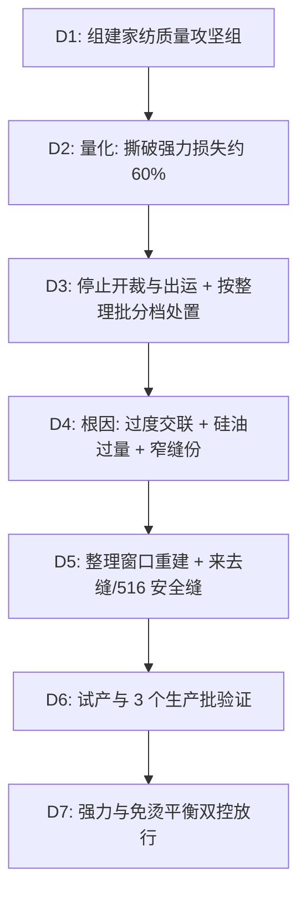

## 一、 案例背景

- **产品**: 400TC 100% 埃及长绒棉贡缎床品四件套（被套、床单、床笠、2 个枕套）
- **客户**: 美国高端家居零售商
- **面料**: 经纱 100s/1、纬纱 80s/1，经密 260 根/英寸 + 纬密 140 根/英寸 = **400TC**（按 ASTM D3775 计数，股线计为一根）；4/1 缎纹；液氨整理 + 免烫树脂整理
  - 立项时商品部门曾要求标“600TC”。QA 核算后指出：以单纱计，这种纱支和组织在物理上排不下 600 根/平方英寸，只能靠把股线拆成多根计数来“凑数”，而这种计数方式会构成 FTC 认定的误导性标示，因此按实际 400TC 标示。
  - 埃及棉（Giza）声明：要求纺纱厂提供原棉采购与轧花溯源文件，并对成品做第三方纤维溯源检测，作为 FTC 声明依据。
- **参与方**: QA（主导）、面料开发、织染厂、成衣缝制厂、美国买手办公室
- **订单**: 50,000 套，FOB $75，货值 $3,750,000
- **问题**（出货前客户指定实验室的大货测试）：
  1. **撕破强力**（ASTM D1424）：经向 **1.7 lbf**、纬向 **1.4 lbf**，客户要求 ≥ 3.0 lbf；
  2. **接缝滑移**：按客户成品接缝方法，枕套与被套边缝达到 1/4 in（6 mm）开口所需载荷只有 **5.8 lbf**，要求 ≥ 15 lbf；
  3. **洗 3 次后**折边受力处出现破洞。

---

## 二、 8D 过程

### D2: 数据

| 项目 | 方法 | 客户要求 | 大货实测 | 偏差 |
| :--- | :--- | :--- | :--- | :---: |
| 撕破强力（经向） | ASTM D1424 | ≥ 3.0 lbf | **1.72 lbf** | −42.6% |
| 撕破强力（纬向） | ASTM D1424 | ≥ 3.0 lbf | **1.41 lbf** | −53.0% |
| 接缝 1/4 in 开口载荷 | 客户成品接缝方法（参考 ASTM D1683） | ≥ 15.0 lbf | **5.8 lbf** | −61.3% |
| 免烫外观 | AATCC 124 | ≥ 3.5 级 | **4.2 级** | 远超要求，提示过度整理 |
| 甲醛 | AATCC 112 | ≤ 75 ppm（客户 RSL） | **68 ppm**（换机后整理批） | 裕量不足 |

> ASTM D434 已于 2004 年撤销，本案不再使用。

### D3: 遏制与处置
1. **停止**：停止开裁和出运；已包装的 18,000 套挂红牌隔离；面料仓 120,000 米已整理面料封存。
2. **按整理批分档复测**：在库 120,000 米面料对应 12 个整理批（每批约 10,000 米）：前 3 批在旧焙烘机上按原工艺整理（树脂 60 g/L、160℃、停留约 3 min），撕破 3.0–3.3 lbf，合格；后 9 批换到高速焙烘机，树脂加到 90 g/L、温度提到 175℃（见 D4），撕破 1.3–1.9 lbf，全部不合格。已制成 18,000 套成品所用的约 135,000 米面料来自另外 14 个整理批，全部在换机后整理，留样复测同样不合格。
3. **为什么不能返修**：树脂交联造成的纤维素降解不可逆；剥离树脂需要酸处理，会进一步损伤纤维。缝制返工只能改善接缝滑移，不能恢复面料撕破强力。
4. **处置**：
   - 合格的 3 批（约 30,000 米，约 4,000 套）：这 3 批同样使用了原硅油柔软剂配方，撕破合格不代表接缝和甲醛合格，因此放行前补测。按新接缝结构（来去缝 / 516 安全缝，缝份 1/2 in）每批制 5 套，接缝 1/4 in 开口载荷 **18.6–20.4 lbf**（≥ 15）；AATCC 112 甲醛 **52–61 ppm**（≤ 75，这 3 批在旧机上停留时间足够，固化充分）；DP 3.9 级。三项合格后改用新接缝结构继续生产；
   - 不合格的 90,000 米作为次级面料出售给非床品用途的买家，回收约 20%；
   - 18,000 套成品全部来自不合格批，去除品牌标识后作为次品出售，并按 FTC 要求重新标注成分与产地；
   - 新织造与整理需要 6 周，客户接受交期顺延 6 周，剩余 32,000 套给予 5% 延误折扣。
5. **损失**：约 **$1.07M**（实际成本，扣除残值、追偿前）：
   - 18,000 套成品按实际成本约 $55/套计 $990,000，作为次品出售回收约 35%，净损失 $643,500；
   - 90,000 米不合格面料按实际成本约 $3.2/米计 $288,000，回收约 20%，净损失 $230,400；
   - 剩余 32,000 套 5% 延误折扣 $120,000；
   - 复测、加急与管理 $76,100。
   依据合同由擅自更改整理参数的染厂承担。追偿状态：截至结案已从染厂后续加工费中抵扣回收 $640,000，其余 $430,000 按协议在 6 个月内分期抵扣。按 GOV-03 的定义，追偿完成后本企业的净损失接近 0，所以这里不标“净损失”，而报告追偿前的实际成本。

### D4: 根因分析

#### 1. 撕破强力为什么下降？
- **组织**：4/1 缎纹交织点少，本身的撕破强力就低于平纹，对整理损伤更敏感。
- **交联过度**：Tech Pack 只要求 DP ≥ 3.5。从第 4 个整理批起，染厂同时做了两项变更，都没有走 ECN：一是为“保险”把树脂（DMDHEU 类，配氯化镁催化剂）由 60 g/L 加到 90 g/L；二是换用高速焙烘机，车速提高后停留时间由约 3 min 缩短到约 1.5 min，染厂把温度从 160℃ 提到 175℃ 来补偿。DP 做到了 4.2，但纤维素在酸性催化与高温下降解，交联又使纱线在撕裂三角区不能移动聚集，单根纱线逐一被撕断。
- **验证**（同一坯布，纬向撕破 / DP，每组 5 个试样均值）：先在高速焙烘机上把车速降到停留约 3 min，做树脂 × 温度 2×2 析因；另在旧机上做原工艺对照，检查设备本身的影响。

| 条件 | 纬向撕破 (lbf) | DP（级） |
| :--- | :---: | :---: |
| 旧机 60 g/L / 160℃ / 约 3 min（原工艺） | 3.1 | 3.9 |
| 新机 60 g/L / 160℃ / 约 3 min | 3.2 | 3.9 |
| 新机 90 g/L / 160℃ / 约 3 min | 2.6 | 4.1 |
| 新机 60 g/L / 175℃ / 约 3 min | 2.2 | 4.1 |
| 新机 90 g/L / 175℃ / 约 3 min | 1.6 | 4.2 |
| 新机 90 g/L / 175℃ / 约 1.5 min（大货实际条件） | 1.5 | 4.2 |
| 新机 45 g/L / 160℃ / 约 3 min（候选新工艺） | 3.8 | 3.6 |

  - 停留时间相同时，新旧设备结果接近（3.2 对 3.1），设备本身不是主因；
  - 温度主效应约 −1.0 lbf，树脂主效应约 −0.6 lbf，交互作用很小：**提温是主因，加树脂是次因**，两者叠加把撕破从约 3.1 打到 1.5–1.6；
  - 1.5 min 与 3 min 在 175℃ 下结果接近，说明大货的损伤来自高温而不是停留时间本身。

#### 2. 接缝为什么滑移？
- 为追求丝滑手感，染厂在整理液中加了过量硅油柔软剂，纱线表面摩擦系数很低；
- 成衣厂用 301 平缝，缝份只有 0.6 cm、SPI 10，纬纱在接缝受力时整排滑出。

#### 3. 体系原因
- 整理参数（树脂浓度、焙烘温度）不是受控参数，换设备没有走 ECN；
- 面料放行只测 DP，没有测撕破与接缝。

### D5: 纠正措施
1. **整理配方与工艺**：低甲醛改性树脂 90 → 45 g/L；焙烘 160℃，高速焙烘机降低车速使停留时间恢复到约 3 min，写入设备配方；柔软剂改为聚乙烯柔软剂为主、少量硅油，兼顾撕破强力（纱线可移动性）与接缝滑移阻力。
   - **为什么是 45 g/L 而不是回到原来的 60 g/L**：60 g/L/160℃ 撕破 3.1–3.2 lbf，对 3.0 的要求只有约 0.2 lbf 余量，而前 3 批大货最低就是 3.0；45 g/L 撕破 3.8 lbf，代价是 DP 只剩 3.6 对 3.5 的余量。撕破不足会在使用中破洞，DP 偏低只影响外观，所以选 45 g/L，并用控制规则管住 DP 余量：任一整理批 DP < 3.6 时，在 45–55 g/L 窗口内上调树脂并复测撕破。
   - **柔软剂单因素对比**（同为 45 g/L/160℃）：原硅油配方与聚乙烯为主配方，用原 301 平缝窄缝份测接缝开口分别为 7.2 与 11.4 lbf，用新来去缝分别为 19.8 与 26.5 lbf。接缝结构是主要改善，柔软剂调整提供额外余量。
2. **缝制结构**：被套四周与枕套改为来去缝（French seam），床单折边用 516 五线安全缝（401 链缝 + 504 三线包缝）；缝份 1/2 in（1.2 cm），SPI 12。不在缝内加热熔条（耐洗性与手感风险高）。
3. **结果**（试产 500 米面料、100 套样品，客户指定实验室）：撕破 经向 **4.3** / 纬向 **3.9 lbf**；接缝 1/4 in 开口载荷 **26.5 lbf**；DP **3.6–3.8 级**（满足 ≥ 3.5）；甲醛（AATCC 112）**< 20 ppm**。

### D6: 验证
- 新工艺前 3 个生产批（共 9 个整理批）逐批测撕破、接缝与 DP，全部合格，撕破最低值 3.6 lbf。
- 目前数据只有 9 个整理批，不足以计算可信的 Cpk；累计 25 个整理批后再评估。
- 上市 6 个月，经复核的质量原因退货占销量 **0.3%**（该品类总退货率约 8%，大多为颜色与偏好原因）。

### D7: 标准化
1. 发布《高支高密纯棉家纺免烫整理与物性平衡控制 SOP》：树脂浓度、焙烘温度、柔软剂类型列为受控参数。
2. **强力与免烫双控**：每个整理批先测撕破与接缝，再测 DP，三项都合格才签发面料绿卡；DP 不追求超过规格太多。
3. 支数标示必须附 ASTM D3775 计数记录；埃及棉等产地/纤维声明须附溯源文件。

---

## 三、 面试 STAR 讲稿

> **面试官提问**：“免烫抗皱和撕破强力是一对矛盾，你怎么平衡？”

- **Situation**：“一批 400TC 埃及棉贡缎床品出货前测试，撕破强力只有 1.4 lbf，要求 3.0；接缝 1/4 英寸开口只要 5.8 lbf。订单 5 万套，375 万美元。”
- **Task**：“我要找出根因，决定已经整理好的 12 万米面料和 1.8 万套成品怎么处理，并让后续生产同时满足免烫和强力。”
- **Action**：
  1. 按整理批分档复测，发现问题集中在换高速焙烘机并提温后的 9 个批次；对比试验证明染厂为了‘保险’把 DP 做到 4.2，过度交联把强力打掉了；
  2. 处置上，合格的 3 个批次继续用，不合格面料和成品降级出售，客户接受顺延 6 周；
  3. 纠正上，树脂减半、降温到 160℃，柔软剂改为聚乙烯为主，接缝改来去缝并加宽缝份；DP 只要满足 3.5，不追求更高。
- **Result**：“撕破回到 4.3/3.9 lbf，接缝开口载荷 26.5 lbf，DP 3.6–3.8 级；上市 6 个月质量原因退货占销量 0.3%。约 107 万美元的损失（追偿前）由擅自改工艺的染厂承担，结案时已回收 64 万美元，其余分期抵扣。我还在立项时坚持按实际 400TC 标示，避免了支数虚标的合规风险。”
