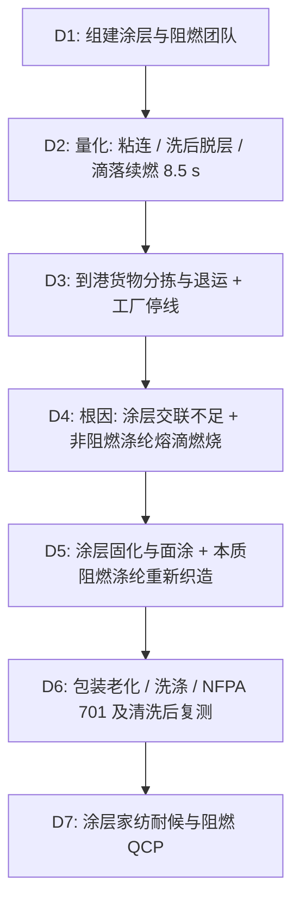

## 一、 案例背景

- **产品**: 三层发泡全遮光提花窗帘（白 + 黑 + 白三道丙烯酸发泡涂层）
- **规格**: 100% 涤纶色织提花 260 GSM + 涂层 120 GSM，合计约 380 g/m²
- **订单**: 80,000 片，平均 FOB $30，货值 $2,400,000
  - **酒店项目 30,000 片**：项目规范要求通过 NFPA 701（由酒店所在地主管机关 AHJ 认可的测试报告）；
  - **零售 50,000 片**：零售家用窗帘没有联邦阻燃强制要求，本款零售版不作阻燃声明。
- **参与方**: QA（项目统筹）、面料部（涂层与阻燃）、织造与涂层厂、Sourcing、第三方实验室
- **问题**: 首批 20,000 片酒店项目窗帘到洛杉矶港后，客户收货抽检发现：
  1. **粘连**：集装箱内温度达 55–60℃，开箱时相邻窗帘的涂层面互相粘住，撕开后涂层被扯破；
  2. **洗后脱层**：按客户洗涤程序洗 3 次后，发泡层起泡、粉化脱落，遮光率由 100% 降到 65%；
  3. **NFPA 701 不合格**：Method 1 测试中滴落物在箱底平均续燃 **8.5 秒**（要求 ≤ 2.0 秒），质量损失 58%（要求 ≤ 40%）。

> **方法选择**：本款为丙烯酸发泡涂层、面密度 ≤ 700 g/m²，按 NFPA 701 适用 Method 1；若为乙烯基（PVC）涂层遮光衬布或使用此类衬布的衬里窗帘，须用 Method 2。方法选择已与实验室和 AHJ 确认。

---

## 二、 8D 过程

### D2: 数据

| 项目 | 方法 | 要求 | 首批结果 | 严重度 |
| :--- | :--- | :--- | :--- | :---: |
| 垂直燃烧 | NFPA 701 Method 1 | 滴落物平均续燃 ≤ 2.0 s，平均质量损失 ≤ 40%（项目规范） | 续燃 **8.5 s**，质量损失 **58%** | S = 10（项目准入） |
| 抗粘连 | 客户包装老化方法：涂层面相对叠放，加压 5 kg，70℃ / 48 h | 分离后无破损，评级 ≥ 4 级 | **1 级**，涂层撕破 | S = 8 |
| 洗涤耐久 | 客户洗涤程序 5 次 | 无起泡、脱层、针孔漏光 | 3 次即起泡脱层，透光率 35% | S = 8 |
| RSL / Prop 65 | 经验证的萃取 + GC-MS | TCEP、TDCPP、DecaBDE 等按客户 RSL | 未检出 | 合格 |

### D3: 遏制与处置
1. **到港 20,000 片**：
   - 不能用于酒店项目（面料本身不阻燃，无法通过 NFPA 701）。
   - 实验室试验表明，对涂层补焙烘（155℃、2 分钟）后，交联度提高，抗粘连达到 4 级、洗 5 次不脱层。
   - 处置：退运回工厂（运费约 $42,000）；分拣出粘连损坏的 2,600 片报废（粘连撕开过、表面有压痕或光泽不均的片都归入此类）；其余 17,400 片补焙烘并复测合格后，**转为零售款销售，不作任何阻燃声明**，吊牌与包装同步更换。
   - **成片补焙烘的做法**：本款为穿杆套式成片，没有塑料挂钩或孔眼配件，不能上连续拉幅焙烘机。补焙烘时先拆去包装，成片单层平铺在网带式热风烘箱上通过（风温 155℃、停留 2 分钟），每班用测温纸在网带两侧和中间确认布面温度 ≥ 150℃；涤纶缝线、织唛和吊牌绳先用 20 片试做，确认无变形、变色后再批量执行。每 1,000 片为一个复测批，抽 5 片做抗粘连（70℃ / 48 h、加压 5 kg）和洗 5 次复测，各批均合格。
2. **工厂与在库**（发现问题时的状态）：
   - **涂层**：立即停止，焙烘温度恢复并验证前不再生产。
   - **在库已涂层面料**：8 个涂层批，原计划用于酒店剩余 10,000 片，尚未裁剪，全部是降温后生产，按涂层批测抗粘连 1–2 级。面料是普通涤纶，不能用于酒店项目；成卷在连续焙烘机上按 158℃、≥ 90 秒补焙烘后按卷复测，抗粘连 4–5 级、洗 5 次不脱层，转作零售款面料。
   - **零售款**：已缝制包装 12,000 片，均为 135℃ 涂层，尚未出运。按上面的网带烘箱方式补焙烘并按批复测合格后，作为零售款出运。其余 38,000 片尚未生产：17,400 片由到港转零售的货物补足，20,600 片用补焙烘后的在库面料和新工艺涂层生产。
   - **已出运**：发现问题时只有到港的首批 20,000 片已出运；没有 135℃ 涂层的零售货在补焙烘前发出。
3. **项目沟通**：酒店项目方同意分两批安装，新工艺窗帘在开业前 12 周到货。

### D4: 根因分析

#### 1. 为什么海运粘连、洗后脱层？
- **交联不足**：发泡涂层用的是自交联丙烯酸乳液（N-羟甲基丙烯酰胺类），需要在约 155–160℃ 保持 90 秒左右才能充分交联；涂层厂为提高车速把焙烘温度降到 135℃。交联不足的涂层表面发粘、耐水性差。
- **为什么粘连**：本体树脂 Tg 约 −25℃，为了柔软的垂坠感，这本身没有问题——室温下涂层就处于高弹态。真正的问题是交联不足使表面发粘，在 55–60℃ 和箱内堆叠压力下，两片涂层面接触后发生分子链相互扩散而粘连。**抗粘连靠的是充分交联、面涂与防粘助剂，而不是单靠提高本体 Tg**。
- **为什么洗后脱层**：未交联的亲水组分在洗涤中吸水溶胀，加上机械揉搓，涂层与织物、涂层与涂层之间的界面失效。
- **包装**：涂层面相对折叠，中间没有隔离膜。

#### 2. 为什么 NFPA 701 不合格？
- 提花布用普通涤纶，涂层中只混入少量添加型多聚磷酸铵（APP）。普通涤纶受热收缩熔融，熔滴带着火焰滴落，在箱底继续燃烧。
- 添加型 APP 在涤纶上效果有限，而且部分品级易溶于水，洗涤后流失，不具备耐久性。
- **体系原因**：项目立项时，阻燃要求只写在项目合同里，没有转化为面料规格；打样只做了遮光与手感测试。

### D5: 纠正措施
1. **涂层**：
   - 焙烘温度恢复到 158 ± 3℃、停留 ≥ 90 秒，车速与温度写入设备配方；
   - 最外层白色涂层改为较高 Tg（约 +10℃）的面涂配方，并加入防粘助剂；中间发泡层保持柔软；
   - 包装改为涂层面之间夹隔离膜，或成卷包装，减少受压面积。
2. **阻燃（酒店项目款）**：
   - 提花布经纬纱全部改为**本质阻燃涤纶**（共聚磷系阻燃单体）。其阻燃机理是：燃烧时熔融聚合物收缩离开火源，熔滴不再续燃——**熔滴依然存在，但会自熄**；
   - 涂层改用与本质阻燃涤纶相容的无卤阻燃配方，并确认涂层不会降低整体阻燃表现；
   - 重新采购阻燃纱、色织与提花织造、涂层和测试，周期约 **10 周**。
3. **零售款**：用普通涤纶 + 新涂层工艺生产，不作阻燃声明。

### D6: 验证
1. **抗粘连**：70℃ / 48 h、加压 5 kg，分离后无破损，**5 级**。
2. **洗涤**：客户洗涤程序 5 次后，涂层无起泡脱层，遮光率 **100%**。
3. **NFPA 701 Method 1**（ISO/IEC 17025 实验室）：滴落物平均续燃 **0 s**（熔滴自熄），平均质量损失 **18%**；按 NFPA 701 规定的清洗程序处理后复测仍合格，支持“可清洗后保持阻燃”的说明。报告为测试报告，不是 NFPA 的“认证证书”。
4. 酒店项目 30,000 片按新工艺交付，项目验收通过；零售款上市后，经复核的全部质量原因退货率 **0.8%**，其中涂层相关 0.5%（零售 50,000 片中有 29,400 片是补焙烘货，统计包含这部分）。

### D7: 标准化
1. 发布《功能涂层家纺耐候与阻燃控制规范》（SOP-QA-HT-035）：焙烘温度与时间列为受控参数；
2. 出运前做包装老化抗粘连测试（70℃ / 48 h、加压 5 kg），合格才能装箱；
3. 工程项目立项时，把 NFPA 701 等项目要求转化为面料规格与测试计划，并在 Gate 2 前完成首轮测试。

### D8: 损失
- 退运、补焙烘（到港 17,400 片、在厂 12,000 片与在库面料）、报废与复测约 $160,000；酒店项目重新织造与延期补偿约 $520,000。按责任分开承担：退运、补焙烘、报废与复测 $160,000 由涂层厂承担（擅自降低焙烘温度）；酒店项目重新织造与延期补偿 $520,000 由品牌方承担（立项时没有把阻燃要求写进面料规格，涂层厂按规格用了普通涤纶）。

---

## 三、 面试 STAR 讲稿

> **面试官提问**：“功能性家纺涉及复合材料与项目准入，你如何解决这类失效？”

- **Situation**：“一批酒店项目全遮光窗帘到港后，开箱发现涂层互相粘连，洗 3 次就脱层；NFPA 701 测试滴落物续燃 8.5 秒，项目要求 ≤ 2 秒。”
- **Task**：“我要处置到港的 2 万片，找出根因，并在酒店开业前交付合规产品。”
- **Action**：
  1. 机理上，粘连和脱层的根因是涂层厂降低焙烘温度导致交联不足，而不是树脂 Tg 本身；阻燃失效是因为用了普通涤纶，添加型阻燃剂对涤纶熔滴无效；
  2. 处置上，到港货物不能用于酒店，退运补焙烘后转零售渠道，并明确不作阻燃声明；
  3. 纠正上，恢复焙烘窗口、加面涂与隔离包装；酒店款改用本质阻燃涤纶重新织造，并做清洗后复测。
- **Result**：“新工艺滴落物续燃 0 秒（熔滴自熄），质量损失 18%，抗粘连 5 级；酒店项目分两批在开业前交付并验收通过。约 68 万美元损失由涂层厂和我们按责任分担。之后所有工程项目在立项时就把阻燃要求写进面料规格。”
