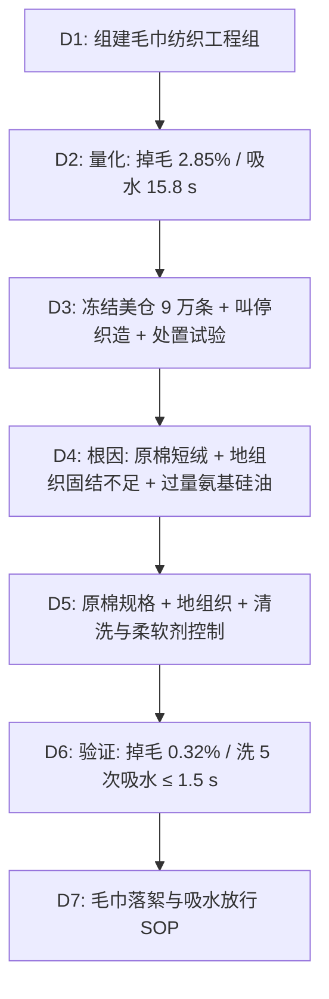

## 一、 案例背景

- **产品**: 650 GSM 100% 棉无捻纱浴巾（家用渠道；酒店渠道需按工业洗涤另行验证，本款未进入酒店渠道）
- **工艺特点**: 棉纤维与水溶性 PVA 纤维合并加捻，染整时在约 95℃ 热水中溶去 PVA，毛圈呈“无捻”蓬松状态
- **客户**: 美国百货与电商
- **参与方**: QA（主导）、纺纱与织造厂、染整厂、Sourcing、第三方实验室
- **订单**: 100,000 条，FOB $18，货值 $1,800,000
- **问题**: 首批 10,000 条上市 6 周：
  - 该款评价中 1 星占 **14.5%**；经实物复核的质量原因退货率 **6.8%**（品类常态约 1%）；
  - 消费者反映擦身后满身棉絮、洗衣机滤网堵塞、混洗时沾染其他衣物，以及洗几次后“不吸水”；
  - 实验室：3 次洗涤累计掉毛率 **2.85%**（客户要求 ≤ 0.80%）；洗 3 次后 AATCC 79 吸水时间由 1.2 秒劣化到 **15.8 秒**（要求 ≤ 3.0 秒）。

---

## 二、 8D 过程

### D2: 数据

| 项目 | 方法 | 客户要求 | 首批结果 | 严重度 |
| :--- | :--- | :--- | :--- | :---: |
| 洗涤掉毛率 | 客户方法：按 AATCC 135 条件洗涤 3 次，ASTM D1776 调湿后称重，扣除边布等结构性损失 | ≤ 0.80% | **2.85%** | S = 8 |
| 吸水性 | AATCC 79（洗 3 次后） | ≤ 3.0 s | **15.8 s** | S = 8 |
| 毛圈拔出力 | 客户单毛圈拉拔法（记录夹具、速度、位置） | ≥ 120 cN | **55 cN** | S = 7 |
| 水洗色牢度 | AATCC 61 2A | 变色 ≥ 4、沾色 ≥ 3.5 | 4.5 / 4.0 | 合格 |

> ASTM D5433、ASTM D1375 都不是毛巾掉毛或毛圈拉拔方法，不再引用。

### D3: 遏制与处置
1. **冻结**：美仓剩余 90,000 条冻结；工厂暂停织造与染整。
2. **补救试验**：取 300 条在美国洗涤服务商做 3 次工业预洗（60℃、强碱性洗涤剂加非离子表面活性剂、双倍剂量、每次加两道漂洗，低温松式烘干 ≤ 50℃），目的是去除柔软剂和松散纤维，然后复测：吸水恢复到 1.6 秒，但之后按 AATCC 135 再洗 3 次，掉毛率仍有 **1.4%**。原因在纤维本身，预洗只能去掉表面松散纤维，短纤维会在使用中持续脱落。

   | 条件 | 温度 | 洗涤剂 | 干燥 | 3 次后吸水 |
   | :--- | :--- | :--- | :--- | :---: |
   | AATCC 135（客户方法，模拟家庭洗涤） | 约 41℃ | AATCC 标准洗涤剂，标准剂量 | 转笼烘干（排气约 66℃） | 15.8 s |
   | 工业预洗（补救试验） | 60℃ | 强碱性洗涤剂 + 非离子表面活性剂，双倍剂量 | 低温松式烘干 | 1.6 s |
3. **处置**：客户拒收 90,000 条；去除品牌标识后出售给清仓买家（回收约 25%），已售 10,000 条按退货政策处理。补单数量调为 60,000 条。原订单 100,000 条已全部运到美国，补单从确认下单到美国港口约 11 周：纺纱厂用库存的合格长绒棉（AFIS 复测短绒率 6.5%）纺 PVA 合股纱约 2 周，织造约 2 周，溶 PVA 与染整约 1.5 周，缝制包装约 1.5 周，海运约 4 周。补单分 4 批出运，最后一批比原订单的计划到港日晚约 11 周。
4. **损失**：约 $1.3M（实际成本，含已售退货）：美仓 90,000 条降级按 FOB $18 计、回收约 25%，净损失 $1,215,000；已售质量退货约 680 条按 FOB 计 $12,240；退货处理 $6,800；美仓隔离仓储、去标与清仓物流 $52,960；预洗补救试验与第三方测试 $13,000。按合同由纺纱厂与染整厂分担：原 PO 的纱线规格写明“100% 精梳长绒棉”，纺纱厂混入约 30% 普通细绒棉与精梳落棉，违反这一约定（以纺纱厂原棉采购单据和 AFIS 长度分布确认），承担 65%；染整厂氨基硅油用量超出工艺单规定，承担 35%。

### D4: 根因分析

#### 1. 为什么掉毛严重？
- **原棉**：原 PO 的纱线规格只写了“100% 精梳长绒棉”，没有长度和短绒率等可测量指标。纺纱厂为降本混入约 30% 普通细绒棉与精梳落棉，短绒率（< 12.7 mm）达 **18.5%**，而合格的精梳长绒棉纱通常 ≤ 8%。
- **机理**：无捻毛圈中的纤维没有捻度束缚，只靠纤维间抱合与地组织固结。PVA 溶去后，短纤维几乎没有被固定，在使用和洗涤中大量脱落。
- **地组织**：地纬密度比 PP 样低 6%，毛圈根部固结不足，毛圈拔出力只有 55 cN。
- **验证**：同一织机用两种棉条各织 50 米：短绒 18.5% 的掉毛 2.7%，短绒 7% 的掉毛 0.6%。

#### 2. 为什么吸水性迅速变差？
- 染整厂为掩盖粗糙手感，在后整理中加入高剂量氨基硅油。氨基吸附在棉纤维上，聚硅氧烷主链上的甲基朝外，在毛圈表面形成疏水层，水滴接触角变大，毛细吸水被阻断。
- **为什么新品吸水正常、洗后才变差**：成品出厂时毛圈表面还残留整理时加入的渗透剂（亲水表面活性剂），掩盖了硅油的疏水性，所以新品吸水 1.2 秒。家庭洗涤先把这些表面活性剂洗掉；转笼烘干的热量又使氨基硅油在纤维表面铺展、甲基进一步朝外取向，疏水层在洗烘过程中逐步显露，吸水随之变差。
- **为什么工业预洗能恢复吸水**：家庭洗涤（约 41℃、标准剂量）去不掉吸附牢固的氨基硅油；60℃、强碱、双倍表面活性剂的工业预洗能乳化去除大部分硅油，低温干燥也避免了热致取向。这只能证明疏水来自硅油，不能作为消费者的使用方式。
- **分离试验**（每组 5 条）：未预洗样品按 AATCC 135 洗 3 次后分别晾干与转笼烘干，吸水 9.6 s 与 15.8 s；工业预洗后的样品分别低温烘干与转笼烘干，吸水 1.6 s 与 2.9 s。洗涤条件（是否去除硅油）是主要因素，转笼烘干的热量是放大因素。

#### 3. 体系原因
- 纱线规格只写了纤维名称（“100% 精梳长绒棉”），没有长度、短绒率等可测量指标，来纱也没有检测，混棉无法在进厂时发现；
- 柔软剂类型与用量不是受控参数；
- 产前只测了初始吸水，没有测洗后吸水与洗后掉毛。

### D5: 纠正措施
1. **原棉与纺纱**：在原“100% 精梳长绒棉”的约定之外，把可测量指标写进纱线规格：平均长度 ≥ 33 mm、短绒率 ≤ 8%、马克隆值 3.5–4.2；精梳去除短纤，每批来纱附原棉检测数据（HVI/AFIS）。补单所用长绒棉产自美国（Pima），纺纱厂按批提供原棉合同、轧花厂与提单等逐级溯源文件，供 UFLPA 审查；以后每批原棉都须附同样的溯源文件，没有溯源文件的原棉不得投产。
2. **织造**：地纬密度恢复到 PP 样值，并适度提高打纬力；毛圈高度维持设计值，以毛圈拔出力 ≥ 120 cN 作为放行条件。
3. **染整**：PVA 溶解后增加两道热水溢流清洗，烘干时用带滤网的松式烘干机去除松散纤维。**不采用纤维素酶抛光**——酶会削弱无捻纤维，并在水解中产生更多碎屑。
4. **柔软剂**：改为亲水型聚醚改性硅油，用量按“洗 5 次后吸水 ≤ 3 s”确定上限。
5. **结果**：掉毛率 **0.32%**；洗 5 次后吸水 **1.0–1.5 秒**；毛圈拔出力 **138 cN**。

### D6: 验证
- 补单 60,000 条分 4 批，每批测吸水、毛圈拔出力；掉毛属于长周期破坏性测试，每批抽测 3 条，不是“每条实验室检测”。
- 补单上市 12 周：评价中 1 星占比降到 **2.1%**，与落絮相关的评价占 **1.2%**（新浴巾首洗仍会有少量棉絮，属于正常现象，已在包装上提示首洗前单独洗涤）；经复核的质量原因退货率 **0.7%**。

### D7: 标准化
1. 发布《无捻纱毛巾落絮与吸水控制 SOP》：原棉短绒率、地纬密、柔软剂用量列为受控参数。
2. 产前与每批放行包含：洗后掉毛、洗后吸水、毛圈拔出力。
3. 护理标签与包装增加“首洗前单独洗涤，勿使用衣物柔顺剂”的提示（柔顺剂同样会降低吸水），并保留护理指令的验证依据。

---

## 三、 面试 STAR 讲稿

- **Situation**：“10 万条 650 GSM 无捻纱浴巾，首批上市 6 周，质量原因退货率 6.8%，掉毛率 2.85%，洗后吸水时间 15.8 秒。”
- **Task**：“我要判断在库 9 万条能否补救，找出根因并恢复交付。”
- **Action**：“先在美国做预洗补救试验：吸水能恢复，但掉毛仍有 1.4%，说明问题在纤维本身，于是建议客户拒收并降级处理。根因上，用两种棉条对比织造证明是原棉混入短绒；氨基硅油过量造成疏水。纠正上，锁定原棉短绒率和地纬密，改用亲水硅油并控制用量，增加 PVA 溶解后的清洗；没有用酶处理，因为酶会让无捻纤维更容易断。”
- **Result**：“补单掉毛 0.32%，洗 5 次后吸水 1.0–1.5 秒，质量原因退货率降到 0.7%。约 130 万美元的损失按合同由纺纱厂和染整厂分担。”
