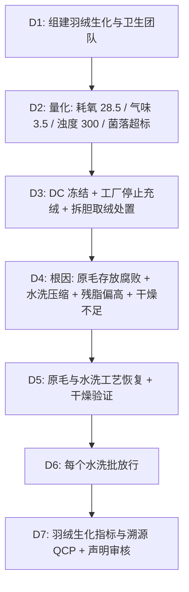

## 一、 案例背景

- **产品**: 800 FP、95% 白鹅绒四季被芯，标称产地匈牙利、RDS 认证；包装原印有“Hypoallergenic”
- **面料**: 380T 防绒纯棉贡缎
- **客户**: 美国高端家居目录与电商
- **参与方**: QA（主导）、羽绒原料采购、羽绒水洗厂、被芯缝制厂、Sourcing、IDFB 认可实验室
- **订单**: 20,000 条，FOB $180，货值 $3,600,000
- **问题**: 首批 5,000 条到达美国 DC 后，客户到货抽检与第三方复核不合格：
  1. **气味**：按 IDFB 气味评定为 **3.5 级**（客户要求 ≤ 1 级）；
  2. **耗氧量**：**28.5 mg O₂/100 g**（客户/行业要求 ≤ 10）；
  3. **浊度**：**300 mm**（要求 ≥ 500 mm）；
  4. **微生物**：嗜温需氧菌总数 **4.8 × 10⁵ CFU/g**（客户规范 ≤ 10³ CFU/g），并检出大肠菌群。
  - 以上是 IDFB/客户要求，**不是美国法定限值**；FTC 的羽绒指南已于 1998 年废止，但羽绒含量、蓬松度、产地与“低过敏”等声明仍须按 FTC Act 第 5 条有充分依据。

---

## 二、 8D 过程

### D2: 数据

| 项目 | 方法 | 要求（客户/行业） | 到货实测 | 严重度 |
| :--- | :--- | :--- | :--- | :---: |
| 耗氧量 | IDFB（高锰酸钾滴定） | ≤ 10.0 mg O₂/100 g | **28.5** | S = 8 |
| 气味 | IDFB 气味评定 | ≤ 1 级 | **3.5 级** | S = 8 |
| 浊度 | IDFB 浊度 | ≥ 500 mm | **300 mm** | S = 7 |
| 残脂率 | IDFB 残脂（溶剂萃取） | 0.5–1.5% | **2.65%** | S = 7 |
| 嗜温需氧菌 | 客户批准的微生物计数方法 | ≤ 10³ CFU/g，指示菌不得检出 | **4.8 × 10⁵ CFU/g**，检出大肠菌群 | S = 8 |
| 蓬松度 | IDFB 蓬松度 | ≥ 800 FP | 790–810 FP | 合格 |

### D3: 遏制与处置
1. **冻结**：DC 冻结 5,000 条；工厂已完成的 6,000 条停止出运；未充绒的 9,000 条暂停。
2. **同批羽绒排查**：水洗厂同期 4 个水洗批全部送测，耗氧量 22–31，全部不合格。
3. **能否补救**：被芯外层面料无法“清洗里面的羽绒”，只能拆胆取绒。取 50 条试验：取出的羽绒按新工艺复洗后，耗氧量 4.6、气味 1 级、菌落合格，但复洗使蓬松度降到 **760 FP**，不能再支持 800 FP 声明。
4. **处置**：
   - DC 的 5,000 条退回工厂（运费约 $38,000），与工厂的 6,000 条一起拆胆取绒；
   - 取出的羽绒复洗合格后，用于该品牌 **750 FP 产品线**（重新测试并按实际蓬松度与绒含量标示；这批羽绒未经消费者使用，不属于二手填充物，但仍按销售州的填充物法定标签要求登记与标示）；
   - 旧外胆吸附了气味，全部报废；
   - 11,000 条 800 FP 被芯用新采购的原料羽绒重做；原料采购与生产周期约 7 周，客户接受顺延。
   - **未充绒的 9,000 条**：对应的已水洗羽绒约 8.1 吨（每条约 0.9 kg），全部来自上面 4 个不合格水洗批。退回水洗厂按新工艺复洗，抽测耗氧量 4.2–5.0、菌落合格，但蓬松度 755–770 FP，与拆胆取绒一样转入 750 FP 产品线；这 9,000 条改用新采购原料羽绒生产。
5. **声明**：包装上的“Hypoallergenic”没有可靠的试验依据，与法务确认后**从包装与网页上删除**。
6. **损失**：约 $690,000（实际成本）：DC 退回运费 $38,000；拆胆取绒 11,000 条 $66,000；复洗羽绒约 18 吨（拆胆取出约 9.9 吨、未充绒约 8.1 吨）$90,000；外胆报废 11,000 条 $154,000；约 18 吨羽绒由 800 FP 转 750 FP 的价差约 $15/kg，计 $270,000；延误造成的空运与折让 $72,000。按合同，水洗厂承担 85%（擅自压缩水洗、干燥不足）；品牌自担 15%（没有按水洗批做放行测试就充绒）。
7. **产地声明核查**：调取水洗厂的原毛采购合同、屠宰场证明与 RDS 交易证书链，原毛来自匈牙利两家屠宰场，链条完整，原批次的“匈牙利产地”声明属实。复洗后转入 750 FP 产品线的羽绒，该产品线是多产地混合产品，包装统一不标产地，只按实测标示绒含量与蓬松度。

### D4: 根因分析

#### 1. 为什么耗氧量和菌落超标？
- **原毛（可能的叠加因素，未单独验证）**：屠宰后的原毛在潮湿环境堆放超过 72 小时才进入初洗，皮屑与血液蛋白可能在微生物作用下分解。下面的对比试验用的是同一批原毛、只改变水洗工艺，不能证明存放超时是原因；而且同批原毛按原工艺洗后耗氧量只有 5.8，说明单靠存放超时不足以超标。存放时限作为预防措施列入 D5。
- **水洗**：水洗厂为节省水电，把规定的多道水洗与漂洗压缩了约一半，也没有使用除蛋白洗涤剂，大量可溶性有机物残留在绒朵上。耗氧量测的是水萃取液中可被高锰酸钾氧化的有机物，残留越多，耗氧量越高。
- **验证**：同一批原毛按原工艺和压缩工艺各洗一批，耗氧量分别为 5.8 和 27.4。试验只改变了水洗工艺，证明的是**水洗道数被压缩**这一主因。

#### 2. 为什么有动物异味？
- 残脂率 2.65%（要求 0.5–1.5%）。过多的天然油脂在海运湿热环境下水解与氧化，产生短链脂肪酸等挥发性物质；微生物大量存在进一步加剧气味。
- 干燥工序只在 95℃ 烘 15 分钟，羽绒含水率偏高，微生物没有被有效降低。

#### 3. 体系原因
- 水洗工艺（道数、助剂、干燥温度与时间、含水率）不是受控参数；
- 只有水洗厂自己的出厂报告，品牌没有按水洗批做耗氧量、气味和微生物放行测试；
- “低过敏”“匈牙利产地”等声明没有经过合规审核与证据归档。

### D5: 纠正措施
1. **原毛**：规定屠宰后 24 小时内初洗或冷藏，超时原毛不得用于本款；原毛批次与屠宰场记录关联，支持产地声明。
2. **水洗**：恢复规定的水洗与漂洗道数，使用除蛋白、脱脂洗涤剂，残脂率控制在 0.8–1.2%（过度脱脂会使羽绒变脆、蓬松度下降）。
3. **干燥与卫生**：热风干燥温度与时间按设备验证确定（本案定为 110–120℃、不少于 30 分钟），出料含水率 ≤ 13%。干燥的目的是把微生物降到客户限值以下，并通过每批微生物检测验证；**不宣称达到无菌或可清除芽孢**。高温饱和蒸汽会损伤角蛋白、降低蓬松度，未采用。
4. **蓬松度保护**：每个水洗批测蓬松度，确认工艺调整没有使 FP 低于 800。
5. **声明管理**：产地、RDS（交易证书链）、蓬松度、绒含量声明逐项附证据，由合规审核后才能上包装。

### D6: 验证
- 新工艺前 6 个水洗批逐批放行：耗氧量 **3.9–4.8**、气味 **≤ 1 级**、浊度 **≥ 500 mm**、残脂 0.9–1.1%、菌落总数 **< 10³ CFU/g** 且指示菌未检出、蓬松度 **800–820 FP**。
- 11,000 条重做被芯与 9,000 条新生产被芯按批送 IDFB 认可实验室测试，全部合格后出运。
- 上市一季，经复核的全部质量原因退货占销量 **0.7%**，其中与气味相关的为 0.4%。

### D7: 标准化
1. 建立《羽绒生化指标与溯源 QCP》：每个水洗批测耗氧量、浊度、气味、残脂、微生物与蓬松度；
2. 水洗与干燥参数列为受控参数，变更走 ECN；
3. 包装声明审核清单：每项声明对应测试报告或证书，未经审核不得印刷。

---

## 三、 面试 STAR 讲稿

- **Situation**：“2 万条 800 FP 鹅绒被芯，首批 5,000 条到美国 DC 后抽检：耗氧量 28.5、气味 3.5 级、菌落超标两个数量级。”
- **Task**：“我要处置已充绒的产品，找出水洗环节的根因，并确认包装声明有依据。”
- **Action**：
  1. 用 50 条做拆胆复洗试验：卫生指标能恢复，但蓬松度降到 760，所以复洗绒转到 750 FP 产品线，800 FP 被芯用新原料重做；
  2. 用同一批原毛的对比水洗试验证明主因是水洗道数被压缩；原毛存放超时只是可能的叠加因素，没有单独验证，作为预防措施加了 24 小时时限；
  3. 恢复水洗工艺，用验证过的干燥条件把菌落降到限值内，每个水洗批放行；
  4. 和法务一起删掉没有依据的“低过敏”声明，产地和 RDS 声明附上溯源证据。
- **Result**：“新工艺耗氧量 3.9–4.8、气味 ≤ 1 级、菌落合格，蓬松度保持在 800 以上。约 69 万美元损失由水洗厂承担；更重要的是，包装声明从此都有证据支撑。”
