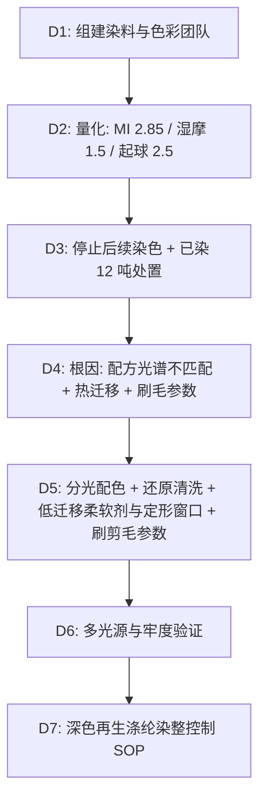

## 一、 案例背景

- **面料**: 100% GRS 认证再生涤纶（rPET）摇粒绒，280 GSM，双面刷毛、单面摇粒
- **客户**: 美国户外环保品牌
- **颜色**: 深橄榄绿、深炭灰
- **参与方**: Material QA（主导）、面料部、染厂工程部、品牌亚洲色彩办公室
- **风险体量**: 150 吨大货面料，对应约 270,000 件抓绒夹克（每件含裁耗约 0.55 kg），成衣货值约 $5,250,000（FOB，约 $19.4/件）
- **拦截经过**: 首批 8 缸（每缸约 1.5 吨，共 12 吨）染整下机后，QA 首缸放行测试发现两项不合格，其余 138 吨坯布尚未染色：
  1. **同色异谱**：D65 下与标样目视评定为 4.5 级，仪器 ΔE CMC(2:1) = 0.6；换到店铺 CWF 光源和家用暖光（A 光源）后明显偏红棕，ΔE 达 **2.8**，同色异谱指数 MI（D65 → A）**2.85**（客户要求主光源 ΔE ≤ 0.8、MI ≤ 0.5）；
  2. **热迁移**：染色出缸湿摩 3.5 级，定形后湿摩跌到 **1.5 级**；AATCC 61 2A 对锦纶、涤纶贴衬沾色 **2.0 级**；
  3. 另外，3 次洗涤后 ASTM D3512 起球 **2.5 级**（要求 ≥ 3.5 级）。

---

## 二、 8D 过程

### D2: 数据

| 项目 | 方法 | 客户要求 | 首批结果 | 严重度 |
| :--- | :--- | :--- | :--- | :---: |
| 主光源色差 | ASTM D2244，ΔE CMC(2:1)，D65 | ≤ 0.8 | 0.6 | 合格 |
| 同色异谱 | 客户 MI 定义（D65 → CWF / A）+ AATCC EP9 多光源目视 | MI ≤ 0.5 | **2.85** | S = 7 |
| 湿摩擦 | AATCC 8 | ≥ 3.0 级 | **1.5 级** | S = 8 |
| 水洗沾色 | AATCC 61 2A | 锦纶/涤纶贴衬 ≥ 3.5 级 | **2.0 级** | S = 7 |
| 起球 | ASTM D3512，3 次洗涤后 | ≥ 3.5 级 | **2.5 级** | S = 6 |

### D3: 遏制与处置
1. **停止**：138 吨坯布暂停染色，等待新配方确认。
2. **已染 12 吨**：
   - 涤纶可以用还原剥色后重染。8 缸逐缸剥色后先测残余色：6 缸残余色均匀（相对未染坯布 ΔE 0.8–1.4），按新配方重染；2 缸（3 吨）剥色后底色不均（布面不同位置 ΔE 2.1–3.5），改染黑色，转用于品牌其他黑色款的口袋布与内衬，避免报废。
   - **重染后的 6 缸（9 吨）不能只看颜色**：这批布已经按原参数强刷毛、剪毛，表面游离纤维是不可逆的损伤，剥色重染去不掉；还原剥色、130℃ 重染和再次定形还可能让细旦 rPET 轻微碱减量、绒面倒伏。因此逐缸复测颜色、牢度、起球、顶破、克重和尺寸。结果：MI 0.31–0.42（D65 → A 与 D65 → CWF 均 ≤ 0.5）、湿摩 3.5–4.0 级、沾色 ≥ 3.5 级合格，但 3 次洗涤后起球只有 **2.5–3.0 级**，不合格。
   - **补救**：在 1 缸上试做再剪毛，只剪去表面游离纤维、不再刷毛：起球升到 3.5 级，克重由 276 降到 269 g/m²（客户规格 280 ± 5%，即 266–294 g/m²），ASTM D3786 顶破强力为新布的 92%、满足客户要求，洗后尺寸 −3.8% / −2.2%（规格 ±5%），手感经客户色彩办公室确认在可接受等级内。其余 5 缸按同一参数再剪毛，逐缸复测起球 3.5 级、克重 267–272 g/m²，其他项目合格后放行。
   - **3 吨缺口**：改染黑色的 3 吨转给品牌其他款使用后，本订单少了约 3 吨面料（按每件 0.55 kg 约 5,450 件）。面料厂用同一 rPET 纱批的余纱补织 3 吨坯布（约 1 周，GRS 交易证书沿用同一纱批），与 138 吨一起按新配方染整，订单数量不调整；补织坯布约 $9,600（约 $3.2/kg）。
   - 剥色重染与改染费用约 $54,000，9 吨再剪毛与复测约 $6,000，补织 3 吨坯布约 $9,600，合计约 **$69,600**，由染厂承担。
3. **交期**：新配方打样与确认用了 9 天，补织的 3 吨坯布在此期间完成，开裁比计划晚约 2 周；成衣厂调整排产，整体交期未受影响。

### D4: 根因分析

#### 1. 为什么同色异谱？
- **机理**：同色异谱指两个样品在一种光源下颜色相同、在另一种光源下不同，原因是两者的**光谱反射率曲线形状不同**，只在某一光源下的三刺激值恰好相等。反射率是样品本身的属性，不随光源改变；改变的是不同光源的光谱能量分布对各波长的加权。
- 染厂师傅凭经验用“黄 + 红 + 黑”三支染料拼橄榄绿，其反射率曲线在 600–700 nm 区间明显高于标样（标样是用另一组染料染的）。在 D65 下三刺激值接近，换到红光成分更多的 A 光源和 CWF 光源时，长波段的差异被放大，颜色偏红棕。
- **rPET 的作用**：不同批次再生切片的特性黏度、结晶度和本色有差异，会影响上染量和缸间色差，需要按纱线批次合缸管理；但它**不是本次同色异谱的原因**。
- **体系原因**：Lab dip 只在 D65 下评定，没有按客户规定的次光源检查 MI。

#### 2. 为什么定形后湿摩下降？
- 分散染料是非离子疏水染料，在 170–175℃ 定形时，涤纶无定形区分子链运动加剧，部分染料由纤维内部向表面扩散；
- 定形前加入的柔软剂与表面活性剂对分散染料有溶解作用，把迁移到表面的染料“留”在纤维表面，形成浮色；
- 染色后的还原清洗只做了一道，深色未固着染料没有充分去除。

#### 3. 为什么起球差？
- 摇粒绒刷毛与剪毛参数过强，产生大量长短不一的游离纤维；涤纶强度高，形成的毛球不易脱落。

### D5: 纠正措施
1. **配色**：用分光光度仪按光谱曲线配色，选择与标样反射率曲线形状接近的染料组合（以高耐升华性分散染料为主，具体染料由染料商按 C.I. 编号提供，配方锁定在 Lab dip 确认单中）；Lab dip 必须在 D65、CWF、A 三种光源下评定并计算 MI。
2. **还原清洗**：深色染后两道还原清洗（保险粉 + 碱，约 80℃），以清洗残液色度与湿摩结果判定终点。还原清洗的作用是把纤维表面未固着的分散染料还原分解后洗去。
3. **定形与柔软剂**：柔软剂改为低热迁移型；定形温度由 175℃ 降到 160 ± 3℃，适当延长停留时间。由于定形温度下降，同时复测洗后尺寸变化，确认仍在客户规格内（−3.5% / −2.0%，规格 ±5%）。
4. **起球**：降低刷毛针布压力与次数、优化剪毛高度，起球改善到 3.5 级。刷毛减弱会改变绒高、蓬松度和克重，因此同时复核：克重 278 g/m²（规格 280 ± 5%）、厚度 3.1 mm（已批准品质样 3.2 mm，客户允差 ±10%），手感由客户色彩办公室对照品质样确认在可接受等级内。
5. **纱线批次**：rPET 纱线按批次合缸，不同批次不混用于同一缸。

### D6: 验证
- 新配方连续 3 缸、共 4.5 吨，送第三方实验室测试：
  - D65、CWF、A 下 ΔE 均 ≤ 0.45，MI = **0.28**；
  - 湿摩 **4.0 级**；AATCC 61 2A 沾色：锦纶贴衬 **4.0–4.5 级**、涤纶贴衬 **4.0 级**（改善前两种贴衬均为 2.0 级）；
  - 3 次洗涤后起球 **3.5 级**；
  - 洗后尺寸在规格内。
- 对 MI，同时保留多光源目视记录和仪器数据，不以单一数字宣称“没有色差”。
- QA 签发面料放行绿卡后，138 吨按新配方分批染整，每缸首件放行。

### D7: 标准化
1. 发布《深色再生涤纶染整与牢度控制 SOP》（SOP-MAT-055）：Lab dip 多光源评定、还原清洗终点、定形温度与柔软剂类型列为受控项；
2. 面料放行增加“定形后湿摩快速抽测”和 MI 计算；
3. GRS 交易证书（TC）与纱线批次一一对应，支持再生含量声明（FTC Green Guides）。

---

## 三、 面试 STAR 讲稿

> **面试官提问**：“你如何在开裁前拦截面料风险，避免成衣大面积损失？”

- **Situation**：“150 吨 rPET 抓绒面料，首批 8 缸下机后放行测试发现：换到店铺和家用光源就跳色，MI 2.85；定形后湿摩从 3.5 级掉到 1.5 级。”
- **Task**：“我负责 Material QA，要在 138 吨坯布开染前锁定根因，并处理已染好的 12 吨。”
- **Action**：
  1. 光谱分析显示，经验拼色配方的反射率曲线在长波段与标样不一致，属于典型的同色异谱；改为按光谱曲线配色，Lab dip 必须三光源评定；
  2. 热迁移的原因是 175℃ 定形加上柔软剂对分散染料的溶解，以及还原清洗不足；降温到 160℃、换低迁移柔软剂、两道还原清洗，并复测洗后尺寸；
  3. 已染 12 吨里，9 吨剥色重染后起球仍不合格，再剪毛后复测起球、强力、克重和尺寸合格才放行；3 吨改染黑色做内衬。
- **Result**：“MI 降到 0.28，湿摩 4.0 级，沾色锦纶贴衬 4.0–4.5 级、涤纶贴衬 4.0 级；138 吨面料按新配方生产，开裁比计划晚了约两周，但成衣整体交期没有受影响，也没有面料报废。”
