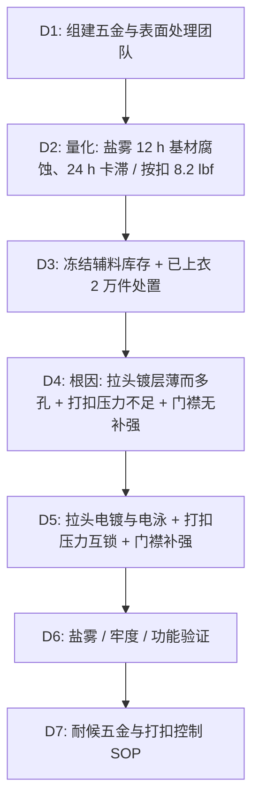

## 一、 案例背景

- **产品**: 航海/户外机能夹克辅料：前中 8 号金属拉链（黄铜链齿、锌合金压铸拉头，镀镍后枪色）、门襟与下摆爪式四合扣
- **客户**: 美国户外与航海装备品牌（成人产品；铅、镉按客户 RSL 管控，CPSIA 不适用）
- **参与方**: Trims QA（主导）、辅料采购、拉链厂、五金厂、成衣厂
- **体量**: 120,000 件夹克，FOB $30，货值 $3,600,000
- **问题**（大货辅料验证与首批成衣测试；验证报告出来前，成衣厂已经上拉链、打扣 20,000 件）：
  1. **盐雾**：客户要求 ASTM B117 中性盐雾 48 小时后拉头无基材腐蚀、开合顺畅。实测 **12 小时**拉头出现大量白色腐蚀产物，**24 小时**拉头卡死；黄铜链齿表面变暗、出现轻微铜绿，但链齿本身没有失效；
  2. **按扣牢度**：首批成衣洗 5 次后，按 ASTM D7142 测爪扣钉合牢度仅 **8.2 lbf**（客户要求 ≥ 17 lbf），按扣连同爪环从门襟被拔出。

---

## 二、 8D 过程

### D2: 数据

| 项目 | 方法 | 客户要求 | 实测 | 严重度 |
| :--- | :--- | :--- | :--- | :---: |
| 中性盐雾 | ASTM B117（5% NaCl，35℃） | 48 h 后拉头无基材腐蚀，开合力在规格内 | 12 h 白色腐蚀，24 h 卡死 | S = 8 |
| 拉链横向强力 | ASTM D2061 | ≥ 700 N | 820 N | 合格 |
| 爪扣钉合牢度（洗 5 次后） | ASTM D7142 | ≥ 17 lbf | **8.2 lbf** | S = 8 |
| 按扣开合力 | ASTM D4846 | 按客户范围 | 合格 | — |
| 铅 / 镉 | 客户 RSL 方法 | 铅 ≤ 100 ppm、镉按 RSL | 旧拉头铅 25 ppm，镉未检出 | 合格 |

> 原报告引用 ASTM D4846 测按扣“拉脱力”有误：D4846 测的是开合力，钉合牢度应使用 ASTM D7142。

### D3: 遏制与处置
1. **冻结**：拉链厂与成衣厂在库拉链 150,000 条、按扣 600,000 套冻结；暂停上拉链和打扣工序。
2. **已上衣的 20,000 件**：
   - **拉链**：链齿合格，只有拉头不合格。由拉链厂派技术员在成衣厂逐件拆下上止、更换新电镀拉头、重新压装上止，每件做往复开合检查；
   - **按扣**：按扣零件本身合格，问题在钉合不足。
     - **能否复压**：爪扣供应商技术员确认，爪齿只弯折约 45°、没有开裂，可用原厂模具在正确气压下二次压合完成卷边。先试做 200 件，截面检查卷边接近 180°、无裂齿的 197 件，3 件裂齿。
     - **执行**：用正确的模具和气压对 20,000 件的按扣逐个复压，每件目检卷边；裂齿或卷边不完整的件（共 118 件）拆下按扣，在门襟背面热压 TPU 补强片后错位 3 mm 重新打扣。
     - **验证条件与失效条件一致**：20,000 件分 10 个批，每批抽 5 件，按客户程序洗 5 次后按 ASTM D7142 测，钉合牢度 **19.6–23.4 lbf**（要求 ≥ 17 lbf，失效件洗后为 8.2 lbf）；未洗状态 24–27 lbf。测试件计入损失。
     - **为什么不补强也接受**：已上衣的门襟要加补强衬只能拆开门襟，会损伤复合面料和压胶。复压品洗后最低 19.6 lbf，满足客户要求；新生产加补强衬后是 28.5–32.0 lbf，余量更大。客户审阅数据后书面同意这 20,000 件按“复压、不补强”放行，售后按扣脱落退货单独跟踪（见 D6）。
3. **在库拉链**：150,000 条拉链由拉链厂更换拉头后重新交付。
4. **损失**：拉头更换与复压约 $95,000，延误约 10 天；由拉链厂（镀层）与成衣厂（打扣）分担。
5. **为什么只延误约 10 天**：拉链厂合作的镀厂本身有铜–酸铜–镍滚镀线和阴极电泳线（为其他户外客户生产），只需调整镀层厚度与工序参数，不需要另找供应商。时间安排：打样 2 天；往复开合预处理加 48 h 盐雾与判读约 3 天，48 h 合格即放行量产，延长到 96 h 的试验与量产并行；3 批第三方测试约 5 天，与量产并行。约 17 万只拉头（已上衣 2 万件 + 在库拉链 15 万条）分批电镀，首批 2 万只在第 6 天到成衣厂；2 万件逐件换拉头与复压按扣约 6 天，与后续批次电镀并行。成衣厂首批出货比原计划晚约 10 天。在库 15 万条拉链中，10 万条用于本订单剩余 10 万件，另 5 万条是拉链厂为同品牌下一季同款备的库存，同样换拉头，费用含在上面的 $95,000 中。

### D4: 根因分析

#### 1. 拉头为什么 12 小时就出现基材腐蚀、24 小时卡滞？
- **镀层**：锌合金压铸拉头采用快速滚镀，铜底层不足，镍层只有 **1.5–2.0 μm**（客户五金规范要求镍层 ≥ 8 μm）。截面金相显示镀层有大量微孔。
- **机理**：盐雾中的氯离子通过微孔到达锌合金基体。锌比镍活泼，在微孔处形成“小阳极（锌）+ 大阴极（镍）”的腐蚀电池，锌基体被快速溶解，生成的白色腐蚀产物（锌的氢氧化物、碱式氯化物）体积膨胀，堵塞拉头与链齿之间的间隙，导致卡死。
- **选型**：航海用途的产品，在 DFMEA 阶段就应评估拉头材质与镀层体系；本款 Tech Pack 只写了颜色与号数，没有写耐腐蚀要求，这是设计端的漏洞。
- **链齿**：黄铜链齿在盐雾中变暗、生成少量铜绿属于正常现象，不影响功能，因此**不对链齿加厚镀层**——加厚镀层会改变链齿尺寸、影响啮合，涂层也会被拉头磨掉。

#### 2. 按扣为什么被拔出？
- **打扣**：打扣机气压只有 0.35 MPa（设备规定 0.55–0.60 MPa），下冲头行程未调整。截面显示爪环的爪齿只弯折约 45°，没有完全卷入（应卷成接近 180° 的闭合卷边），受力时直接滑出。
- **门襟**：门襟为单层 2.5 层复合面料，没有补强衬，爪齿穿孔处面料承载能力不足。
- **体系**：打扣机没有压力监控；首件只看外观，不做牢度测试。

#### 3. 为什么辅料没放行就上了衣？（体系根因）
- 拉头盐雾与成衣按扣测试的报告在大货开裁后约 10 天才出，成衣厂按交期先行上拉链、打扣，到报告出来时已完成 20,000 件。
- 辅料没有“放行绿卡”与缝制工序的互锁：采购到货即发料，QA 的辅料验证只是并行流程，不是上线条件。

### D5: 纠正措施
1. **拉头表面处理**（只针对拉头和拉片）：
   - 锌合金压铸件：碱性铜打底 + 酸铜 + 镍层 ≥ 8 μm（总镀层约 16 μm），再做枪色面层；
   - 电镀后做阴极电泳透明涂层封闭（约 5 μm，按涂料商推荐温度固化），降低微孔暴露；
   - 镀层厚度每批抽检（截面金相或 X 射线荧光测厚；XRF 只能测厚度，测不出孔隙）；孔隙率用加速腐蚀间接控制：每批抽 10 个拉头做 24 h 中性盐雾（ASTM B117）筛查，以每件点蚀点数判定，出现基材腐蚀点即整批复查。
2. **链齿**：黄铜链齿保持原工艺，加做防变色钝化，并在 Tech Pack 中注明“链齿允许轻微变色”。
3. **打扣**：
   - 打扣机加装气压传感器，气压低于 0.55 MPa 自动锁机；
   - 更换匹配的模具，按爪扣供应商规范调整行程，首件做截面卷边检查；
   - 门襟打扣位置增加补强衬。
4. **DFMEA**：航海/户外产品的五金在设计阶段写明盐雾等级、材质与镀层体系。
5. **RSL 与 Prop 65**：新拉头换了镀层与面层体系，首批按客户 RSL 重测：拉头铅 18 ppm、镉未检出；黄铜链齿为低铅黄铜，供应商材质证明加抽测铅 60 ppm。本款在加州销售，可触及金属部件的铅暴露是 Prop 65 的常见关注点；按客户 Prop 65 程序（可触及金属部件铅含量 ≤ 100 ppm，属客户要求，不是法定限值）评估，新拉头与链齿都在限值内，不需要警示；镀层或材料再变更时须重测。

### D6: 验证
- **盐雾**：新拉头先做 500 次往复开合预处理（模拟拉头内腔电泳层的磨损），再按 ASTM B117 做到 48 小时（客户要求），拉头无基材腐蚀、开合力在规格内；为了解余量，继续做到 96 小时，96 小时时拉头表面没有白色腐蚀产物、没有红锈、没有卡滞，开合力在规格内。试验在 96 小时停止，没有出现客户定义的失效，所以记为 **≥ 96 小时**（截尾值），不是失效时间。报告同时记录白色腐蚀、红锈、卡滞和开合力变化，不把小时数写成“合格率”。
- **按扣**：新工艺按扣洗 5 次后钉合牢度 **28.5–32.0 lbf**；按 ASTM D4846 往复开合 1,000 次，开合力稳定，无松动。
- **大货**：连续 3 批辅料（拉头、按扣）按批送第三方实验室测试，全部合格。上市一季后（秋冬季，促销与渠道结构与上一季同类夹克相近），经复核的全部质量原因退货占销量 **0.9%**（上一季同类夹克 1.0%），其中与拉链卡滞、按扣脱落相关的 0.3%（上一季同类夹克 0.4%）；复压的 20,000 件与新生产件分开统计，按扣脱落退货分别为 0.08% 与 0.05%。航海使用环境下的腐蚀需要更长时间才会暴露，一季的结果不能证明长期耐蚀性，退货跟踪延长到 12 个月。

### D7: 标准化
1. 发布《耐候金属辅料与打扣控制 SOP》：拉头镀层体系与厚度、盐雾等级、打扣气压与模具、首件截面检查列为受控项；
2. 辅料进厂按批抽测盐雾（每批至少 3 个拉头）和镀层厚度；
3. 成衣厂每台打扣机每班首件做 D7142 牢度测试。
4. **辅料放行互锁**：五金辅料（拉头、按扣）的盐雾、钉合牢度与 RSL 报告合格、QA 签发辅料绿卡后，仓库才能发料上线；交期紧时只允许按书面批准的风险投产上限（不超过一个班次的产量）先行。

---

## 三、 面试 STAR 讲稿

- **Situation**：“一批 12 万件航海机能夹克，辅料验证时拉链头盐雾 12 小时就出现基材腐蚀、24 小时卡滞，要求 48 小时；首批成衣洗 5 次后按扣牢度只有 8.2 lbf，要求 17 lbf。”
- **Task**：“我负责辅料 QA，要找出根因，处理已经上衣的 2 万件，并让后续辅料达标。”
- **Action**：
  1. 截面金相显示锌合金拉头镍层只有 1.5–2 μm 且多孔，盐雾中锌基体被腐蚀，腐蚀产物把拉头卡死；黄铜链齿只是正常变色，所以只处理拉头，不给链齿加厚镀层；
  2. 按扣是打扣机气压不足，爪齿没有卷到位，门襟也没有补强；
  3. 处置上，2 万件逐件换拉头、复压按扣并抽样破坏测试；在库 15 万条拉链换拉头；
  4. 纠正上，拉头改为铜底 + 厚镍 + 电泳封闭，打扣机加气压互锁，门襟加补强衬。
- **Result**：“新拉头经往复开合预处理后盐雾 48 小时合格，做到 96 小时停止试验时仍没有基材腐蚀和卡滞（记为 ≥ 96 小时）；按扣牢度 28.5–32 lbf。返工成本约 9.5 万美元，由拉链厂和成衣厂分担，交期只延误 10 天。”
