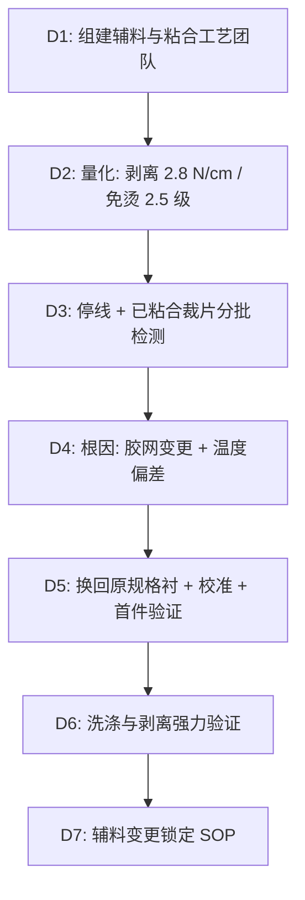

## 一、 案例背景

- **产品**: 男士正装衬衫（60% 棉 / 40% 涤纶府绸），粘合衬用于前襟、领底、袖叉
- **客户**: 美国中端商务男装品牌
- **参与方**: QA 辅料工程师（主导）、成衣厂粘合车间、粘合衬供应商
- **风险体量**: 80,000 件大货订单，FOB 约 $22/件，成衣货值约 $1,760,000
- **拦截经过**: 首批 15,200 件成衣完成后，QA 抽取 10 件做洗涤验证（AATCC 135，家用洗衣机、冷水温和、低温烘干）。第 3 次洗涤后，6 件前襟衬出现明显气泡脱层，2 件袖叉衬边缘翘起；剥离强力实测 **2.8 N/cm**（客户要求洗 3 次后 ≥ **6.0 N/cm**）。同时，AATCC 124 免烫外观等级降至 **2.5 级**（要求 ≥ **3.5 级**），前襟因衬布脱层后不平整而严重起皱。

---

## 二、 8D 过程

### D2: 数据

| 项目 | 方法 | 客户要求 | 首批结果 | 严重度 |
| :--- | :--- | :--- | :--- | :---: |
| 洗后剥离强力 | 180° 剥离，50 mm/min，洗 3 次后 | ≥ 6.0 N/cm | **2.8 N/cm** | S = 8 |
| 免烫外观 | AATCC 124，洗 3 次后 | ≥ 3.5 级 | **2.5 级** | S = 7 |

### D3: 遏制与处置

1. **停线**：粘合车间暂停使用该批粘合衬，剩余 64,800 件裁片暂不粘合。
2. **已粘合 15,200 件裁片分批检测**：
   - 按粘合日期分 4 批（每批约 3,800 件），每批随机抽 20 件做洗 3 次剥离强力测试。
   - 批次 A（最早）：4.5–5.8 N/cm，接近但未达标——这批使用的是旧胶网粘合衬的尾料，胶点密度尚可，但粘合温度已偏低；
   - 批次 B/C：2.5–4.8 N/cm，不合格——新胶网叠加温度偏差；
   - 批次 D（最晚）：1.8–3.2 N/cm，最差——新胶网、温度偏差、且操作工提速缩短了停留时间。
3. **处置**：
   - **批次 B/C（约 7,600 件）**：蒸汽松解衬布后剥离，换回原规格粘合衬重新粘合。蒸汽剥离后布面状态逐件检查：底布无热损伤、无残胶硬块的可重压。每批重压后抽 5 件洗 3 次测剥离强力 ≥ 6.0 N/cm 且目视无起泡后放行。
   - **批次 D 中 3,200 件**：前襟衬起泡严重，蒸汽剥离后部分布面留有不可逆压痕（胶点高温渗透至面料正面形成亮点）。这些裁片无法通过重压恢复外观。改为品牌奥特莱斯渠道以工厂店价格销售，护理标签改为"干洗"（16 CFR 423）以避免消费者机洗后起泡。
   - **批次 A（约 3,800 件）与批次 D 中无热损伤的约 600 件**：重压后合格，合并后续生产放行。
   - 剥衬重压合计约 12,000 件，工时与辅料约 $36,000。3,200 件降级损失约 $38,720（FOB 扣除约 45% 残值）。
4. **设备**：粘合机温度传感器校准费用 $1,800。
5. **合计损失**：约 **$76,520**。粘合衬供应商承担辅料差价与剥衬重压工时；成衣厂承担设备校准费与降级残值损失。

### D4: 根因分析

#### 1. 为什么剥离强力不足？

- **主因：粘合衬胶网型号变更**。供应商因原胶网供应商停产，更换为另一胶网；新胶网的聚酰胺热熔胶胶点密度约 75 点/cm²（原规格约 110 点/cm²），单点面积略大但总覆盖面积减少约 20%。胶点密度降低直接减少了衬布与面料之间的有效粘合面积。
- **叠加因素：粘合机温度传感器偏差**。粘合机设定温度 155℃，但热电偶老化后实际辊面温度约 147℃。聚酰胺热熔胶的最佳流动温度约 150–160℃，实际温度偏低导致胶点熔融不充分、渗透不足，与面料纤维的锚定效果差。
- **操作因素**：批次 D 期间操作工为赶交期将输送速度提高约 15%，停留时间缩短，加剧了温度不足的影响。
- **体系原因**：粘合衬供应商的变更通知只发到采购部，未抄送 QA 与工艺部；成衣厂没有辅料变更触发重新验证的流程。

#### 2. 为什么洗后起泡？

粘合强力不足时，洗涤过程中面料与衬布因膨胀率不同（棉涤面料湿膨胀约 3–5%，涤纶衬布约 0.5–1%）产生层间剪切应力。当应力超过局部粘合力时，胶点断裂形成微小气腔；烘干时气腔内的水蒸气膨胀，推动脱层扩展为可见气泡。粘合力越弱，越少洗涤次数就会出现起泡。

### D5: 纠正措施

1. **辅料**：换回原规格粘合衬（110 点/cm² 聚酰胺胶网），供应商书面确认胶网型号与技术参数；QA 入库时抽测胶点密度（显微镜计数）。
2. **设备**：更换粘合机热电偶，校准后实测辊面温度 155 ± 2℃；纳入月度校准计划。
3. **工艺**：粘合参数（温度、压力、速度/停留时间）写入工艺卡，操作工不得自行调整速度；每日首件做剥离强力速测（3 个点，≥ 6.0 N/cm 方可继续生产）。
4. **体系**：发布《辅料变更通知与重新验证 SOP》：供应商任何原材料、工艺或产地变更须书面通知品牌 QA，QA 签核前不得上线；变更通知模板纳入供应商手册附件。

### D6: 验证

- 换回原规格粘合衬后连续 3 天、每天首件 + 尾件取样，洗 3 次后剥离强力 **8.2–9.1 N/cm**，AATCC 124 免烫外观 **3.5 级**。
- 延长到 10 次洗涤：剥离强力 6.8–7.5 N/cm，仍高于 6.0 N/cm 要求；目视无起泡。
- 64,800 件后续生产按新 SOP 执行，QA 每批抽检合格后放行。

### D7: 标准化

1. 粘合参数首件验证写入日常 QC 检查表；
2. 《辅料变更通知与重新验证 SOP》纳入供应商准入审核评分项；
3. 护理标签按洗涤验证结果标示"机洗温和、低温烘干"（16 CFR 423）。

---

## 三、 面试 STAR 讲稿

> **面试官提问**："你如何管理辅料供应商的变更风险？"

- **Situation**："80,000 件正装衬衫订单，首批洗涤验证发现前襟粘合衬起泡脱层，剥离强力只有 2.8 N/cm，客户要求 ≥ 6.0。"
- **Task**："我负责辅料 QA，要快速定位根因、处理已粘合的 15,200 件裁片，并防止后续生产重复出问题。"
- **Action**：
  1. 分批抽检发现越晚的批次剥离越差，追溯到供应商更换了胶网型号（胶点密度降低约 20%），叠加粘合机温度传感器偏差约 8℃；
  2. 12,000 件蒸汽剥衬后换回原规格重压，逐批洗涤复测；3,200 件底布热损伤无法修复，降级到奥特莱斯渠道并改护理标签为干洗；
  3. 写了辅料变更通知与重新验证 SOP，供应商任何变更必须 QA 签核后才能上线。
- **Result**："剥离强力恢复到 8.5 N/cm，免烫外观 3.5 级。代价是约 $76,520 的返工与降级损失、交期延误约 10 天。体系上堵住了辅料变更无人知的漏洞。"
