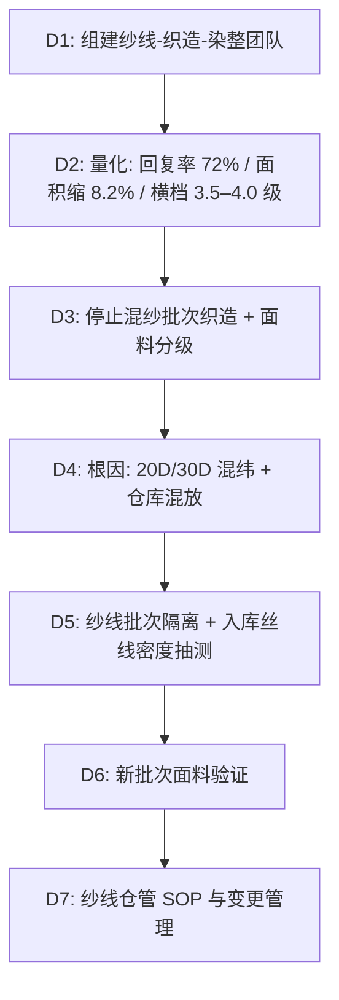

## 一、 案例背景

- **面料**: 78% 锦纶 / 22% 氨纶经编弹力针织面料，200 GSM，用于女装瑜伽裤与运动紧身裤
- **客户**: 美国运动休闲品牌
- **参与方**: Material QA（主导）、面料部、织厂、包芯纱供应商
- **风险体量**: 25 吨大货面料，对应约 90,000 件成衣（每件含裁耗约 0.28 kg），成衣货值约 $2,250,000（FOB 约 $25/件）
- **拦截经过**: 首批 8 吨面料染色出缸后，目检发现约 30% 的面料存在可见横档——沿纬向每隔约 3–20 cm 出现明暗相间的条纹。D65 灯箱下色差目视评定横档区域约 3.5–4.0 级。同时，横档区域的经向拉伸回复率（50% 定伸长、10 次洗烘后）只有 **72%**，无横档区域为 89%（客户要求 ≥ **85%**）。面料尺寸变化方面，混纱区域 1 次洗烘后面积缩水 **8.2%**（客户要求 ≤ **5%**）。

---

## 二、 8D 过程

### D2: 数据

| 项目 | 方法 | 客户要求 | 混纱区域结果 | 严重度 |
| :--- | :--- | :--- | :--- | :---: |
| 拉伸回复率 | 经向 50% 定伸长，10 次洗烘后 | ≥ 85% | **72%** | S = 8 |
| 面积缩水 | AATCC 135 程序 (1)(V)(Aiii)，1 次洗烘 | ≤ 5% | **8.2%** | S = 7 |
| 横档色差 | ASTM D2244 + AATCC EP6 仪器辅助 | 无可见横档 | 目视 **3.5–4.0 级** | S = 8 |

### D3: 遏制与处置

1. **停止**：织厂暂停所有使用该纱线批次的经编机台，等待纱线批次确认。
2. **已染 8 吨面料分级**：由 QA 与客户验布师逐卷灯箱目检，按横档严重度分三级：
   - **A 级（无横档）**：约 4.2 吨（52%），拉伸回复率 87–91%，面积缩水 3.2–3.8%，合格放行。这部分面料恰好来自纯 30D 纱线编织的机台。
   - **B 级（轻微横档，间距 > 15 cm，目视 4.0 级）**：约 2.2 吨（28%），拉伸回复率 78–83%，横档区域上色略浅但整体可接受度取决于裁剪排版。成衣后横档落在裤腿侧面或腰头区域时目视不明显。转用于品牌的深色（黑色、深海军蓝）内搭与运动背心款式——深色染后横档对比度降低，且这些款型裁片面积小，排料时可避开横档最明显的区域。实际成衣后由客户色彩办公室确认可接受，按降级价格结算。
   - **C 级（严重横档，间距 < 5 cm，目视 3.5 级）**：约 1.6 吨（20%），横档密集且拉伸回复率 68–73%，无论裁剪还是改色都无法消除：氨纶丝线密度不同区域的弹性与上染量差异是纱线结构造成的，不是表面颜色问题。报废回收。
3. **未织坯布**：剩余 17 吨坯纱经逐轴丝线密度抽测后确认纯 30D 批次（未混入 20D），按正常排产织造染整。
4. **补织**：报废的 1.6 吨加上 B 级中约 2.0 吨转用后的缺口，共需补织约 3.6 吨。纱线供应商紧急补发 30D 纯批次包芯纱，补织染整约 3 周。
5. **损失**：
   - 3.6 吨报废面料约 $46,800（纱线 + 织造 + 染整成本约 $13/kg）；
   - 4.2 吨降级面料残值损失约 $27,300（按 FOB 扣除约 50% 残值）；
   - 补织 3.6 吨约 $50,400；
   - 合计约 **$124,500**。织厂承担报废与补织费用（仓库管理失误导致混纱），降级损失由品牌与织厂按合同 6:4 分担。
6. **交期**：补织与染整约 3 周，总交期延误约 2 周（部分合格面料先行裁剪消化了缓冲）。

### D4: 根因分析

#### 1. 为什么出现横档？

- **机理**：经编弹力面料的每一横列由同一根氨纶丝弹性控制。当不同丝线密度（20D 对 30D）的包芯纱交替出现时，20D 区域弹力低、线圈松、上染量少（颜色浅），30D 区域弹力高、线圈紧、上染量多（颜色深），形成沿纬向的明暗条纹。这种差异在坯布时不明显（白色），染色后因为线圈密度影响上染率而显现。
- **直接原因**：20D 与 30D 两批锦纶/氨纶包芯纱外包锦纶规格相同（40D/34F 半消光锦纶 6），线轴外观几乎一致（颜色、粗细肉眼难辨），织厂仓库未按丝线密度分区摆放，上纱时混取。
- **体系原因**：纱线供应商送两批不同规格纱线（一批为另一客户退回的 20D 批次、一批为本订单的 30D 批次），送货单标注了规格，但织厂仓管员按"同一供应商、同一面纱规格"合并入库，未核对芯纱丝线密度。

#### 2. 为什么拉伸回复率和缩水不合格？

- 20D 氨纶的弹性回复力低于 30D，混纬区域的平均弹力介于两者之间，整体回复率下降。10 次洗烘后，弱弹力区域的氨纶疲劳更快，回复率从洗前 82% 降到 **72%**。
- 弹力不均也导致面料内应力不平衡，洗后面积缩水 **8.2%**，超出客户 5% 要求。

### D5: 纠正措施

1. **纱线仓库**：按芯纱丝线密度、批次号分区标识，不同规格纱线物理隔离；入库时仓管员核对送货单与线轴标签的芯纱规格，不一致拒收。
2. **入库抽测**：每批包芯纱抽 5 轴，用线密度仪（或称重法测 100 m 线长重量）验证芯纱丝线密度，偏差 > ±5% 的拒收并通知供应商。
3. **织造**：每台经编机只使用同一批次纱线；换批次时先织 2 m 样布，灯箱目检无横档后继续。
4. **纱线供应商**：要求线轴标签增加芯纱丝线密度字段（不只标面纱规格），不同规格纱线使用不同颜色线轴端盖。

### D6: 验证

- 新批次纯 30D 纱线织造 5 缸面料（约 7.5 吨），灯箱目检 D65 与 CWF 下无可见横档。
- 仪器测色：同一卷内任意两点 ΔE CMC(2:1) ≤ 0.35。
- 经向 50% 定伸长回复率（10 次洗烘后）：**89–92%**（均值 **91%**，客户要求 ≥ 85%）。
- AATCC 135 程序 (1)(V)(Aiii) 1 次洗烘后面积缩水：**3.2–3.8%**（均值 **3.5%**，客户要求 ≤ 5%）。

### D7: 标准化

1. 发布《弹力纱线仓库管理与上机验证 SOP》，纳入织厂供应商审核评分项。
2. 面料准入测试增加"模拟混纱横档检查"——对新面料开发，以同一面纱搭配不同丝线密度芯纱各织 1 m 对照，确认面料对芯纱批次差异的敏感度。
3. 纤维成分标签按 16 CFR 303 标注"78% Nylon / 22% Spandex"，纱线规格不影响标签但支撑内部可追溯性。

---

## 三、 面试 STAR 讲稿

> **面试官提问**："你遇到过哪些面料来料不合格的问题？"

- **Situation**："25 吨弹力针织面料，首批 8 吨染色后发现约 30% 有明显横档，混纱区域拉伸回复率只有 72%、面积缩水 8.2%。"
- **Task**："我负责 Material QA，要定位横档成因、处理已染面料，并确保后续 17 吨不再出问题。"
- **Action**：
  1. 追溯到织厂仓库把 20D 与 30D 两批包芯纱混放——外包锦纶相同、肉眼看不出差别，仓管按面纱规格合并入库；丝线密度不同导致弹力与上染率差异，表现为横档；
  2. 8 吨面料分三级处置：4.2 吨无横档放行、2.2 吨转深色内搭降级使用、1.6 吨报废，补织 3.6 吨；
  3. 建立纱线按芯纱丝线密度分区存放、入库抽测丝线密度、上机换批次先织样布目检的流程。
- **Result**："新批次回复率恢复到 91%、面积缩水 3.5%。代价是约 $124,500 的报废、降级与补织损失，交期延误约 2 周。"
