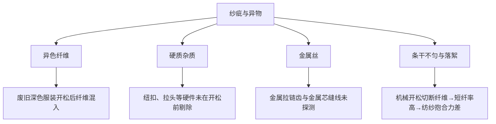

## 一、 背景与产前风险

美国休闲品牌计划推出"再生系列"T 恤，面料为 50% 再生棉（post-consumer recycled cotton，来自废旧服装回收）/ 50% 原生棉环锭纺混纺单面针织，180 GSM。大货计划 35 吨面料，对应约 160,000 件 T 恤。

面料开发阶段，第一批开发样（约 500 m 面料）在灯箱目检时发现以下问题：
1. **异色纤维点**：白色坯布上散布蓝色、红色、黑色纤维片段，每米约 3–8 处，成品染色后部分异色点仍可见（尤其浅色）；
2. **硬杂质**：偶见 1–3 mm 的硬质颗粒嵌入布面，触摸有异物感，初步判断为纽扣碎片或塑料残渣；
3. **金属丝**：500 m 中检出 2 处金属丝（长约 5 mm），来源为废旧服装的金属拉链齿或缝线中的金属芯；
4. **四分制评分**: **42 分/100 码**（客户限值 ≤ **28 分/100 码**）；
5. **掉毛**: 3 次洗涤累计掉毛率 **4.8%**（客户要求 ≤ **3.0%**），手感粗糙偏硬。

面料准入评审判定：**不予通过**，暂停大货下单。

---

## 二、 风险界定与分层

对再生棉原料和混纺纱线做分层追溯：

| 层 | 检查内容 | 结果 |
| :--- | :--- | :--- |
| 再生棉批次 A（深色废旧服装来源） | 异色纤维比例、短纤率、杂质 | 异色纤维约 1.2%（目标 < 0.3%）；短纤率 38%（原生棉约 15%）；纽扣碎片 3 粒/kg |
| 再生棉批次 B（白色/浅色废旧服装来源） | 同上 | 异色纤维约 0.4%；短纤率 32%；杂质较少 |
| 原生棉对照 | 同上 | 异色纤维 < 0.05%；短纤率 14%；无杂质 |
| 混纺纱条干 | USTER 条干不匀率 CVm% | 混纺纱 18.2%（全原生棉纱 12.5%，客户目标 ≤ 14%） |

**结论**：异物主要来自再生棉批次 A（深色来源），短纤率高是再生棉的固有特征（机械开松切断纤维），条干不匀由短纤率驱动。

---

## 三、 根因分析

1. **异色纤维**：废旧服装回收后的分拣只按颜色大类分（深色/浅色/白色），未按纤维成分分；深色涤纶、腈纶纤维混入棉中，开松后成为短纤维点，不能在后续梳棉中完全去除。
2. **硬质杂质**：回收服装的纽扣、拉头、搭扣等应在开松前的预处理工序（剪切与剔除）中去掉，但该再生棉供应商的预处理线无自动光学分拣，依赖人工——漏检率高。
3. **金属丝**：开松线没有配置在线金属探测器，金属芯缝线和拉链齿碎片直接进入开松机。
4. **短纤率与落絮**：机械开松本身会切断纤维，这是再生棉的固有特征，不可能完全消除。但该供应商只做一次开松（刀片式），没有二次精开松（锯齿式）来减少超短纤维的比例。短纤率高导致纺纱时纤维抱合力差、条干不匀、成纱毛羽多，织成面料后落絮严重。

---

## 四、 产前纠正与验证

### 4.1 对再生棉供应商的要求

1. **预处理**：增加自动光学分拣（近红外 NIR 识别纤维成分，剔除非棉纤维与硬质杂质），人工分拣作为补充而非唯一手段。
2. **金属探测**：开松线出口增设在线金属探测器（灵敏度 ≤ 1.5 mm 铁质、≤ 2.0 mm 非铁金属），检出即停机剔除。
3. **二次精开松**：一次开松后增加锯齿式精开松，降低超短纤维比例。
4. **入厂检验收紧**：
   - 异色纤维比例 ≤ 0.3%（目视计数法，每批 5 个 10 g 样本）；
   - 短纤率（< 12.7 mm）≤ 25%（HVI 测试）；
   - 金属异物：每批过金属探测器，检出即拒收；
   - 硬质杂质：每批 1 kg 样本手工检查，检出 > 0 粒/kg 拒收。

### 4.2 纺纱工艺调整

- 再生棉与原生棉混和比例从 50:50 调整为 40:60（再生棉降到 40%），以改善条干和抱合力。纤维成分标签按实际标注（16 CFR 303），再生含量声明按 FTC Green Guides（16 CFR 260）以"40% recycled cotton"如实标示，不笼统写"再生系列"。
- 梳棉增加一道精梳（去除短纤维和残余杂质），虽然出条率降低约 8%，但纱线品质改善。

### 4.3 验证

两批改进后的再生棉（各 2 吨），按新流程纺纱、织布、染整后验证：

| 项目 | 改进前 | 改进后 | 客户要求 |
| :--- | :--- | :--- | :--- |
| 四分制疵点 | **42** 分/100 码 | **18** 分/100 码 | ≤ 28 |
| 掉毛率 | **4.8%** | **2.1%** | ≤ 3.0% |
| 条干 CVm% | 18.2% | 13.8% | ≤ 14% |
| 异色纤维 | 1.2%（批次 A） | 0.18% | ≤ 0.3% |
| 金属异物 | 2 处/500 m | 0 处/2,000 m | 0 |

四分制疵点从 42 降至 **18 分/100 码**，掉毛率从 4.8% 降至 **2.1%**，均满足客户要求。

### 4.4 时间线与代价

- 供应商改造开松线（增加光学分拣与金属探测器）约 6 周；二次开松设备供应商已有，调试约 2 周。
- 两批验证样的纺纱、织布、染整约 3 周。
- 大货面料下单比原计划晚约 10 周。
- 再生棉采购单价因增加分拣与精开松上升约 15%（约 +$0.30/kg），40:60 混纺比例的纱线成本比 50:50 低约 $0.10/kg（原生棉便宜），两项大致抵消。精梳增加的出条损失由纺纱厂在报价中消化。

---

## 五、 产前门禁固化

1. 再生棉类面料准入必须包含四分制评分、掉毛率、条干 CVm%、异色纤维比例与金属探测记录。
2. 再生棉供应商准入增加开松线实地考察项（光学分拣、金属探测器、二次精开松），否则不列入合格供应商名录。
3. 再生含量声明与纤维标签由合规人员按 FTC Green Guides 与 16 CFR 303 审核后定稿。

---

## 六、 面试 STAR 讲稿

> **面试官提问**："你在可持续材料采购中遇到过哪些质量挑战？"

- **Situation**："品牌推再生系列 T 恤，50/50 再生棉混纺面料打样后四分制疵点 42 分/100 码（限值 28），掉毛率 4.8%（限值 3.0%），还有金属丝和纽扣碎片等硬异物。"
- **Task**："我负责面料准入，要在再生原料的固有短板下找到可量产的质量窗口。"
- **Action**：
  1. 分层追溯发现深色来源的再生棉异色纤维 1.2%、短纤率 38%，且供应商开松线没有光学分拣和金属探测；
  2. 要求供应商增加 NIR 光学分拣、在线金属探测和二次精开松，收紧入厂检验标准；
  3. 混纺比例从 50:50 调整到 40:60，增加精梳去短纤维，再生含量声明按实际 40% 标注。
- **Result**："疵点降到 18 分/100 码，掉毛率 2.1%，金属异物零检出。代价是大货下单晚约 10 周，再生棉比例从 50% 降到 40%——营销声明做了调整，但产品质量可靠。"
