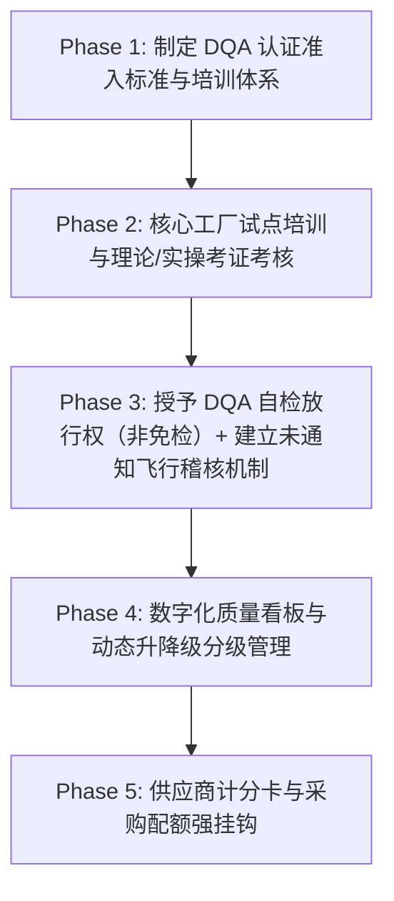

## 一、 案例背景与企业痛点 (Executive Summary)

- **企业背景**: 年出货量 3,000 万件（涵盖服装、家纺）的美国跨国服装零售供应链管理中心
- **原有质量管控模式的严重弊端 (The "Bottleneck" Model)**:
  - 依赖超过 80 名全职与第三方派驻 QC，对**每一批出货都安排尾期 AQL 抽样终检 (Final AQL Inspection)**；
  - **痛点 1: 成本高昂**: 每年第三方验货费与内部质检差旅人力成本高达 **$2,800,000 USD**；
  - **痛点 2: 严重卡脖子延误交期**: 大货全部堆在工厂尾道等品牌 QA 验货放行，平均滞留等待 3-5 天，导致旺季频发赶船延误；
  - **痛点 3: 恶性“猫鼠游戏”与防腐败风险**: 工厂把质检责任完全推给品牌 QA，私下掩盖疵点，甚至引发商业贿赂道德风险；大货一次验货合格率 (FTR) 长期徘徊在 **83%** 的低位。
- **战略转型目标**:
  由质量总监发起并主导**“供应商指定质量保证认证计划 (Designated QA / Factory Self-Inspection Certification Program)”**，推动工厂从“被动受检”向“自主质量保证”转型，建立飞行稽核（Surprise Audit）与严惩激励机制。

---

## 二、 DQA 体系设计与转型路线图 (Transformation Roadmap)



---

## 三、 DQA 体系核心实施方案与工程模型

### 1. DQA 人员准入、培训与“双盲”考核机制 (DQA Certification)
- **资格初筛**: 必须由工厂内部评选至少有 3 年以上现场质检经验、无不良记录的专职质检组长；
- **标准化强化培训 (40小时理论 + 40小时实操)**:
  - 美标 ANSI/ASQ Z1.4 抽样统计学、AQL 缺陷定级标准（Critical, Major, Minor）；
  - 美标 AATCC / ASTM 现场快测规范、检针机 9 点校验与防呆；
  - 真实缺陷盲样箱考核（Defect Blind Box Test）：100 件盲样（含 120 处已知缺陷及 30 件无缺陷样品），**Major 缺陷漏检率 ≤ 5%、Critical 缺陷零漏检，缺陷分级与标准答案的 Cohen's kappa ≥ 0.80**；每年复考；
- **颁发授权 (DQA Authorization)**: 通过考核者颁发附带唯一识别码的《DQA 品牌授权印章与证书》，仅赋予其在品牌合同与程序范围内签发《最终出货放行单 (Release Certificate)》的内部授权，不等同于政府或法律意义上的执照。

---

### 2. “信任但不放任”：高频非通知飞行稽核机制 (Surprise Audit & Correlation)

```
                       工厂 DQA 签发自检合格报告
                                  │
                                  ▼
      ┌───────────────────────────────────────────────────────┐
      │  品牌 Senior QA 随机抽取 15% - 20% 订单进行飞行稽核    │
      └───────────────────────────────────────────────────────┘
                                  │
                  ┌───────────────┴───────────────┐
                  ▼                               ▼
       【判定一致率 ≥ 95% 且 kappa ≥ 0.80】    【发现重大漏检 / 虚假数据】
                  │                               │
                  ▼                               ▼
      按 SYS-003 计分卡定级                      立即熔断停权 (Revocation)
       ★ Tier 1 可申请增配                       ★ 改为每批第三方 AQL 检验
       ★ 豁免验货费用补贴                      ★ 返工与检验费用按合同由工厂承担
```

- **授权资格（本库唯一口径）**：工厂须为 [SYS-003](case:SYS-003) 计分卡 Tier 1 或 Tier 2 且无红线，DQA 人员须通过上面的盲样考核；Tier 3 暂停授权，Tier 4 或出现红线撤销授权；增配按 SYS-003 的 Tier 1 规则执行。验厂等级（[Sourcing SOP](doc:SOP-SOURCING) 的 Level A–D）只作采购准入门槛，不单独决定 DQA 授权。授权后是“DQA 自检放行 + 15–20% 飞行稽核”，不是免检。
- **数据一致性考核 (Agreement Index)**:
  以同一订单、同一抽样框和同一缺陷分级进行逐件/逐缺陷比对，记录漏检、误报和分级偏差；一致性指标应由混淆矩阵或 Cohen's kappa 等经 QA 批准的方法计算，不能只用缺陷数量差值代表“相关性”。
- 一致性要求、允许误差和最小样本量须在 DQA 程序中预先定义，并按供应商风险等级分层执行。

---

### 3. 数字化质量协同云平台 (Digital QA Cloud System)
- 开发上线移动端 APP：工厂 DQA 必须在验货现场**实时拍照上传测量尺寸数据、条形码扫码记录、关键疵点高清图及检针机校准视频**；
- 数据带 GPS 水印与时间戳，后台算法实时比对制程参数异常波动，杜绝事后补录假报告。

---

## 四、 商业与管理量化成效 (Business ROI & Quantitative Impact)

历经 18 个月的深度推进，45 家核心战略供应商（约占出货量的 70%）进入计划并完成分阶段评估，其中 38 家获得正式授权（约占出货量的 62%）；7 家未通过或仅有条件通过（约占 8%），继续接受每批第三方检验；计划外约 30% 的出货维持原有尾期检验。

**口径说明**：
- **FTR 与退货率用同一队列比较**：授权本身就是按能力筛选的结果，拿 38 家授权工厂的转型后数据对比全体供应商的转型前基线，会混入选择偏差。下表“转型前”取这 38 家工厂在授权前 12 个月的数据，全体供应商的同期变化另列作对照。
- **FTR 前后含义的差异**：转型前是品牌对工厂首次交验批次的终检合格率；转型后是 DQA 放行批次在飞行稽核与第三方复验中的合格率，中间多了一道 DQA 筛选。为便于比较，另按“首次交验即合格且稽核合格”折算：DQA 首检拒收并返工的批次占 1.4%（自检口径），折算后的首次合格率约 93.8%（98.6% × 95.1%）。
- **成本按出货分段**：转型前的 $2.8M 覆盖 100% 出货；转型后按授权工厂、未授权工厂、计划外三段列出，前后都是全口径（见成本分段表）。

| 考核指标 (KPI Dimension) | 转型前 (Before DQA) | 转型后 (After DQA) | 说明 |
| :--- | :---: | :---: | :--- |
| **FTR（稽核口径，38 家授权工厂同一队列）** | 86.4% | **95.1%** | 提高 8.7 个百分点；按首次交验折算约 93.8%。DQA 自检报告的合格率为 98.6%，与稽核口径相差 3.5 个百分点，差距作为 DQA 复考与降级依据，**不作为业绩指标** |
| FTR（稽核口径，全体供应商，对照） | 83.2% | 88.7% | 其中未授权工厂与计划外工厂同期由 79.5% 到 80.8%，变化很小 |
| **质量管理成本（全口径，品牌支出）**| $2,800,000 / 年 | **$1,914,000 / 年** | **年化净节省约 $886,000（降幅 32%）**，经财务核对；平台一次性开发费 $300K 与人员调整一次性费用约 $90K 另列 |
| **出货等待（38 家授权工厂覆盖的全部批次平均）**| 3.8 天 | **0.7 天** | 资料齐全且风险放行的批次（占 82%）为 0.4 天；需要等待飞行稽核或补资料的批次（占 18%）为 2.1 天；平均缩短 3.1 天 |
| **质量原因退货率（经实物复核，占销量，38 家覆盖订单）** | 1.8% | **1.4%** | 同口径、同品类结构比较；全体供应商同期 1.9% → 1.6%。总退货率主要受尺码、偏好和政策影响，不作为本项目成果 |
| **验货腐败/舞弊** | 每年投诉 4–6 起，经调查确认 1–2 起 | 每年投诉 2 起，经调查确认 0 起 | 前后都按投诉数与确认数两种口径报告；未发现已确认事件，不等同于证明风险永久消失 |

**质量管理成本分段**（品牌支出，美元/年）：

| 出货分段 | 出货占比 | 转型前 | 转型后 | 转型后构成 |
| :--- | :---: | ---: | ---: | :--- |
| 38 家授权工厂 | 62% | 1,736,000 | 850,000 | 飞行稽核 520K、DQA 培训与复考 180K、移动平台运维 150K |
| 7 家未授权工厂 | 8% | 224,000 | 224,000 | 继续每批第三方 AQL 检验 |
| 计划外工厂 | 30% | 840,000 | 840,000 | 维持原尾期检验 |
| 合计 | 100% | 2,800,000 | 1,914,000 | 净节省 886,000 |

**成本转移、FOB 与人员**（GOV-03 §3）：
- **成本转移**：DQA 人员由工厂承担，38 家共约 110 名 DQA，按工厂人工估算每年约 $660,000；停权期间改为每批第三方检验的费用按合同也由工厂承担，不计入上表。品牌支出的下降中有相当一部分是成本转移：按供应链总成本计，年化净节省约 $226,000（$886,000 − $660,000），交期缩短与 FTR 提升的收益未折算成金额。
- **FOB 跟踪**：统计期内 38 家授权工厂同品类、同复杂度款式的 FOB 变化 +0.4%，与未授权工厂（+0.5%）接近，没有发现把 DQA 成本转回 FOB 的迹象；按季度继续跟踪。
- **人员调整**：原 80 名 QC 中内部员工 34 名，28 名转为飞行稽核与 DQA 培训岗位，6 名离职；第三方派驻人员随合同到期减少。转岗培训与离职补偿一次性约 $90K。

---

## 五、 面试高阶问答与 STAR 话术提炼

> **面试官提问**：“作为质量总监/高级经理，你如何看待‘增加质检人手’与‘质量体系建设’的关系？你有没有主导过从根本上提升供应商质量成熟度的系统级变革？”

### 卓越总监级应答讲稿：
- **Situation (背景)**：“面对年出货 3000 万件、耗费近 300 万美元尾端验货费但合格率依然停滞在 83% 的痛点，我意识到传统的‘人海战术当警察’已经走到尽头，不仅拖慢交期，还无法根除隐性质量风险。”
- **Task (任务)**：“我主导了全集团向‘供应商指定质量保证体系 (DQA / Factory Empowerment)’的战略转型，目标是在不降低质量底线的前提下，将品牌验货支出削减 30% 以上，并把授权工厂稽核口径的 FTR 提升到 95% 以上。”
- **Action (行动 - 突出管理格局与系统架构力)**：
  1. **建立严苛的认证赋能机制**：开发 80 小时理论与实操课程，引入‘双盲缺陷箱’严格考核，给合格的工厂自检员颁发认证印章与放行权；
  2. **构建‘信任+威慑’的飞行稽核网**：不打招呼随机抽测 15–20% 订单，用判定一致率和 kappa 衡量 DQA 质量，对造假一票否决；
  3. **数字化云端赋能**：推行现场带防伪水印的数字移动验货系统，实现数据实时透明监控；
  4. **与采购配额强绑定**：将 DQA 绩效作为 Sourcing 分配优质大单的核心权重。
- **Result (量化成果)**：“品牌质量管理支出全口径由 280 万美元降到约 191 万美元/年，年化净节省约 89 万美元（降幅 32%）；其中 DQA 人力约 66 万美元转由工厂承担，按供应链总成本算净节省约 23 万美元，同期 FOB 没有被推高；另有平台一次性开发 30 万美元和人员调整约 9 万美元。38 家授权工厂同一队列的稽核 FTR 由 86.4% 提高到 95.1%，出货等待平均缩短 3.1 天，质量原因退货率由 1.8% 降到 1.4%；45 家核心供应商中有 7 家没有获得授权，继续逐批检验。我特意用稽核数据而不是工厂自检数据来衡量成果，因为自检报告的合格率比稽核高 3.5 个百分点。”
