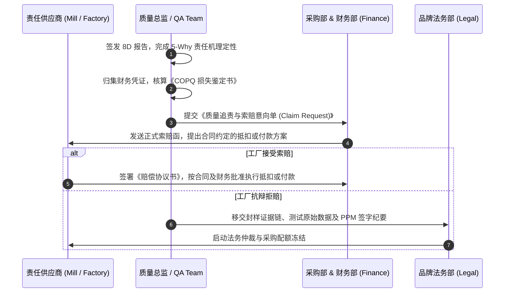

## 一、 体系背景与商业痛点 (Executive Summary)

在许多跨国纺织服装与家纺企业中，质量问题往往只停留在“技术缺陷”层面，缺乏与**财务数据（Financial P&L）的直接联动**：
- **痛点 1: 质量损失是一笔“糊涂账”**: 返修工时、空运差价、面料报废、海外翻箱及客诉罚款分散在生产、物流、业务各部门，未形成统一的 **COPQ (Cost of Poor Quality - 质量不良成本)** 数据库；
- **痛点 2: 索赔扯皮率极高 (Low Claim Recovery Rate)**: 发生大货质量事故后，供应商往往以“工艺单没写清”、“打样确认过”、“交期太赶”为由推卸责任，历史索赔实际回收率仅有 **28%**，企业默默吞下数百万美元隐性亏损；
- **转型目标**:
  由 QA 负责人牵头财务与采购，以 PAF 为总质量成本框架，统一内部与外部故障成本的 COPQ 口径，并建立跨国责任认定与追偿机制，将质量管理上升到经营损益层面。

---

## 二、 纺织服装 COPQ 经典 PAF 财务模型构建

```mermaid
graph TD
    COQ[企业总质量成本 Cost of Quality / PAF] --> Prevention[1. 预防成本 Prevention Cost<br>DFQ / 培训 / 体系认证 / 审核]
    COQ --> Appraisal[2. 鉴定成本 Appraisal Cost<br>第三方测试费 / 验布验货费 / 实验室设备]
    COQ --> InternalFail[3. 内部故障成本 Internal Failure<br>裁片报废 / 车缝返修工时 / 染缸重修]
    COQ --> ExternalFail[4. 外部故障成本 External Failure<br>客诉赔偿 / 港口退运 / 空运补货 / 销毁]
    
    InternalFail --> BadCOPQ[⚠️ 核心削减目标: 不良质量成本 (COPQ)]
    ExternalFail --> BadCOPQ
```

> **核算口径**：PAF 中的预防、鉴定、内部故障和外部故障合计为总质量成本（Cost of Quality）。本案例将 COPQ 定义为内部故障成本与外部故障成本；若企业把其他机会损失纳入 COPQ，必须由财务制度统一定义，并在各期保持同一口径，不能把预防和鉴定投入直接当作“不良损失”。

### COPQ 详细核算明细与责任归属科目表

| 故障类别 | 详细损失科目 (Loss Category) | 损失计算公式与财务凭证依据 | 责任追偿主体 |
| :--- | :--- | :--- | :--- |
| **内部故障 (Internal)** | **面料/辅料瑕疵报废损失** | $\text{报废码数} \times \text{采购单价} + \text{已发生运费}$ (IQC 异常报废单) | 织染厂 / 辅料厂 |
| **内部故障 (Internal)** | **车缝/后道返修人工工时** | $\text{返工人数} \times \text{返工工时} \times \text{标准工时费率 (Standard Hourly Rate)}$ | 成衣缝制厂 |
| **内部故障 (Internal)** | **二次送检与复验重检费** | 第三方实验室开具的二次复测发票，按合同约定和已确认责任比例计入 | 责任供应商 / 品牌 / 共同责任 |
| **外部故障 (External)** | **海运延误转空运差价 (Air Freight)**| $(\text{实际空运费} - \text{原定海运费}) \times \text{质量责任比例}$ (物流对账单) | 导致延误的工厂/染厂 |
| **外部故障 (External)** | **美国保税区/目的港翻箱工时费**| 美国当地第三方返工公司结算账单 ($\$45 - \$65\text{ USD/工时}$) | 涉案工厂 |
| **外部故障 (External)** | **零售商客诉退款与违约罚款 (Chargebacks)**| 买手扣款通知单 (Debit Memo / Chargeback Notice) | 责任供应商 |

---

## 三、 跨国质量事故“穿透式”责任界定与索赔闭环流程



索赔前必须由跨部门责任矩阵区分 **supplier-caused、brand-caused、shared responsibility 与 force majeure**，并确认直接损失、可预见的间接损失及责任比例。对未付货款或保证金的抵扣不能由 QA 单方决定，须有采购合同或补充协议依据，并经采购、财务及必要时法务批准；存在争议时，应按合同约定的协商、仲裁或诉讼路径处理。

---

## 四、 商业与管理量化成果 (Business ROI)

经过 12 个月的全体系推行与数字化 COPQ 监控：
- **故障成本（COPQ，追偿前）**: 按统一口径，由推行前的 **$2,100,000 / 年** 降至 **$1,350,000 / 年**，减少 **$750,000（−36%）**。这是质量故障本身的减少，来源于 Pareto 前五项的纠正措施。业务量与组合校正：推行前后 12 个月出货分别约 2,450 万件和 2,520 万件（+2.9%），按每千件出货折算，COPQ 由约 $85.7 降到约 $53.6，同样下降约 38%；各品类出货占比前后相差都在 2 个百分点以内。
- **追偿后的公司净损失**: 推行前，已确认供应商责任的索赔约 $1.0M，回收 28%，公司净损失约 $1.82M；推行后，已确认供应商责任的索赔约 $0.60M，回收 94.2%，净损失约 $0.79M。净损失减少约 **$1.03M**，其中约 $0.75M 来自故障减少，约 $0.28M 来自追偿改进。
- **注意**：追偿是把成本转移给责任方，不是供应链总成本的下降。为防止供应商把索赔成本加价回 FOB，Sourcing 同期跟踪同品类 FOB 变化（观察期内无异常上涨），并对配合整改的工厂优先采用“技术帮扶 + 分期抵扣”。新增预防与鉴定投入（约 $180,000 / 年）单列报告；扣除这部分投入后，公司年度净收益约 **$0.85M**。
- **供应商索赔回收率**: 以“已完成责任确认且到期应收的索赔金额”为分母，由 **28% 提升至 94.2%**；争议中、未到期或品牌责任金额不进入该分母，因此同时报告争议中金额（期末约 $90,000）与账龄，防止把难收的款项移出分母来“美化”回收率。
  - **推行前的分母怎么来**：推行前没有责任认定机制，28% 是推行初期由 QA 与财务按新的责任矩阵，对推行前 12 个月的索赔逐笔回溯认定后计算的：回溯确认供应商责任且到期的索赔约 $1.0M，已回收约 $0.28M；回溯时仍有争议的约 $0.35M（账龄多在 180 天以上），不进入分母。
  - **含争议金额的对照口径**：把争议中金额也计入分母，推行前约 21%（$0.28M / $1.35M），推行后约 82%（$0.565M / $0.69M）。两种口径都显示明显改善，改善不是靠移出分母得到的；
- **空运差价损失**: 质量原因引发的加急空运费用由约 $410,000 / 年降到约 $74,000 / 年，下降 **82%**。

---

## 五、 面试 STAR 核心讲稿提炼

> **面试官提问**：“作为质量总监，你如何向 CEO 或 CFO 汇报质量工作的价值？你如何处理大额质量索赔与供应商合作关系的平衡？”

### 卓越应答讲稿：
- **Situation**: “过去公司每年发生大量由于面料瑕疵、成衣返工和空运补货引发的隐性质量损失（年超 200 万美元），但财务报表无法精准归集，索赔回收率不足 30%，供应商频繁扯皮。”
- **Task**: “我主导建立集团级 COPQ 核算与追偿体系，把质量数据转化为财务语言；目标是故障成本下降 30% 以上，已确认索赔的回收率提升到 90% 以上。”
- **Action**:
  1. **建立 PAF 财务核算明细**: 联合财务制定清晰的标准工时费率、报废与空运差价计算公式，将损失转化为可复核的财务凭证，并把总质量成本与 COPQ 分开报告；
  2. **打造受控证据链闭环**: 从 PPM 纪要、封样标签到第三方测试报告建立版本控制、权限管理、审计日志与样品交接记录（chain of custody），用经验证的事实判定责任主体；
  3. **平衡博弈艺术**: 采取‘以理服人、阶梯扣款、技术帮扶’策略。对主动配合 8D 整改的优质工厂，允许以工时返工或分期抵扣方式减免部分间接损失，倒逼其提升源头制程能力。
- **Result**: “故障成本本身由 210 万降到 135 万美元，减少 36%；已确认索赔的回收率由 28% 提高到 94.2%（含争议金额的口径由约 21% 到约 82%），公司净损失合计减少约 103 万美元；扣除每年新增约 18 万美元的预防与鉴定投入后，年度净收益约 85 万美元。我向 CFO 汇报时把‘损失减少’和‘追偿回收’分开列，因为后者只是成本转移；同期也跟踪了 FOB，确认供应商没有把索赔成本加价转回来。”
