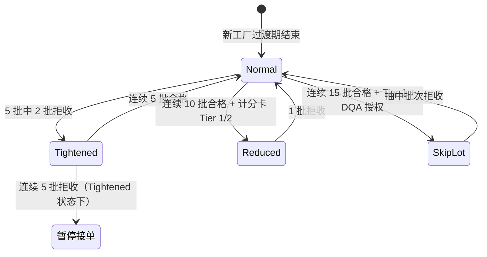

## 一、 案例背景

- **企业背景**: 年出货约 1,500 万件服装与家纺的美国品牌，合作供应商约 90 家
- **原有抽检模式**: 所有供应商、所有品类统一使用 ANSI/ASQ Z1.4 Normal Inspection Level II，AQL Critical = 0 / Major = 2.5 / Minor = 4.0。无论工厂历史质量表现如何，每批都按同一方案抽检。
- **痛点**:
  1. **优质工厂过度检验**: 连续 20 批以上零 Major 的老牌工厂仍然每批全套抽检，QA 验货员在这些工厂花费大量时间但几乎不产生拦截价值，出货等待平均 2.8 天；
  2. **高风险工厂检出不足**: 首季新工厂或近期出过 8D 的工厂也只是 Normal 方案，AQL 2.5 的抽样量在小批次时对散发性缺陷的检出力不足；
  3. **资源浪费**: 品牌年检验支出约 **$1,850,000**，但 60% 花在只贡献 15% 拦截量的低风险工厂上。
- **改进目标**: 建立风险分级动态抽检方案，把检验资源向高风险端集中，同时不降低整体拦截能力。

---

## 二、 风险分级模型

### 2.1 供应商质量风险分级

按过去 12 个月滚动数据，将供应商分为四级：

| 风险等级 | 准入条件 | 对应抽检方案 |
| :--- | :--- | :--- |
| **Level 1（跳批）** | 连续 ≥ 15 批 Normal 合格，且 [SYS-003](case:SYS-003) 计分卡 Tier 1，无 Critical 缺陷 | Skip-Lot：每 5 批抽 1 批做 Normal/II 全套抽检，其余 4 批凭工厂 DQA 报告放行（须为 [SYS-001](case:SYS-001) 授权工厂） |
| **Level 2（放宽）** | 连续 ≥ 10 批 Normal 合格，计分卡 Tier 1 或 Tier 2 | Reduced Inspection：按 Z1.4 Reduced 方案，样本量约为 Normal 的 40% |
| **Level 3（正常）** | 默认等级，新工厂过渡期完成后的起始等级 | Normal Inspection：Z1.4 Normal/II，AQL 0/2.5/4.0 |
| **Level 4（加严）** | 最近 5 批中有 2 批拒收，或出现 Critical 缺陷，或计分卡 Tier 4 | Tightened Inspection：按 Z1.4 Tightened 方案；连续 5 批拒收则暂停接单，触发 [SYS-003](case:SYS-003) 红线评审 |

### 2.2 切换规则

严格按 Z1.4 的 switching rules 执行，不做简化：

- **切换的最小单元**: 按"供应商 × 品类"组合分别计数，同一供应商的衬衫与床品是两条独立的切换轨道。
- **新工厂**: 首 5 批强制 Tightened（不论计分卡），连续 5 批合格后转 Normal，过渡期完成。与 [SYS-010](case:SYS-010) 的新供应商准入流程衔接。
- **季节性品类**: 间隔超过 6 个月无出货的组合，复产首批回退一级（Skip-Lot → Reduced → Normal）。

### 2.3 品类风险加权

并非所有品类风险相同。对以下高风险品类，AQL Major 从 2.5 收紧到 1.5：
- 儿童产品（法规合规，Critical 缺陷后果严重）
- 高可视安全服装（功能性要求，ANSI/ISEA 107）
- 含填充物床品（填充物均匀性、标签合规）

---

## 三、 实施与资源再分配

### 3.1 检验资源分配变化

| 风险等级 | 供应商数 | 出货量占比 | 改进前检验资源占比 | 改进后检验资源占比 |
| :--- | :---: | :---: | :---: | :---: |
| Level 1（跳批） | 12 家 | 28% | 28% | 8% |
| Level 2（放宽） | 22 家 | 30% | 30% | 18% |
| Level 3（正常） | 41 家 | 32% | 32% | 42% |
| Level 4（加严） | 15 家 | 10% | 10% | 32% |

改进后，**74% 的检验资源集中在 Level 3 和 Level 4**（改进前只有 42%）。Level 4 加严工厂的验货员密度从平均每人负责 3 家降到每人专注 1–2 家，巡检频率从出货前一次改为在线巡检 + 出货前终检。

### 3.2 数据系统支持

- 每批检验结果实时录入质量数据平台，系统自动按切换规则计算下一批的检验等级，验货员不得手动覆盖；
- 月度自动生成各供应商的切换轨迹报告，QA 经理审阅异常（如频繁在 Normal/Tightened 之间切换的工厂——可能存在系统性但不稳定的问题）。

---

## 四、 量化成效

实施 12 个月后（与实施前 12 个月同期对比，同一供应商队列）：

| KPI | 改进前 | 改进后 | 说明 |
| :--- | :---: | :---: | :--- |
| **FTR（稽核口径，全体加权）** | **89.2%** | **93.5%** | 主要贡献来自 Level 4 工厂的 FTR 从 72% 提升到 84%（加严方案 + 资源集中）；Level 1/2 工厂 FTR 从 96% 微降到 95.2%，在预期范围内 |
| **出货等待（全体加权）** | **3.2 天** | **1.4 天** | 跳批工厂 0.3 天（仅凭 DQA 报告放行）；加严工厂 4.1 天（双重检验） |
| **品牌检验支出（全口径）** | **$1,850,000/年** | **$1,520,000/年** | 净节省约 $330,000（18%），主要来自 Level 1/2 检验频次降低；Level 4 支出增加约 $120,000 |
| Level 4 → Level 3 转化 | — | 15 家中 6 家 | 连续 5 批 Tightened 合格后转 Normal，改善可持续 |
| Level 4 暂停接单 | — | 15 家中 2 家 | 连续 5 批 Tightened 拒收，触发 SYS-003 红线评审 |

**口径说明**：FTR 改善不能全部归因于抽检方案变化——加严工厂同期也接受了更多驻厂指导和在线巡检，方案调整与资源再分配共同作用。Level 1/2 工厂的 FTR 微降（96% → 95.2%）需持续监控：如果进一步下降可能说明跳批频率过高，需收紧回退规则。

---

## 五、 面试 STAR 讲稿

> **面试官提问**："你怎样设计一个科学的抽检方案来平衡成本和风险？"

- **Situation**："90 家供应商全部用同一 AQL 方案检验，60% 的检验资源花在 15% 的拦截量上，年检验支出 185 万美元，但高风险工厂的检出力不足。"
- **Task**："我主导重新设计抽检体系，目标是把资源向高风险端集中，同时不降低整体 FTR。"
- **Action**：
  1. 按 12 个月质量历史和计分卡等级把供应商分四级，分别对应 Z1.4 的跳批、放宽、正常和加严方案，切换规则严格按 Z1.4 switching rules 执行；
  2. 检验资源从 Level 1/2 释放出来集中到 Level 3/4，加严工厂增加在线巡检；
  3. 系统自动计算切换等级，验货员不能手动覆盖，月度审阅切换轨迹异常。
- **Result**："全体 FTR 从 89.2% 提到 93.5%，主要是 Level 4 工厂从 72% 到 84%；出货等待从 3.2 天降到 1.4 天；检验支出节省约 33 万美元。但 Level 1/2 的 FTR 微降了 0.8 个百分点，列入持续监控。"
