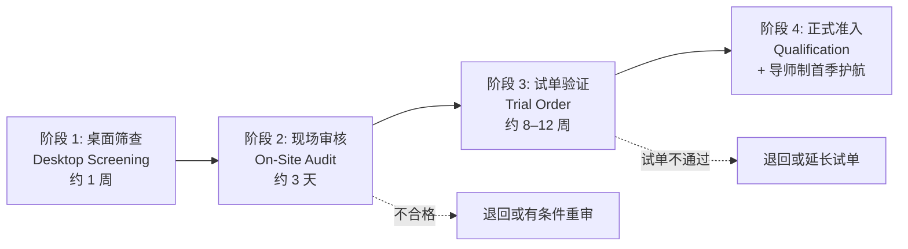

## 一、 案例背景

- **企业背景**: 美国中型服装品牌，年出货约 800 万件，合作成衣供应商约 55 家，每年新增 8–12 家以支持品类扩张与产能分散
- **痛点**: 新供应商从商务洽谈到首单上线平均只有 6–8 周，其间 QA 仅做一次现场验厂（2 天），主要看设备和证照，无结构化质量能力评估。结果：
  1. 新工厂**首季 FTR（稽核口径）仅 74%**，远低于老工厂的 91%；
  2. 新工厂首季**质量原因退货率 3.1%**，是老工厂 1.2% 的 2.5 倍以上；
  3. 约 30% 的新工厂在首季即被列入 [SYS-003](case:SYS-003) 计分卡 Tier 3/4，导致配额冻结或退出，前期开发投入浪费。
- **改进目标**: 建立分阶段新供应商准入流程与评分模型，在量产前识别并弥补质量能力差距，将新工厂首季 FTR 提升到 ≥ 85%。

---

## 二、 四阶段准入流程

### 阶段 1: 桌面筛查（Desktop Screening）

在安排现场审核前，先用公开信息和供应商自评筛除明显不合格者，避免无效差旅：

| 筛查项 | 要求 | 淘汰条件 |
| :--- | :--- | :--- |
| 合规资质 | CPSC 注册（儿童产品）、CTPAT 或等效（进口安全）、无 CPSC 召回记录 | 缺失任一必要资质 |
| 社会责任 | 有效的第三方社会责任审核报告（WRAP/BSCI/SA8000 或等效） | 无有效报告或最近审核出现零容忍项 |
| 产能匹配 | 月产能 ≥ 品牌预估月需求的 120%（留余量） | 产能不足 |
| 品类经验 | 过去 3 年有同类产品（面料、工艺、目标市场）的量产经验 | 完全无同类经验 |
| 质量体系自评 | 填写标准化自评问卷（检针、AQL 抽检、实验室、8D 流程等） | 自评显示无基本质量控制流程 |

### 阶段 2: 现场审核（On-Site Quality Audit）

由 Senior QA 主导的 3 天结构化审核，覆盖以下六维度，每维度 0–100 分加权合计：

| 维度 | 权重 | 审核内容 |
| :--- | :---: | :--- |
| **质量管理体系** | 20% | 组织架构、QC 人员配比、SOP 完整性、8D 流程、纠正预防记录 |
| **过程控制** | 25% | 关键工序作业指导书（WI）执行率、在线检验频率、首件确认、SPC 或 X-bar 记录 |
| **设备与计量** | 15% | 关键设备维护计划与执行、检针机 9 点校验、量具校准证书有效性 |
| **实验室能力** | 15% | 自有或外部实验室能力、面料与成衣常规测试覆盖率、MSA 记录 |
| **合规与追溯** | 15% | 成分标签流程、受限物质管理（RSL）、原辅料批次追溯到纱线/面料批次 |
| **持续改进** | 10% | 退货/客诉分析、改善项目记录、管理评审频率 |

**评分结果与决策**：

| 加权总分 | 决策 |
| :---: | :--- |
| ≥ 80 分 | 直接进入阶段 3 试单 |
| 65–79 分 | 有条件通过：出具改善计划（CAP），限期 60 天整改并复审关键项；复审通过后进入阶段 3 |
| < 65 分 | 不通过，6 个月后方可重新申请 |

红线项（一票否决，无论总分）：
- 检针机缺失或校验记录造假
- 无任何过程检验记录
- 使用品牌禁用的受限物质且无替代方案
- UFLPA 实体清单关联（16 CFR 1110 与 UFLPA 进口合规，参见 [CPSC-CERT-EFILING](reg:CPSC-CERT-EFILING)）

### 阶段 3: 试单验证（Trial Order）

通过现场审核后，安排 1–2 个试单（每单 3,000–5,000 件），验证量产能力：

- **过程监控**: QA 工程师驻厂跟进试单关键节点（裁剪铺料、首件确认、中查、尾查、包装）；
- **验收标准**: 与正式大货相同的 AQL 方案和测试要求，但按 [SYS-009](case:SYS-009) 新工厂规则强制 Tightened Inspection；
- **数据收集**: 试单的 FTR、缺陷类型 Pareto、工序能力、交期准时率作为准入评分的实证数据；
- **试单失败处理**: 任一试单 FTR < 75% 或出现 Critical 缺陷，暂停准入，出具根因分析与改善计划，限期 90 天内完成第二次试单；第二次试单仍不通过则终止准入流程。

### 阶段 4: 正式准入与导师制护航

试单通过后正式列入合格供应商名录（ASL），但首季（前 3 个月或前 5 批大货，取较长者）执行导师制：

- **指定导师**: 为每家新工厂指定一名 Senior QA 作为导师（Mentor），负责首季的周度远程会议与至少 2 次现场走访；
- **首季检验等级**: 按 SYS-009 强制 Tightened，连续 5 批合格后转 Normal；
- **首季评审**: 首季结束时由 QA 经理与采购总监联合评审：FTR ≥ 85% 且无 Critical → 转入正式管理；FTR 75–84% → 延长导师制 1 季；FTR < 75% → 降级为有条件供应商，配额上限 10%。

---

## 三、 量化成效

实施 18 个月，覆盖 16 家通过新流程准入的工厂（对比此前 18 个月准入的 14 家工厂，同期同品类）：

| KPI | 改进前（旧流程准入的新工厂首季） | 改进后（新流程准入的新工厂首季） |
| :--- | :---: | :---: |
| **FTR（稽核口径）** | **74%** | **88%** |
| **质量原因退货率** | **3.1%** | **1.5%** |
| 首季即列入 Tier 3/4 的比例 | 30%（14 家中 4 家） | 6%（16 家中 1 家） |
| 准入到首单上线周期 | 6–8 周 | 14–18 周 |
| 首年供应商留存率 | 64%（14 家中 9 家留存） | 88%（16 家中 14 家留存） |

**口径说明**：
- FTR 与退货率对比用的是新工厂首季数据，品类结构和复杂度在前后两组之间并不完全一致，但采购部确认两组的品类分布接近（基础款 60%、中等复杂度 30%、高复杂度 10%）。
- 准入周期从 6–8 周延长到 14–18 周，是有意的前置投入：首季质量问题减少后，首季返工、补货、8D 处理的隐性成本大幅降低。按 [SYS-002](case:SYS-002) COPQ 口径估算，新流程工厂首季的故障成本约为旧流程的 40%。
- 导师制的人力成本约 $2,500/工厂/季（Senior QA 工时分摊），16 家合计约 $40,000/年；与首季 COPQ 节省（约 $180,000/年）相比，投入产出正向。

---

## 四、 面试 STAR 讲稿

> **面试官提问**："你怎样确保新供应商不会拉低整体质量水平？"

- **Situation**："每年新增 8–12 家供应商，但准入流程只有一次 2 天验厂，新工厂首季 FTR 只有 74%，质量退货率 3.1%，约 30% 在首季就被列入低分工厂。"
- **Task**："我牵头重新设计供应商准入流程，目标是新工厂首季 FTR ≥ 85%。"
- **Action**：
  1. 建立桌面筛查-现场审核-试单验证-正式准入四阶段流程，现场审核按六维度评分并设红线项一票否决；
  2. 试单强制 Tightened 抽检，QA 驻厂跟进关键节点，两次试单不过则终止；
  3. 首季导师制——每家新工厂配 Senior QA 导师，周度远程 + 现场走访，首季结束联合评审决定去留。
- **Result**："新流程下 16 家工厂首季 FTR 88%、质量退货率 1.5%，首年留存率从 64% 升到 88%。代价是准入周期从 6–8 周延长到 14–18 周，但首季故障成本降低了约 60%。"
