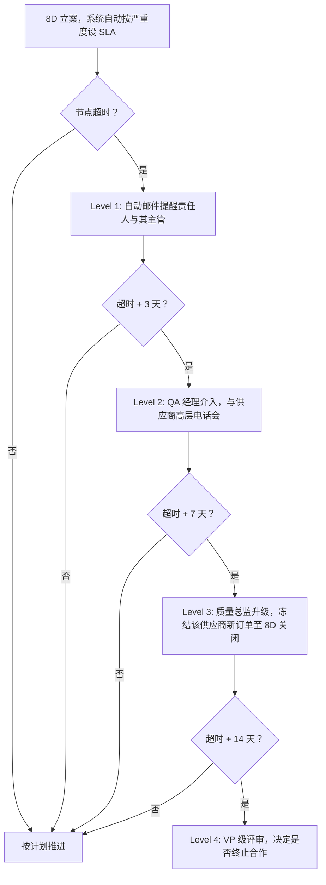

## 一、 案例背景

- **企业背景**: 美国服装家纺品牌，年出货约 2,000 万件，每年产生约 180–220 起 8D 立案（含客诉、内部拦截、退货分析触发的质量问题）
- **痛点**:
  1. **8D 关闭周期过长**: 中位关闭周期 **67 天**，最长超过 6 个月。根因：缺少 SLA、责任部门推诿、验证数据迟迟收不齐、管理层不跟踪；
  2. **重复问题率高**: 同一供应商 × 同一失效模式在 12 个月内再次立案的比例达 **34%**——说明纠正措施浮于表面或根本没有执行；
  3. **索赔回收率低**: 8D 拖延导致证据链不完整、供应商以"超过合同约定的时效"为由拒赔，索赔回收率仅 **28%**（与 [SYS-002](case:SYS-002) COPQ 体系的困境同源）。
- **改进目标**: 8D 中位关闭周期 ≤ 30 天，重复问题率 ≤ 15%。

---

## 二、 根因分析

对过去 18 个月所有 8D 案例的关闭时间做 Pareto 分析，识别延迟的主要原因：

| 延迟原因 | 累计占比 | 说明 |
| :--- | :---: | :--- |
| 供应商不响应或拖延提交根因报告 | 35% | 缺乏合同约束与后果，品牌 QA 只能"催" |
| 验证数据等待（需等下一批大货出货后才能验证） | 22% | 纠正措施的验证窗口与大货排产不同步 |
| 品牌内部跨部门协调（QA ↔ 采购 ↔ 财务） | 18% | 索赔需采购同意、财务审核，排队等签批 |
| 根因分析质量差，反复打回重做 | 15% | 供应商 8D 能力不足，"5-Why"停在第一层 |
| 无人跟踪，自然搁置 | 10% | 无系统、无仪表盘、无升级机制 |

---

## 三、 改进方案

### 3.1 8D 分级 SLA

按严重度分三级，每级定义从立案到关闭的总时限与关键节点时限：

| 严重度 | 定义 | 总时限 | D3 遏制 | D4 根因 | D5 措施 | D6 验证 | D8 关闭 |
| :--- | :--- | :---: | :---: | :---: | :---: | :---: | :---: |
| **Critical** | 安全/法规/召回级 | **14 天** | 24 h | 72 h | 5 天 | 10 天 | 14 天 |
| **Major** | 批次拒收/大面积返工/客诉 | **30 天** | 48 h | 7 天 | 14 天 | 21 天 | 30 天 |
| **Minor** | 零星缺陷/流程偏差 | **60 天** | 5 天 | 14 天 | 30 天 | 45 天 | 60 天 |

- D6 验证如果需要等下一批大货，允许"有条件关闭"（D7 标准化已完成 + 措施已部署），但必须在系统中标记"验证待完成"，由系统在下一批出货时自动触发验证任务。
- 时限为自然天数。国际供应链的时区差异和工厂节假日不延长 SLA（已经留有余量），但如果工厂整体停产超过 7 天（如春节），QA 经理可批准一次性延期。

### 3.2 升级机制

冻结新订单（Level 3）是最有效的杠杆——大多数供应商在收到冻结通知后 48 小时内会提交根因报告。这一机制需要采购总监的预先授权，写入供应商合同的质量条款中。

### 3.3 根因质量提升

- **8D 模板标准化**: 提供中英双语 8D 模板，5-Why 必须写到物理层面和管理层面，不能停在"操作工没注意"；
- **根因审核**: QA 工程师在收到 D4 报告后 48 小时内审核，不合格的打回并注明具体要求（如"第三层 Why 缺乏数据支撑"），不是笼统的"请补充"；
- **供应商 8D 能力培训**: 季度线上培训（2 小时），用本库的案例（如 [RM-001](case:RM-001)、[APP-001](case:APP-001)）作为教学素材，演示合格的根因分析与纠正措施。

### 3.4 重复问题专项 PDCA

- **月度 Pareto**: 每月按"供应商 × 失效模式"维度做 Pareto，识别重复问题的 Top 5 组合；
- **专项 PDCA**: 对重复问题组合启动专项改善——不是再开一个 8D，而是升级到更深层的改善项目：
  - 如果是工艺问题反复，升级为 SPC 控制项（参考 [playbooks/control-plan.md](doc:PB-QCP)）；
  - 如果是供应商管理体系问题，升级为供应商发展项目（QA 驻厂辅导 2–4 周）；
  - 如果连续 3 次同一组合立案，触发 [SYS-003](case:SYS-003) 计分卡红线评审。
- **PDCA 进度在 QBR 上汇报**: 与供应商季度业务评审（QBR）联动，重复问题改善进度作为 QBR 议题。

### 3.5 与 COPQ 索赔联动

- 8D 关闭同时触发 [SYS-002](case:SYS-002) 的索赔流程：D4 根因确认责任方后，QA 48 小时内向采购提交索赔意向单，不等 D8 关闭；
- SLA 内关闭的 8D 证据链完整（封样、测试报告、根因报告、纠正措施记录、验证数据），供应商以"超时效"抗辩的空间大幅缩小。

---

## 四、 验证与成效

实施 12 个月后（对比实施前 12 个月，同一组织架构和供应商群体）：

| KPI | 改进前 | 改进后 | 说明 |
| :--- | :---: | :---: | :--- |
| **8D 中位关闭周期** | **67 天** | **23 天** | Critical 中位 11 天、Major 22 天、Minor 38 天；"有条件关闭"占 18%，其中 92% 在下一批出货时完成了验证 |
| **重复问题率** | **34%** | **12%** | 同一供应商 × 同一失效模式 12 个月内再次立案；Top 5 重复组合均有专项 PDCA |
| **索赔回收率** | **28%** | **61%** | 证据链完整度和提交时效改善后，供应商抗辩成功率从 52% 降到 19%；61% 回收率仍有提升空间，争议中金额约 $120K |
| 升级到 Level 3（冻结新订单） | — | 12 次/年 | 其中 10 次在冻结后 48 小时内解除；2 次持续超过 1 周 |
| 供应商培训覆盖 | — | 82% | 82% 的活跃供应商至少参加 1 次 8D 培训 |

**口径说明**：
- 索赔回收率的提升不能全部归因于 8D 时效改善——同期财务部也优化了索赔审批流程（从 3 级签批简化为 2 级），并在供应商合同中增加了质量罚款条款。
- 重复问题率的 12 个月窗口意味着，改善效果需要至少一个完整年度才能充分体现；首 6 个月的重复率为 21%，后 6 个月降至 8%，趋势向好。

---

## 五、 面试 STAR 讲稿

> **面试官提问**："你是如何提高质量问题的闭环效率的？"

- **Situation**："每年 200 起左右的 8D，中位关闭周期 67 天，34% 的问题在同一供应商同一失效模式上重复出现，索赔回收率只有 28%。"
- **Task**："我负责质量体系，要把 8D 从'走形式'变成真正闭环的管理工具。"
- **Action**：
  1. 按严重度分三级定义 SLA（Critical 14 天、Major 30 天、Minor 60 天），系统自动升级——超时 3 天提醒主管，超时 7 天 QA 经理介入，超时 14 天冻结新订单；
  2. 根因报告必须写到物理层面和管理层面，48 小时内审核打回不合格的，季度线上培训用案例库教 5-Why；
  3. 月度 Pareto 识别重复问题 Top 5，升级为 SPC 或驻厂辅导的专项 PDCA，并在 QBR 上跟踪。
- **Result**："中位关闭周期降到 23 天，重复问题率降到 12%，索赔回收率从 28% 升到 61%。最有效的杠杆是冻结新订单——全年触发 12 次，10 次在 48 小时内就解除了。"
