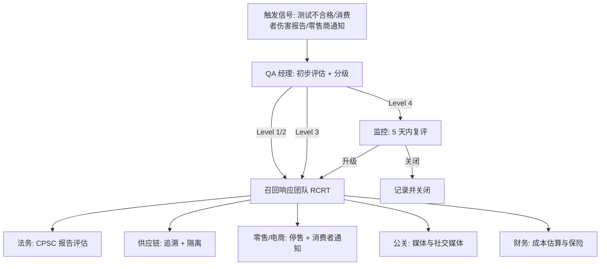

## 一、 案例背景

- **企业背景**: 美国服装与家纺品牌，产品涵盖成人服装、儿童服装与床品，年进口约 1,200 万件，从亚洲约 60 家供应商采购
- **现状**: 品牌有一份《产品召回程序》（2019 年编写，约 12 页），规定了 CPSC 报告义务（CPSA Sec. 15(b)）和召回分类，但：
  1. **从未做过实战演练**: 程序只在纸面上存在，没有人真正走过一遍完整流程；
  2. **追溯能力未知**: 没有人知道从一个消费者投诉反向追溯到具体工厂、批次、面料批号需要多长时间，能不能追到；
  3. **沟通链不清**: 发现安全问题后，QA 应该通知谁、多久内通知、通知什么内容，程序里写的角色有些人已经离职或调岗。
- **触发事件**: 某日 QA 收到一封邮件——第三方实验室报告显示一款儿童连帽衫的涂层铅含量 **110 ppm**（CPSIA Sec. 101 限值 90 ppm）。该结果来自大货留样的年度复测，不是出货前测试（出货前测试合格）。QA 经理决定先暂不按 CPSA 15(b) 报告（尚需确认批次范围和是否构成实质性产品危害），但这次事件暴露了整个响应链的脆弱——花了 **72 小时**才初步确定受影响的批次范围，其间多次找不到关键数据。
- **改进目标**: 建立可执行的召回响应流程并通过年度模拟演练验证，追溯定位时间 ≤ 24 小时。

---

## 二、 首次桌面推演暴露的问题

QA 总监在铅含量事件处理完毕后，组织了一次跨部门桌面推演（Tabletop Exercise），模拟场景为"某批儿童睡衣燃烧测试不合格，已出货至零售渠道"。

### 推演发现的关键缺口

| 环节 | 预期 | 实际发现 |
| :--- | :--- | :--- |
| **触发报告** | QA 发现问题后 24 小时内启动评估 | 程序中的"质量总监"岗位已空缺 3 个月，报告链断裂；没有备选联系人 |
| **批次追溯** | 从成品箱号 → PO → 工厂生产批次 → 面辅料批次 | 箱号到 PO 可追溯（WMS），但 PO 到工厂生产批次缺乏系统映射——需要人工打电话找工厂翻纸质记录，耗时 **48 小时** |
| **范围界定** | 确定受影响的 SKU、批次、数量、已售渠道 | 仓库系统（WMS）只有 SKU 级库存，无批次级跟踪；无法区分"同一 SKU 的安全批次"与"问题批次"，只能按整个 SKU 处理，范围被放大 5–8 倍 |
| **消费者通知** | 法律与 PR 团队在 48 小时内准备消费者通知草案 | 法务代表在推演中表示"从未收到过这类通知请求"，没有模板；PR 不在推演名单中 |
| **监管沟通** | 确定是否需要向 CPSC 提交 15(b) 报告、报告时限 | 参与者对 CPSA 15(b) 的"知悉即报告"义务理解不一，有人认为"只有确认了才需要报告"，有人认为"合理怀疑就需要" |
| **产品隔离** | 仓库内受影响产品标记隔离，零售端停止销售 | 仓库可以按 SKU 隔离但不能按批次隔离；零售端（电商和实体店）的停售操作需要 IT 介入，周末无人值班 |
| **追溯总耗时** | ≤ 24 小时 | **72 小时**（其中 48 小时在找工厂生产记录，24 小时在汇总渠道数据） |

---

## 三、 召回响应流程建设

### 3.1 四级响应分类

| 级别 | 定义 | 响应时限 | 决策权 |
| :--- | :--- | :--- | :--- |
| **Level 1: 安全召回** | 已确认或合理怀疑存在实质性产品危害（CPSA Sec. 15(b)） | 4 小时内启动响应团队 | VP 级批准 |
| **Level 2: 自愿纠正** | 法规不合格但不构成安全危害（如标签错误、成分标识偏差） | 24 小时内启动 | QA 总监批准 |
| **Level 3: 质量召回** | 严重质量问题导致大面积退货或品牌声誉风险，但不涉及安全 | 48 小时内启动 | QA 总监与采购 VP 联合 |
| **Level 4: 监控** | 信号尚不明确，需进一步调查后升级或关闭 | 5 个工作日内完成初步评估 | QA 经理 |

### 3.2 响应团队与沟通链

- **召回响应团队（RCRT）**由 QA 总监召集，成员为上述各职能的指定代表与备选代表（各 2 人）；
- **联系名单季度更新**，每个角色必须有主联系人和备选联系人，附手机号；
- **CPSA 15(b) 判断**: 法务按 CPSC 的《Recall Handbook》中"实质性产品危害"定义评估，不由 QA 单独判断；如果合理怀疑但尚未确认，按"知悉即报告"原则在 24 小时内联系 CPSC——迟报的罚款风险（CPSA Sec. 20）远大于误报的成本。

### 3.3 追溯体系补强

针对桌面推演暴露的批次追溯缺口：

1. **WMS 增加批次维度**: 入库时扫描工厂装箱单上的生产批次号（Lot #），与箱号、PO、SKU 绑定。投资约 $45,000（WMS 定制开发 + 条码打印机），实施约 3 个月。
2. **供应商追溯要求写入合同**: 工厂必须在装箱单和纸箱标签上注明生产批次号，可追溯到面辅料批次和生产日期。无法提供的工厂按 [SYS-010](case:SYS-010) 的合规维度扣分。
3. **追溯快速查询工具**: IT 开发简单的批次查询界面——输入 PO 或 SKU + 批次号，返回：受影响数量、仓库位置、已发货渠道与数量、零售端库存。查询目标 < 30 分钟。

### 3.4 年度模拟演练制度

- **频率**: 每年至少 1 次全流程演练（桌面 + 实操），另有 1 次桌面推演只测沟通链与决策速度；
- **场景设计**: QA 总监设计场景，演练前不提前透露具体内容，只通知"本周将有召回演练"；场景从案例库中选取或自创（如儿童睡衣燃烧不合格、床品甲醛超标、金属异物伤人等）；
- **实操部分**: 仓库实际执行批次隔离操作，IT 实际执行电商停售，法务草拟 CPSC 报告模板——不是纸上谈兵；
- **评估维度**: 追溯定位时间、沟通链完整性（是否有人联系不上）、决策正确性（分级是否恰当）、隔离操作时间、CPSC 报告草稿质量；
- **演练后复盘**: 识别差距，更新流程与联系名单，差距列入改善计划并在下次演练前关闭。

---

## 四、 第二次演练成效

首次桌面推演后 6 个月，WMS 批次追溯上线 3 个月后，进行第二次全流程演练。场景为"加州消费者报告某款儿童外套拉绳存在勒颈风险"（模拟 16 CFR 1120.3 相关场景）：

| 环节 | 首次推演 | 第二次演练 |
| :--- | :---: | :---: |
| 追溯定位时间 | **72 小时** | **8 小时** |
| 受影响范围界定 | 只能按整个 SKU（放大 5–8 倍） | 按批次精确界定（受影响 3 个批次 / 全部 12 个批次） |
| 沟通链断裂 | 3 个角色联系不上 | 0 个（备选联系人机制生效） |
| CPSC 报告草稿 | 无模板 | 法务在 4 小时内完成草稿 |
| 仓库隔离操作 | 无法按批次隔离 | 2 小时内完成批次隔离 |
| 电商停售 | 需 IT 介入，周末无人 | 零售运营团队有自助停售权限，15 分钟完成 |

追溯定位时间从 **72 小时**降至 **8 小时**（目标 ≤ **24 小时**）。

**说明**：模拟演练的条件与真实召回不同——参与者知道这是演练（虽然不知道场景），压力和外部利益方（CPSC、零售商、媒体）的干扰均不存在。实际召回可能会更慢、更复杂。8 小时的追溯时间在真实场景中可能延长到 12–16 小时，但仍在 24 小时目标内。

---

## 五、 面试 STAR 讲稿

> **面试官提问**："你的公司有召回准备吗？你如何确保团队在紧急情况下能快速响应？"

- **Situation**："一次儿童产品涂层铅超标事件暴露了我们的召回程序只是纸面文件——追溯一个批次花了 72 小时，沟通链上 3 个角色联系不上，仓库无法按批次隔离。"
- **Task**："我负责质量体系，要把纸面程序变成可执行、可演练、可度量的召回响应能力。"
- **Action**：
  1. 建立四级响应分类和跨部门召回响应团队（RCRT），每个角色双人配置、季度更新联系方式；
  2. WMS 增加批次维度，供应商装箱单必须标注生产批次号并可追溯到面辅料，IT 开发批次查询工具；
  3. 年度至少 2 次演练（1 次全流程 + 1 次桌面），场景从案例库取材，演练后复盘并关闭差距。
- **Result**："第二次演练追溯定位时间从 72 小时降到 8 小时，批次隔离 2 小时完成，沟通链零断裂。这是演练条件下的数据，真实场景会更复杂，但我们至少证明了流程是可执行的。"
