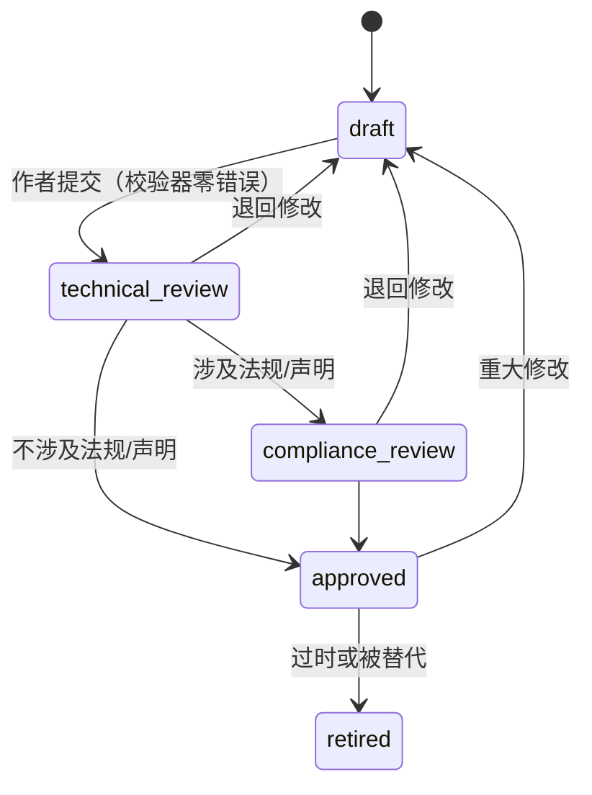

# 角色职责与评审流程

## 1. 角色

| 角色 | 职责 | 资格要求 |
| :--- | :--- | :--- |
| **库主（Library Owner）** | 对案例库整体质量负责；批准治理文件变更；每季度主持健康度复盘 | 质量经理及以上 |
| **作者（Author）** | 按 [GOV-02](doc:GOV-02) 编写案例与模板；运行校验器直到零错误 | 任意质量人员 |
| **技术评审（Technical Reviewer）** | 审机理、方法、数字合理性与内部一致性 | 对应品类/工艺 5 年以上经验，不得评审自己写的案例 |
| **合规评审（Compliance Reviewer）** | 审法规引用、声明（成分、产地、阻燃、羽绒、环保）与是否混淆法定/客户要求 | 合规或法务背景 |
| **注册表维护人（Registry Steward）** | 维护标准与法规注册表；按期核实；处理法规变更 | 合规负责人或其指定人 |

## 2. RACI

| 活动 | 作者 | 技术评审 | 合规评审 | 注册表维护人 | 库主 |
| :--- | :---: | :---: | :---: | :---: | :---: |
| 新案例编写 | R | C | C | I | A |
| 技术评审 | I | R | I | I | A |
| 合规评审（涉及法规或声明的案例） | I | I | R | C | A |
| 标准/法规注册表更新 | I | C | C | R | A |
| 治理文件修改 | C | C | C | C | R/A |
| 季度健康度复盘 | I | C | C | C | R/A |

## 3. 案例状态流转

- 状态写在 `case.json` 的 `review.status`；评审人与日期写在 `review` 字段，评审意见按 `templates/review-record.md` 归档在案例目录下（`review-YYYYMMDD.md`）。
- **进入 approved 的硬条件**：校验器零错误；评审人不是作者；涉及法规的案例必须有合规评审人；所引用法规条目的 `verifiedAt` 在 180 天以内。校验器会检查前三项中能机器判断的部分。
- `approved` 后的修改：错别字、格式可直接改；任何数字、结论、法规引用的修改都回到 `draft`。

## 4. 时效
| 事项 | 时限 |
| :--- | :--- |
| 技术评审 | 提交后 10 个工作日 |
| 合规评审 | 提交后 10 个工作日 |
| 法规变更（新规、修订、废止） | 注册表 5 个工作日内更新；受影响案例 30 天内复审 |
| 校验器警告 | 季度复盘时清理或给出保留理由 |

## 5. 争议处理
技术评审与作者意见不一致时，由库主指定第二位评审人；合规问题以合规评审意见为准，必要时提交法务。
