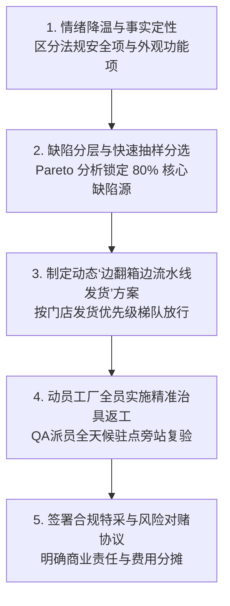

# 跨部门博弈与冲突化解实战案例录 (Cross-Functional Quality Conflicts)

> **Mastering High-Stakes Supply Chain Conflicts: Delivery vs Quality, Cost vs Compliance, Design vs DFQ**

---

## 一、 为什么质量总监面试必考“跨部门冲突”？

在真实商业环境中，QA 永远处于多方利益的夹缝之中：
- **PDD (设计研发)**：追求极致视觉新颖与前卫设计，容易忽视材料兼容性与可制造性；
- **Sourcing (采购/业务)**：背负单价 (Cost) 与交期 (OTD) 考核，视 QA 严格把关为“阻碍发货的绊脚石”；
- **供应商/工厂 (Vendors)**：追求生产利润与排产效率，习惯掩盖工艺波动并向买手施压；
- **Compliance / QA**：背负品牌法律合规与消费者口碑底线。

**考察核心**：面试官想确认你是一个**“只会死板说 No 的质检书呆子”**，还是一个**“具备商业大局观、懂材料工程、能用数据量化风险、并能提供替代性解决方案的卓越领导者”**。

---

## 二、 经典冲突场景 1：【交期 vs 质量】黑五大促前夕，10万件大货 AQL 终检严重拒收

### 1. 冲突情境 (The High-Stakes Dilemma)
- **背景**: 一批 10 万件户外抓绒外套（货值 $2,500,000）是黑五档期商品，客户规定的最晚入 DC 日期（In-DC date）在 **24 天后**。从工厂出运到美西 DC，快船航程约 11 天，加上订舱、清关与 DC 收货约 5 天，工厂最晚必须在 **7 天内**出运。
- **冲突爆发**: 品牌 QA 进行 ANSI/ASQ Z1.4 终检时，发现 **严重跳针、拉链波浪起皱以及口袋处止口脱线**，Major 缺陷超出 AQL 2.5 限值 3 倍，QA 判定 **Reject**。
- **各方博弈**:
  - **业务副总裁 (Sales VP)**: “错过 In-DC 日期，客户会按合同扣款甚至取消订单，黑五档期就开天窗了。QA 必须马上放行，问题到美国再说！”
  - **工厂厂长**: “工人连夜加班赶出来的，都是轻微做工问题，不影响穿，你们 QA 不要吹毛求疵！”

---

### 2. 卓越 QA 负责人的破局五步战法



1. **第一步：迅速定性分类，守死安全底线**
   - 立即核查是否涉及检针断针、重金属超标等法律红线（确认无安全法规缺陷，纯属车缝做工变异）。
2. **第二步：数据化 Pareto 缺陷分层 (Defect Categorization)**
   - 组织 4 名资深质检员对拒收批次进行 1000 件快速抽检分层：
     - 发现 **72% 的缺陷集中在“前中拉链起皱”**，原因是车缝拉链时送布牙压脚压力过大；
     - 仅 **8% 为口袋脱线严重缺陷**；其余 20% 为可快速清理的浮线线头。
3. **第三步：制定“梯队流水线放行 + 靶向返修”救援方案**
   - 拒绝“整批 10 万件死等”：要求工厂立即成立 **50 人精干返修突击队**，只拆解返修拉链和口袋脱线部位；
   - 将 10 万件货物按美国物流仓优先级拆分为 **4 个批次（每批 25,000 件）**；
   - 第一批 25,000 件在 36 小时内完成返修与 100% 复验，按原计划订舱出运；其余三批每 36–48 小时完成一批，均在 7 天出运窗口内完成；返修后的每一批都重新做 AQL 终检，合格才放行；
4. **第四步：物流补救（快船代替空运）**
   - 协同物流部把后三批由普通海运改订美西快船航线（航程约 11 天，比普通航线快约 5–7 天），抵消返工耽误的时间，避免空运。快船舱位与运费差价在决策前已确认。
5. **第五步：闭环与责任复盘**
   - 最终 10 万件在 In-DC 日期前全部入库；上市后，经复核的做工原因退货率与同类款持平；
   - 工厂承担快船差价与返工工时；复盘时把“拉链起皱”加入该工厂的 PFMEA 与首件检查，QA 也因此在业务团队中建立了信任。

---

## 三、 经典冲突场景 2：【成本 vs 合规】采购为了降本私自更换辅料供应商

### 1. 冲突情境 (The Cost Dilemma)
- **背景**: 采购部面临年度 8% 的降本 KPI，在未告知 QA 的情况下，把一款婴儿连体哈衣（PO 80,000 件，儿童产品）的金属四合扣由原认证供应商切换为某本地低价辅料厂，单件节约 $0.15（整单 $12,000）。
- **冲突爆发**:
  已生产 30,000 件时，QA 下线抽检：按客户童装附件方法（参考 16 CFR 1500.51–1500.53 的使用与滥用拉力条件，客户要求 15 lbf 保持 10 秒；爪扣牢度参考 ASTM D7142），按扣在 **11 lbf、5 秒**时脱落，脱落件能完全放入小零件测试筒。16 CFR 1501 本身豁免儿童服装，但婴儿服装上可脱落的小部件会被 CPSC 视为窒息危险，可按实质性产品危害处理，属于**致命缺陷**。
  此外，按扣是新供应商的新部件，原 CPC 所依据的第三方测试（含铅）已不覆盖这批按扣。
- **采购抗辩**: “已经做好了 8 万件，单价压得很低，如果全换按扣要亏损几万美元，而且婴儿衣服大人都会看着穿，不会有事的。”

---

### 2. 卓越 QA 负责人的破局策略
1. **法律威慑与高管升级 (Executive Escalation with Regulatory Facts)**
   - 不与采购私下妥协。整理 CPSC 网站上婴幼儿服装按扣脱落的公开召回公告作为事实依据，签发《安全隐患停线通报 (Stop-Shipment Notice)》，抄送采购 VP、法务与供应链 VP；说明这不仅是拉力问题，还涉及 CPC 依据失效。
2. **机理分析与处置**
   - 现场解剖失效按扣：发现并非按扣金属断裂，而是**按扣爪齿过短且底模冲压压力不足**，导致无法穿透并紧密咬合婴儿纯棉双层包边布；
   - 处置：拆下不合格按扣后，原孔位面料已损伤。用 50 件做重钉试验（加补强衬、换原认证供应商按扣），ASTM D7142 牢度 13–16 lbf、离散大，不能稳定满足 15 lbf。婴儿产品没有让步空间，因此已生产的 30,000 件**报废**（FOB 口径约 $135,000，是这次“降本”$12,000 的 11 倍）；未生产的 50,000 件使用原供应商按扣；
   - 新按扣批次送 CPSC 认可实验室测铅并重签 CPC；打扣机加装数字气压传感器互锁，调整模具。
3. **建立《辅料工程变更 (ECN) 违规连带问责制度》**
   - 在制度层面固化：童装辅料的供应商替换必须走 ECN，经拉力与第三方化学测试并更新 CPC 后才能使用；违规替换按制度追究当事人，返工费用按责任承担。降本 KPI 的核算也改为“扣除质量与合规成本后的净节约”。

---

## 四、 经典冲突场景 3：【设计 vs DFQ】前卫撞色设计与极度易移色面料

### 1. 冲突情境 (The Design vs DFQ Dilemma)
- **背景**: 设计总监（Design Director）开发了一款极具视觉冲击力的黑白高对比撞色运动卫衣（胸前大面积纯黑与纯白拼接）。
- **冲突爆发**:
  QA 在样板阶段（Proto Gate）做 AATCC 61 2A 测试，并把黑白拼片缝成小样做成衣洗：黑色针织布对白色棉布的沾色只有 **2.0 级**（买手要求撞色款 ≥ 4.0 级）。洗后白色区域泛灰，出现明显搭色。
- **设计抗辩**: “这是我们新季度的 Runway 主打款，黑白碰撞是整个系列的核心灵魂，绝对不能改颜色，也不能改成印花！你们 QA 想办法搞定！”

---

### 2. 卓越 QA 负责人的破局策略（从“阻挡者”变身“技术合伙人”）

```
【原设计方案】: 普通活性染料黑色棉针织 + 白色棉布，黑布只做一道皂洗 ===> 成衣洗后串色 (2.0 级)
                                  │
                                  ▼ (QA 联合面料工程)
【QA 落地方案】:
  1. 黑色面料: 改选高固着率活性黑组合，多道皂洗 + 固色，以皂洗残液色度与沾色等级判定终点 (沾色 4.0–4.5 级)
  2. 白色面料: 保持纯棉白色，选用同批次做拼色成衣洗验证；不在接缝加嵌条（洗涤时染料经洗液转移，嵌条挡不住）
  3. 护理标签: 增加 "Wash with like colors / Wash inside out" 警示，作为补充而非替代
```

- **谈判与呈现**:
  - QA 带着 **2 套洗后拼色样衣** 参加设计评审会：
    - 样衣 A（原方案）：洗 5 次后白色区域明显泛灰；
    - 样衣 B（染整改进方案）：洗 5 次后黑白分明，沾色 4.0–4.5 级，手感与原方案一致；
  - 设计总监确认样衣 B 的外观与手感，方案通过；面料成本每码增加约 $0.12，商品部门同意。
- **面试话术提炼**:
  > “优秀的 QA 从不扼杀设计师的创意，而是**利用材料物理与染整化学的硬核工程技术，给天马行空的设计插上能够安全落地的翅膀**。”

---

## 五、 经典冲突场景 4：【交期 vs 规格】面料缩率超标，业务要求“免测特采直接开裁”

### 1. 冲突情境
- 旺季前，一批 20 万件针织卫衣用的面料，经向缩率 −5.5%（客户规格 −3.0%）。业务与采购要求“免测特采直接开裁”。

### 2. 处理思路
1. **量化风险**：4 小时内做 5 件成衣洗水样，衣长洗后缩短约 3.5 cm，接近差一个尺码。
2. **首选面料回修**：面料厂对未裁剪面料重新毛毯预缩，复测 −2.6%，合格；回修产能 3 天只够 18.8 万件用量。
3. **剩余部分如实特采**：另外 1.2 万件用量的面料已在成衣厂松布待裁，退回回修会错过船期。向客户说明纸样放量的后果：洗后尺寸回到公差内，但出厂尺寸偏大、成衣缩率测试仍不合格。客户书面同意特采，并更新护理标签依据。
4. **签署偏差单**：业务、采购、QA、版房共同签署，写明责任与费用。

### 3. 结果
18.8 万件按规格生产，1.2 万件按书面特采出货；整体延误 3 天，没有空运；上市后尺寸原因退货与同类款持平。

> 要点：纸样放量不是“修好了”，只是让步手段；必须让客户知情并书面同意。
