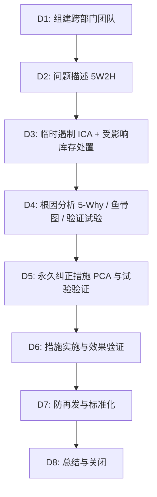

# 纺织品 / 家纺 / 服装 8D 质量问题闭环分析与报告标准指南

> **Standard 8D Problem Solving Report Guide Tailored for US Apparel & Home Textiles**

---

## 一、 8D 在美线质量管理中的定位

在美国零售与品牌业务中，以下事件应启动 8D：
1. **第三方实验室测试 Fail**：法规项（铅、阻燃、拉绳）或关键性能项（缩率、起球、强力）。
2. **大货终检拒收**：批量色差、接缝失效、断针、包装条码错误等。
3. **入仓拒收、口岸扣留或 CPSC 抽样不合格**。
4. **终端客诉或经实物复核的质量原因退货率异常升高**。

**8D 的成功标准**：控制损失、找到可验证的根因、防止再发。**不是“挽救了整张订单”**——已经造成物理损伤的货物通常无法修复，处置决策本身就是 8D 的核心内容。

---

## 二、 8D 标准流程

**时间要求（参考）**：D1–D3 在 24–72 h 内；D4 根因在 7–10 天内经试验确认；D6 效果验证以“措施后连续生产批次的数据”为准，通常需要 4–8 周，8D 不应在效果数据出来前关闭。

---

## 三、 8D 标准报告范例

### 【报告信息头】
> 说明：本范例是独立的教学情景（高支平纹床品），与案例库中的 [HT-001](case:HT-001)（400TC 缎纹床品）机理相似，但不是同一事件，订单、数字与 SOP 编号互不通用。

- **报告编号**: `8D-2026-TXT-008`
- **产品 / 款号**: 高支平纹（Percale）床品四件套 #PC-8802（被套、床单、床笠、枕套）
- **客户**: US Luxury Home Specialty Retailer
- **供应商**: 某江苏织染与缝制一体化工厂（示例）
- **订单**: PO #984210 / 25,000 套 / FOB $50 / 套，货值 $1,250,000
- **立案 / 根因确认 / 关闭**: 2026-08-08 / 2026-08-17 / 2026-10-20（关闭前完成 3 个新生产批次的效果验证）

---

### D1: 团队
- **组长**: Senior QA Manager（对客户沟通、跨部门裁决）
- **成员**: 面料工艺与染整工程师、工厂技术厂长、Sourcing Manager、合规专员、财务（COPQ 与索赔核算）、第三方实验室技术支持

---

### D2: 问题描述 (5W2H)
- **What**: 被套、枕套接缝处出现滑移开口；面料撕破强力不足，洗 3 次后折边受力处出现破洞。
- **Where**: 客户指定第三方实验室抽检：ASTM D1424 撕破强力；按客户成品接缝方法（参考 ASTM D1683）测定达到 1/4 in（6 mm）开口所需载荷。
- **When**: 2026-08-08，首单大货测试报告。
- **Who / 范围**: 第一批 10,000 套已在美国 DC 入库；第二批 15,000 套在工厂已包装待运。两批来自同一整理工艺，共 7 个整理批。
- **How much**: 撕破强力 经向 1.8 / 纬向 1.5 lbf（客户要求 ≥ 3.0 lbf）；接缝 1/4 in 开口载荷 6.2 lbf（要求 ≥ 15 lbf）；AATCC 124 免烫外观 4.0 级（客户要求 ≥ 4.0）。
- **严重度**: 功能失效（S=8），无安全法规问题。

---

### D3: 临时遏制与库存处置
1. **系统冻结**：美国 DC 对 10,000 套执行 WMS Hold，禁止调拨到门店和电商仓。
2. **工厂隔离**：15,000 套挂红牌隔离；同面料后续 PO（#984211/984212）暂停裁剪。
3. **按批分层复测**：对 7 个整理批的留样逐批测撕破与接缝，结果撕破 1.5–2.3 lbf，**全部不合格**，说明问题不是个别批次。
4. **有效性确认**：WMS 与工厂盘点核对，确认 25,000 套全部在受控状态，无一套流向消费者。
5. **处置决策**（客户、Sourcing、财务、QA 共同签署）：
   - **为什么不能返修**：拆线加宽缝份可以解决接缝滑移，但面料撕破强力不足是整理工艺造成的纤维损伤，**无法通过返工恢复**。
   - **美国 DC 的 10,000 套**：客户拒收并按合同扣款；货物在第三方监督下去除品牌标识后回收处理，取得回收/销毁证明，避免以品牌名义流入二级市场。
   - **工厂的 15,000 套**：去品牌后作为次品出售给清仓买家（回收约 $6 / 套），并按 FTC 要求重新标注成分与产地；同时用新工艺面料重做 15,000 套，客户同意交期顺延 5 周。
   - **损失核算（D8 归档）**：扣款 $500,000 + 处置与物流 $32,000 + 重做成本约 $525,000 − 次品回收 $90,000 ≈ **$967,000**。按责任协议，整理工艺擅自变更由工厂承担。

---

### D4: 根因分析

#### 1. 鱼骨图排查（6M）
- **Man**: 整理车间是否按批准的工艺卡操作。
- **Machine**: 焙烘机实际布面温度、车速、烘房温度均匀性。
- **Material**: 原纱强力与变异、坯布经纬密。
- **Method**: 树脂浓度、催化剂、焙烘温度与时间、柔软剂类型。
- **Measurement**: 裁样方向、调湿（ASTM D1776）、实验室间比对。
- **Milieu**: 整理车间温湿度、坯布存放。

#### 2. 验证试验（不是只靠推理）
- 取同一坯布，分别按“打样工艺卡”和“大货实际参数”整理：大货参数下撕破强力损失 58%，打样参数下损失 30%，与大货结果吻合。
- 布面测温记录显示大货焙烘温度为 170℃，比批准的 158℃ 高 12℃。

#### 3. 5-Why
- **Why 1**: 为什么撕破强力和接缝滑移不达标？——树脂交联过度使纤维素降解、纱线在撕裂三角区无法移动聚集；同时柔软剂使纱线表面过于光滑，接缝 SPI 和缝份不足。
- **Why 2**: 为什么交联过度？——为达到 DP 4.0，树脂用量 80 g/L，并在 170℃ 焙烘。
- **Why 3**: 为什么大货温度比打样高？——大货改用高速连续焙烘机，为赶交期提高温度和车速。
- **Why 4**: 为什么变更没被发现？——参数变更没有走 ECN，也没有在开裁前做全套物性测试。
- **Why 5（体系根因）**: 免烫整理没有被定义为特殊工艺，缺少“工艺卡锁定 + 面料放行绿卡”机制。

---

### D5: 永久纠正措施（经试验验证后才执行）
1. **工艺与配方**：低甲醛改性树脂 80 → 45 g/L；焙烘 158℃，写入设备配方并互锁；增加聚乙烯柔软剂以提高纱线可移动性（硅油用量受控，防止接缝滑移恶化）。
2. **客户规格调整**：试验表明在该组织与纱支下，DP 4.0 与撕破 ≥ 3.0 lbf 无法同时满足。客户技术部评审后书面修改规格为 DP ≥ 3.5，这是客户批准的规格变更，不是 QA 单方让步。
3. **缝制**：缝份由 1/4 in 加宽到 1/2 in；被套四周与枕套改为包缝后双针明线压缝，SPI 由 10 提高到 12。
4. **试验结果**（300 m 试产面料、60 套样品，第三方实验室）：撕破 经向 4.2 / 纬向 3.8 lbf；1/4 in 开口载荷 24 lbf；DP 3.5–3.8 级；甲醛满足客户 RSL。

---

### D6: 实施与效果验证
- 新工艺应用于重做的 15,000 套及后续 PO 的前 3 个生产批（共 7 个整理批）：每个整理批测撕破与接缝，全部合格。撕破最低值 经向 3.9 / 纬向 3.5 lbf。
- **能力评价**：目前只有 7 个整理批的数据，**不足以计算可信的 Cpk**；先按“每批全部合格 + 均值/最小值”放行，累计 25 个以上整理批后再评估过程能力。
- 补货到店后跟踪 8 周：经实物复核，该款未出现撕破或接缝开口相关退货。

---

### D7: 防再发与标准化
1. 更新《高支高密家纺免烫整理工艺控制 SOP》（SOP-QA-RM-042）：树脂浓度、焙烘温度、车速列为特殊工艺参数，变更须走 ECN 并重新做物性测试。
2. 面料放行绿卡：免烫、涂层等关键面料按**每个整理批**做撕破、接缝、DP、甲醛测试（抽样批级测试，不是“100% 全检”）后才能开裁。
3. PFMEA 增加“免烫整理强力损失”失效模式；同类款式横向排查。

---

### D8: 总结与关闭
- 2026-10-20 在效果验证完成后关闭。
- 本次 COPQ 约 $967,000，由责任工厂按协议承担；客户关系保住，后续 PO 恢复下单。
- 经验教训纳入《美线家纺质量案例库》；对整理车间负责人与 QA 做 ECN 与特殊工艺培训。
- **签批**: QA Director，2026-10-20
