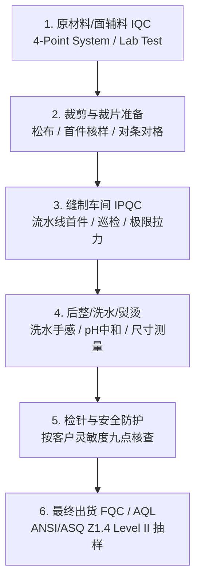

# 纺织服装与家纺全流程质量控制计划 (QCP / Control Plan)

> **End-to-End Quality Control Plan (QCP) Standard Template: From Yarn/Greige to Finished Goods AQL**

---

## 一、 质量控制计划 (Control Plan / QCP) 概述

**质量控制计划 (QCP)** 是将产品设计规范（Tech Pack）、物化标准（AATCC/ASTM/CPSC）和过程风险（PFMEA）转化为**生产现场具体监控动作**的核心操作纲领。
本模板覆盖从**原材料进料检验 (IQC) -> 裁剪/缝制过程巡检 (IPQC) -> 最终出货检验 (FQC/AQL)** 的全工序闭环控制。

---

## 二、 QCP 架构全景与工序控制矩阵

---

## 三、 标准全流程 QCP 控制计划工程表 (Standard Control Plan Table)

### 【工程受控信息 (Document Metadata)】
- **产品类别**: 美线高规格梭织/针织服装及家纺床品
- **适用标准**: ASTM / AATCC / 16 CFR / ANSI/ASQ Z1.4 (Level II, Major 2.5, Minor 4.0, Critical 0)

| 工序编号 | 工序名称 (Process Step) | 关键质量特性 (CTQ / Parameter) | 控制规格与要求 (Specification) | 检验与控制方法 (Method / Tool) | 抽样频次 (Frequency) | 责任人 (Owner) | 异常应急反应计划 (Reaction Plan) |
| :---: | :--- | :--- | :--- | :--- | :--- | :--- | :--- |
| **01** | **面料入库检验 (IQC)** | 1. 物理外观疵点 2. 门幅与克重 3. 边中/段色差 | 1. ASTM D5430 四分制，按 [Raw Material SOP](doc:SOP-FABRIC) 统一基准：常规批平均 ≤ 28、单卷 ≤ 40 分/100 sq yd（高端 20/28），客户更严从严 2. 克重 ±3–5%（按客户），门幅不小于可裁幅宽 3. 边中/头尾色差按 AATCC EP9 目视（灰卡等级 ≥ 4）或仪器 ΔE | 验布机 / 对色灯箱（客户指定光源）/ 电子天平 | 每批至少 10% 卷数且不少于客户规定卷数；新供应商或高风险面料加严 | IQC 面料质检员 | 扣分超标整批隔离评级；色差超标通知染厂打 Shade Band 或退回重修。 |
| **02** | **面料实验室测试 (Lab Test)** | 1. 水洗尺寸与扭腿 2. 色牢度 (皂洗/摩擦/汗渍) 3. 撕破与顶破强力 4. 甲醛/pH值/禁用偶氮 | 1. 缩率按客户（梭织常见 −3% ~ +1%，针织 −5% ~ +2%），扭斜按客户 2. 水洗变色 ≥ 4、沾色 ≥ 3–3.5，湿摩按客户（常见 ≥ 2.5–3） 3. 强力满足买手矩阵 4. pH、甲醛、偶氮按客户 RSL（甲醛须注明方法：婴幼儿常 ≤ 16–20 ppm，接触皮肤常 ≤ 75 ppm） | AATCC 135 / AATCC 8 / AATCC 61 / ASTM D1424 / AATCC 112 或 ISO 14184-1 / EN ISO 14362 | 每一个大货染色缸（Lot）抽检 1 组完整测试样 | 认可实验室检测工程师 | 测试 Fail 严禁开裁；签发工程偏差报告（NCR），联合 QA 与染厂复测并启动 8D。 |
| **03** | **面料松布与预缩 (Resting)** | 消除织造与定型内应力，释放弹性张力 | 1. 梭织面料自然松布 ≥ 12 小时 2. 针织高弹/氨纶织物松布 24-48 小时 3. 记录温湿度环境 | 计时器 / 挂签追踪 / 裁片回弹测试 | 100% 每一卷面料追踪 | 裁床主管 / IPQC | 未达松布规定时间拉布机自动互锁锁定；私自开裁按严重违纪处理并封存裁片。 |
| **04** | **拉布与裁剪 (Cutting)** | 1. 拉布张力与对格 2. 上下层裁片尺寸一致性 3. 刀口光洁度，无熔边 | 1. 无张力铺布，平整无褶皱 2. 上下层偏差 ≤ 1.0 mm 3. 条格对称对位偏差 ≤ 1.5 mm | 钢直尺 / 样板比对 (Template Check) / 数控自动裁床监控 | 每床拉布首层与尾层对比；每拉 50 层抽检 1 次 | 裁床质检员 | 裁片尺寸超标立即停裁，销毁超标层，调整裁床刀片速度与吸附真空负压。 |
| **05** | **缝制首件确认 (First Piece Approval)** | 1. 工艺做工与 Tech Pack 符合性 2. 关键部位尺寸 3. 线迹密度 (SPI) 与缝纫线张力 | 1. 100% 符合技术包封样要求 2. 尺寸公差在 Tech Pack 允许范围内 3. 针迹无跳针、浮线、起皱，SPI 满足规定 | 软卷尺 / 封样对比 / 放大镜数针器 | 开线时必须确认 3 件首件 (Pass 后方可量产) | 产线组长 + QA 巡检 | 首件未获 QA 签字确认，产线严禁批量车缝；发现尺寸偏差立即调试模板与设备。 |
| **06** | **缝制过程巡检 (In-line IPQC)** | 1. 车缝缺陷（断线/跳针/歪线） 2. 止口与缝份宽度 3. 小部件/辅料拉力测试 | 1. 缝份宽度均匀，无脱线漏缝 2. 严防漏装水洗唛/防伪标 3. 童装纽扣/按扣拉力按客户方法（常见 15 lbf 保持 10 s；爪扣参考 ASTM D7142），新件与洗后各测 | 拉力计/拉力试验机 / 巡线目视 | 每工位每 2 小时抽查 5 件；拉力测试每机台每班次抽测 10 次 | IPQC 质检员 | 发现拉力不达标立即隔离该机台自上次点检以来的全部产出，重新加固打扣。 |
| **07** | **成衣洗水与后整理 (Washing & Finishing)** | 1. 洗水风格与颜色 2. 残留化学物中和 (pH) 3. 烘干温度控制 | 1. 颜色与标准样板 (Master Sample) 一致 2. 洗后 pH 值稳定在 5.5 - 7.5 3. 烘干温度 ≤ 70℃ 防止烫死弹性丝 | pH 计 / 比色箱 / 手感封样样卡对比 | 每洗水缸出锅测量 pH；每锅首批对色 | 洗水车间质检员 | pH 偏酸或偏碱立即加水洗助剂中和漂洗；手感偏硬增加柔顺剂循环调整。 |
| **08** | **全数检针安全控制 (Needle Detection)** | 在规定灵敏度下检出铁磁性断针碎片（检针通过不等于绝对无金属） | 1. 灵敏度按客户（常见 1.0–1.2 mm Fe 球），九点、多方向测试卡全部报警 2. 报警自动停机/倒退；含金属辅料款按 [SYS-006](case:SYS-006) 的替代控制路线 | 输送式检针机 / 测试卡 | 100% 过机；班前、每 2 小时、班后用测试卡核查；核查失败则复检自上次合格核查以来的全部产品 | 专职检针员 (持证上岗) | 报警衣物放入专用“隔离锁箱”，由专人使用手持探测器寻找断针并记录在案。 |
| **09** | **最终出货检验 (FQC / Final AQL)** | 1. 整体外观缺陷与包装 2. 成品全尺寸测量 3. 条形码与外箱唛头扫描 | 1. 致命缺陷 Critical: 抽样中发现即拒收（Ac = 0，并触发全数排查） 2. 严重缺陷 Major: AQL 2.5 3. 轻微缺陷 Minor: AQL 4.0 4. 扫码率 100% 正确匹配 | ANSI/ASQ Z1.4 Normal Level II 单次抽样方案 / 扫码枪 | 按出货批量查表抽样（如 5000 件抽检 200 件） | 专职 QA 验货官 / 客户指定第三方 | AQL 超标判定为整批 Reject；必须由工厂进行 100% 全数返工，重新申请二次验货。 |

---

## 四、 QCP 评审与变更控制机制 (Review & ECN)

1. **版本更新触发条件**:
   - 客户修改 Tech Pack、公差标准或更换面辅料供应商；
   - 生产过程中发生重大质量事故（8D 改善措施需反哺固化至 QCP）；
   - 工厂生产线设备升级或自动化改造。
2. **QCP 签署与生效**:
   - 必须由 **QA Manager、生产技术总监、采购经理** 共同会签生效，并分发至 IQC、IPQC、FQC 及裁缝后道各车间看板。
