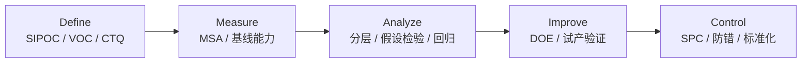

# 纺织服装 Six Sigma DMAIC 精益六西格玛质量改善项目模板

> **DMAIC Project Charter & Roadmap Tailored for Apparel & Home Textile Quality Improvement**

---

## 一、 DMAIC 的适用场景

DMAIC 适用于**长期存在、多因子交织、用常规 8D 难以根治**的问题，例如洗水尺寸变异、缸差、起球客诉、FTR 长期偏低。它能体现三项能力：
1. 数据驱动决策；
2. 统计与过程能力分析（MSA、Cp/Cpk、假设检验、DOE）；
3. 把质量指标转化为财务收益（COPQ）。

**使用纪律**：Cpk 只用于连续型、过程稳定、测量系统合格的数据；均值落在规格外时 Cpk 为负值，必须如实报告。

---

## 二、 项目立项书 (Project Charter)

| 字段 | 内容 |
| :--- | :--- |
| **项目名称** | 降低美线针织抓绒卫衣洗后长度缩率与扭斜 |
| **业务背景** | 2025Q3–Q4，该系列（3 家面料厂、2 家成衣厂）首次终检合格率（FTR）为 84.5%；不合格项中约 60% 与洗后尺寸或扭斜有关。相关返工、复测、空运与客户扣款的 COPQ 约 **$420,000 / 年**（其中客户扣款与索赔 $280,000）。 |
| **问题陈述** | 面料洗后长度缩率（AATCC 135，3 次洗烘，客户规格 −5.0% ~ +2.0%）均值 −4.0%、σ = 0.60%，**Cpk = 0.56**；成衣扭斜（AATCC 179，客户规格 ≤ 5.0%）均值 3.9%、σ = 0.80%，**Cpk = 0.46**。两项综合合格率约 87%。 |
| **目标** | ① 两项 Cpk ≥ 1.33；② FTR ≥ 96%；③ 尺寸/扭斜相关 COPQ 降低 ≥ $250,000 / 年。 |
| **范围** | In：纱线规格、圆机织造、染整定型与预缩、裁床松布。Out：版型修改、消费者洗护习惯。 |
| **周期** | 2026-01 至 2026-06（Control 阶段延续 3 个月数据跟踪） |
| **团队** | Champion：供应链 VP；Black Belt：QA Senior Manager；成员：面料经理、Sourcing、染厂工艺工程师、成衣厂 IE |

---

## 三、 五阶段路线

### 1. DEFINE
- **VOC → CTQ**：“洗后不能变短，侧缝不能扭到前面” → CTQ1 长度缩率 −5.0% ~ +2.0%（AATCC 135，3 次）；CTQ2 扭斜 ≤ 5.0%（AATCC 179）。
- **SIPOC**：S 纱线厂/染厂/助剂商 → I 精梳棉/涤纶 DTY 抓绒纱、定型柔软剂 → P 织造 → 染色 → 定型/预缩 → 松布裁剪 → 缝制 → O 卫衣 → C 美国零售商与消费者。

### 2. MEASURE
- **MSA**：3 名测量员 × 10 块试样 × 2 次，测 AATCC 135 标记距离并计算缩率。%GRR（相对公差宽度 7.0 个百分点）= **7.8%**，可区分类别数 ndc = 9，测量系统可接受。扭斜测量同样做了 Gage R&R（%GRR = 12%，条件可接受，测量时规定统一的平铺与标记方法）。
- **基线**：连续 30 缸，每缸取头、中、尾 3 个样（n = 90）：
  - 长度缩率：均值 −4.0%，σ = 0.60%，Cpk = (−4.0 − (−5.0)) / (3 × 0.60) = **0.56**；
  - 宽度缩率：均值 +0.4%，在规格内且能力充足（不作为本项目重点）；
  - 扭斜：均值 3.9%，σ = 0.80%，Cpk = (5.0 − 3.9) / (3 × 0.80) = **0.46**。
- 过程稳定性：I-MR 图显示有 3 缸超出控制限，均来自同一定型机，作为 Analyze 的线索。

### 3. ANALYZE
1. **长度缩率**：
   - 按定型机分层：2 号定型机的缩率均值比 1 号低 1.1 个百分点（t 检验 p < 0.01），原因是 2 号机超喂实际值比设定值低约 6%（超喂辊打滑）。
   - 回归：长度缩率与定型超喂率（R² = 0.62）、出布含湿率显著相关。
   - 裁床未执行松布：裁片在 24 h 内平均回缩 0.8%，形成额外尺寸偏差。
2. **扭斜**：
   - 纱线捻系数：捻系数 3.8 批次的扭斜均值比 3.4 批次高 1.3 个百分点（p < 0.01）；
   - 圆机进纱路数多且捻向单一；定型时未做纬斜矫正。

### 4. IMPROVE
- **DOE（3 × 3 × 2 全因子，2 次重复，共 36 次试验）**：A 定型超喂（15%、25%、35%），B 定型温度（150、160、170℃），C 预缩机压力（2 个水平：0.3、0.5 MPa）；响应为长度缩率与克重。
  - 结论：A 主效应最显著，A×B 交互显著；C 影响较小。最优窗口为超喂 25 ± 2%、温度 160 ± 3℃、预缩 0.5 MPa。验证试验 5 缸，长度缩率均值 −2.6%。
- **扭斜**（非 DOE 因子，单独验证）：
  - 抓绒面纱捻系数由 3.8 调整为 3.4，圆机采用 S/Z 捻交替进纱；
  - 定型机加装纬斜检测与自动矫正，设定 ≤ 2% 的纬斜控制目标。
- **裁床**：无张力拉布 + 松布 24 h（按裁片回缩实测确定），每拉 50 层测一次回弹。
- **定型机修复**：更换 2 号机超喂辊包覆，每班用标记布核对实际超喂。

### 5. CONTROL
- **SPC**：每缸头、中、尾 3 个缩率样组成一个子组，使用 $\bar{X}$-R 控制图；控制限按改善后前 25 个子组计算，不能用规格限代替控制限。
- **防错**：定型配方由扫码调用，超喂与温度偏离窗口时设备报警并锁定；超喂辊每周维护。
- **文件**：更新《针织抓绒面料定型与预缩作业指导书》（WI-PRD-088）；面料放行绿卡增加缩率与扭斜两项。
- **Control 阶段数据**（改善后连续 40 缸）：长度缩率均值 −2.6%、σ = 0.53%，Cpk = (−2.6 + 5.0) / 1.59 = **1.51**；扭斜均值 2.2%、σ = 0.62%，Cpk = (5.0 − 2.2) / 1.86 = **1.51**。

---

## 四、 项目收益

| 指标 | 改善前 | 改善后（Control 阶段 3 个月） | 说明 |
| :--- | :---: | :---: | :--- |
| 长度缩率 Cpk | 0.56 | **1.51** | 连续 40 缸，过程受控 |
| 扭斜 Cpk | 0.46 | **1.51** | 同上 |
| 洗后尺寸+扭斜综合合格率 | ≈ 87% | ≈ 99.9%（按能力推算），实测 40 缸全部合格 | |
| FTR（终检首次合格） | 84.5% | **96.8%** | 剩余不合格多为外观项，不在本项目范围 |
| 尺寸/扭斜相关 COPQ | $420,000 / 年 | **$96,000 / 年**（年化） | 新增测试与维护成本约 $30,000 / 年，净节约约 **$294,000 / 年**，经财务核对 |

---

## 五、 面试话术要点
1. 讲清楚**基线是怎么测出来的**（MSA 合格、30 缸 90 个样、Cpk 计算式）。
2. 说明 DOE 的**设计结构**（3×3×2 全因子，不要说成响应曲面）和显著因子。
3. 指出 DOE 解决不了扭斜，扭斜需要回到纱线捻系数与进纱方式。
4. 结果按**净节约**报告，并说明测量口径与观察期。
