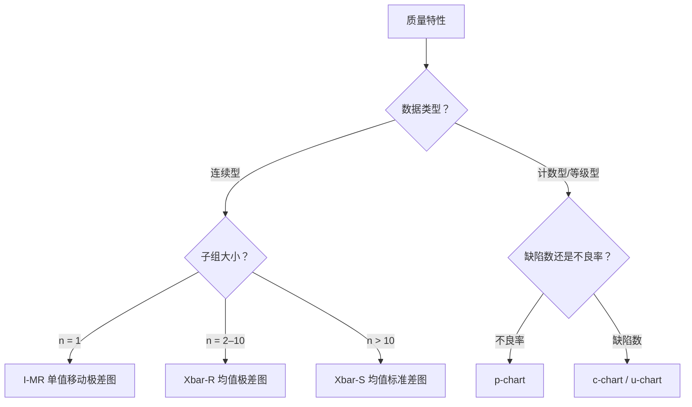

# 纺织服装 SPC 控制图与过程能力（Cpk）分析模板

> **Statistical Process Control Charts & Process Capability (Cpk) for Textile Quality**

---

## 一、 SPC 在纺织服装中的适用与限制

SPC 控制图和过程能力指数（Cpk）适用于**连续型、过程相对稳定、测量系统合格**的质量特性。在纺织服装领域，典型的适用与不适用场景：

| 适用 | 不适用 |
| :--- | :--- |
| 面料克重（连续型、逐批可测） | 色牢度等级（等级型/序数型，不可算 Cpk） |
| 撕破强力、顶破强力 | 起球等级 |
| 成衣关键部位尺寸 | 缺陷数/缺陷率（用 p-chart / c-chart，不用 Cpk） |
| 面料 pH 值 | 主观手感评级 |
| 静水压 | "好/坏"二值判定 |

**使用纪律**（GOV-02 §3.3、GOV-03 §5）：
- Cpk **只用于** `registry/metrics.json` 中 `cpkAllowed: true` 的连续型指标；
- 必须写明子组数（≥ 25 个子组）和 MSA 结果（Gage R&R %Study Var 三级判定，详见 [PB-MSA](doc:PB-MSA)）；
- 过程不稳定（控制图有失控点未消除）时**不计算 Cpk**——先稳定，再评估能力；
- 均值落在规格外时 Cpk 为负值，必须如实报告，不遮掩。

---

## 二、 控制图类型选择

### 纺织服装常用场景

| 场景 | 推荐控制图 | 子组定义 | 示例 |
| :--- | :--- | :--- | :--- |
| 面料克重逐卷检测 | **I-MR** | 每卷取 1 个样 | 每卷 1 点，子组 n = 1 |
| 成衣关键尺寸抽检 | **Xbar-R** | 每小时抽 5 件 | n = 5，每班约 8 个子组 |
| 撕破/顶破强力 | **Xbar-R** | 每批取 3–5 个试样 | n = 3–5 |
| AQL 终检不良率 | **p-chart** | 每批一个抽样结果 | 变动样本量用 p-chart |
| 面料四分制疵点 | **u-chart** | 每卷的疵点数/100 码 | 卷长不等用 u-chart |

---

## 三、 Xbar-R 控制图操作步骤（以成衣胸围为例）

### 3.1 数据收集

- **规格**: 胸围 54.0 cm ± 2.0 cm（USL = 56.0, LSL = 52.0）
- **子组**: 每 2 小时从产线随机抽 5 件测量胸围，连续收集 ≥ 25 个子组
- **测量**: 同一量具、同一测量员（或 MSA 已验证的测量系统）

### 3.2 计算控制限

| 统计量 | 公式 |
| :--- | :--- |
| 子组均值 | $\bar{X}_i = \frac{1}{n}\sum_{j=1}^{n} X_{ij}$ |
| 子组极差 | $R_i = X_{max} - X_{min}$ |
| 总均值 | $\bar{\bar{X}} = \frac{1}{k}\sum_{i=1}^{k} \bar{X}_i$ |
| 平均极差 | $\bar{R} = \frac{1}{k}\sum_{i=1}^{k} R_i$ |
| Xbar 图控制限 | $UCL_{\bar{X}} = \bar{\bar{X}} + A_2 \bar{R}$，$LCL_{\bar{X}} = \bar{\bar{X}} - A_2 \bar{R}$ |
| R 图控制限 | $UCL_R = D_4 \bar{R}$，$LCL_R = D_3 \bar{R}$ |

n = 5 时：$A_2 = 0.577$，$D_3 = 0$，$D_4 = 2.114$

### 3.3 判稳规则（Western Electric / Nelson）

控制图上出现以下任一模式时判为**失控**，需要调查原因：

| 规则 | 描述 |
| :--- | :--- |
| 规则 1 | 1 点超出 3σ 控制限 |
| 规则 2 | 连续 9 点在中心线同一侧 |
| 规则 3 | 连续 6 点递增或递减 |
| 规则 4 | 连续 14 点交替升降 |

失控点必须调查并记录原因（可追溯到批次、班次、设备或操作变更），确认为特殊原因后剔除并重新计算控制限。不能不调查就剔除数据点。

---

## 四、 过程能力 Cpk

### 4.1 前提条件

1. 控制图已判稳（无未解决的失控点）；
2. 数据近似正态分布（用正态概率图或 Anderson-Darling 检验确认；纺织数据常见右偏，必要时做 Box-Cox 变换）；
3. MSA 已通过（Gage R&R %Study Var ≤ 10% 为优秀，10–30% 为勉强可用，> 30% 不合格；详见 [PB-MSA](doc:PB-MSA) 三级判定）。

### 4.2 计算

$$C_p = \frac{USL - LSL}{6\hat{\sigma}}$$

$$C_{pk} = \min\left(\frac{USL - \bar{\bar{X}}}{3\hat{\sigma}},\; \frac{\bar{\bar{X}} - LSL}{3\hat{\sigma}}\right)$$

其中 $\hat{\sigma} = \bar{R} / d_2$（n = 5 时 $d_2 = 2.326$）。

### 4.3 解读

| Cpk | 含义 | 行动 |
| :---: | :--- | :--- |
| ≥ 1.67 | 卓越——过程中心且变异小 | 可考虑放宽检验频次 |
| 1.33–1.67 | 良好 | 维持控制 |
| 1.00–1.33 | 勉强合格——几乎无余量 | 改善变异或居中 |
| < 1.00 | 不合格——预期有超规产品 | 必须改善后重新评估 |
| < 0 | 均值在规格外 | 如实报告，立即纠正 |

### 4.4 纺织服装的典型 Cpk 基准

以下为行业参考范围（非标准），企业应建立自己的基线：

| 指标 | 典型 Cpk 范围 | 说明 |
| :--- | :---: | :--- |
| 面料克重 | 0.8–1.5 | 受纱线批次和织机张力波动影响 |
| 成衣关键尺寸 | 0.7–1.3 | 缝纫工序变异较大，弹性面料更难控制 |
| 撕破强力 | 1.0–2.0 | 面料层面相对稳定 |
| 面料 pH | 1.2–2.5 | 水洗充分时变异小 |

---

## 五、 I-MR 控制图（面料克重逐卷监控）

当每个子组只有 1 个数据点时（如每卷面料取 1 个克重样本），用 I-MR 图：

- **I 图**（Individual）：$UCL_I = \bar{X} + 2.66 \bar{MR}$，$LCL_I = \bar{X} - 2.66 \bar{MR}$
- **MR 图**（Moving Range）：$UCL_{MR} = 3.267 \bar{MR}$

其中 $\bar{MR}$ 为相邻两个数据点之差绝对值的平均（移动极差 span = 2）。

---

## 六、 SPC 在案例库中的应用

| 案例 | 可用 SPC 的指标 | 控制图类型 |
| :--- | :--- | :--- |
| [RM-001](case:RM-001) | ΔE 值、克重 | I-MR |
| [RM-006](case:RM-006) | 拉伸回复率 | Xbar-R（每批 3–5 个试样） |
| [APP-001](case:APP-001) | 接缝开裂伸长率 | Xbar-R |
| [HT-007](case:HT-007) | 松紧带回缩率 | Xbar-R |
| [SYS-004](case:SYS-004) | 实验室间色牢度评级 | p-chart（一致/不一致） |
