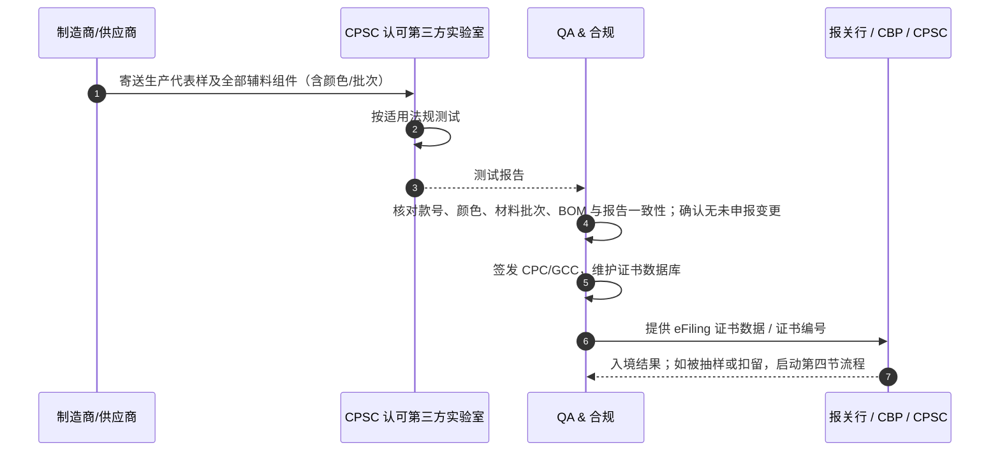

# QA 与法务合规 (Compliance) 协同：美国市场进关、安全法规与召回防御 SOP

> **US Regulatory Compliance & Recall Defense SOP: CPSC, CPSIA, Prop 65, FTC, UFLPA & Certificate Protocols (CPC/GCC)**

> 法规条款与数值以 [美国法规指南](doc:REF-US-REGS) 为单一来源；本 SOP 只规定 QA 与合规的分工和动作。

---

## 一、 合规风险的真实后果（不夸大）

- **口岸**：CPSC 可在口岸抽样；不合格货物可被拒绝入境，由进口商在规定期限内退运、在监管下整改（如经批准）或销毁。UFLPA 推定适用的货物会被扣留，直到进口商举证或退运。
- **市场**：已流通的不合格产品可能触发 CPSA 第 15(b) 条报告义务和召回（通常为与 CPSC 协商的自愿召回）。
- **罚款**：未及时报告或销售违禁产品可被处以民事罚款，法定上限按 2021 年调整为相关系列违规约 **$17.15M**。罚款不是扣留的自动结果，取决于知情程度、报告及时性、违规历史等因素。
- **QA 的定位**：技术证据与产品判定的守门人；法律定性与对外沟通由法务负责，QA 不单独对外作法律承诺。

---

## 二、 法规—产品匹配矩阵

```mermaid
graph TD
    P[产品定义: 儿童/成人 · 尺码段 · 睡衣/日常 · 家纺类别 · 销售州 · 渠道] --> C1[CPSC 燃烧性: 1610 / 1615-1616 / 1630-1631 / 1632]
    P --> C2[儿童产品: 铅 / 邻苯(仅玩具与护理用品) / 拉绳 / 小部件风险 / 追溯标签 / CPC]
    P --> F[FTC: 303 成分与产地 / 423 洗标 / 260 环保声明]
    P --> S[州法: Prop 65 警示 / AB 1817 等 PFAS 法规]
    P --> U[CBP: UFLPA 供应链溯源]
```

| 法规 | 适用产品 | 核心要求 | 方法 / 证据 | 违规风险 |
| :--- | :--- | :--- | :--- | :--- |
| **16 CFR 1610** | 成人与儿童服装纺织品 | Class 3 不得销售；平面织物 ≥ 3.5 s 为 Class 1；起绒织物分级见法规指南 | 45° 燃烧仪；或依测试豁免（≥ 2.6 oz/yd² 平面织物，或完全由腈纶/改性腈纶/锦纶/丙纶/涤纶/羊毛组成） | 停售、召回 |
| **16 CFR 1615/1616** | 尺码 0–14 儿童睡衣 | 平均炭长 ≤ 7.0 in，原样及 50 次洗烘后；或满足紧身尺寸表与规定标签 | 垂直燃烧 | 召回、罚款 |
| **CPSIA 铅** | 12 岁及以下儿童产品 | 涂层 ≤ 90 ppm（Sec.101(f)/16 CFR 1303）；基材 ≤ 100 ppm | CPSC-CH-E1001/2/3（认可实验室） | 不得销售 |
| **16 CFR 1307 邻苯** | **儿童玩具与儿童护理用品**（含 3 岁及以下睡衣、围兜等） | 8 种各 ≤ 0.1% | CPSC-CH-C1001-09.4 | 不得销售；普通童装按客户 RSL |
| **16 CFR 1120.3 / ASTM F1816** | 儿童上身外衣 | 2T–12（含 12 码/L 码）风帽/颈部不得有拉绳；2T–16 腰/下摆拉绳须符合 F1816；14–16 风帽/颈部拉绳法规未规定，按客户要求 | 尺码段规则 + 实物检查 | 实质性产品危害，召回 |
| **16 CFR 1632** | 床垫、床垫护垫 | 香烟阴燃炭长 ≤ 2 in | 原型测试记录 | 不得销售 |
| **16 CFR 1630/1631** | 地毯 | 片剂燃烧 | 原型测试 | 不得销售/须标签 |
| **FTC 423** | 有护理需求的纺织服装与部分家纺 | 至少一套完整护理指令，且有合理依据（测试、经验或行业知识） | ASTM D3938 指南；AATCC 135/150/61 等验证 | FTC 执法 |
| **FTC 303 / 300** | 纺织与羊毛制品 | 通用名称、±3 个百分点容差（“100%”不适用）、产地、RN | AATCC 20/20A | FTC 执法 |
| **Prop 65** | 在加州销售的产品 | 超过安全港须按规定格式警示 | 按和解基准做筛查 | 60 日通知、和解 |
| **CA AB 1817** | 纺织品 | 不得有意添加 PFAS；TOF < 100 ppm（2027 年起 < 50 ppm） | TOF + 声明 | 州执法 |
| **UFLPA** | 尤其棉制品 | 供应链不得涉及新疆或实体清单 | 逐级溯源文件包 | 扣留、拒绝入境 |

---

## 三、 证书与电子申报流程

- **CPC**：儿童产品必须基于 **CPSC 认可第三方实验室**的测试结果，由美国进口商或本土制造商签发；材料或供应商变更须重测（16 CFR 1107/1109）。
- **GCC**：仅适用于受 CPSC 规则、禁令或标准约束的非儿童产品（如需测试的成人服装 1610、床垫护垫 1632、地毯 1630/1631），基于测试或合理测试程序签发。
- **eFiling**：自 **2026-07-08** 起，需要证书的进口产品须在入境申报时向 CBP/CPSC 电子提交证书数据（经外贸区入境的自 2027-01-08 起）。数据错误或缺失可能导致放行延迟或被抽样，不存在“系统秒级自动放行”的承诺。



---

## 四、 口岸扣留与市场问题响应

1. **0–24 h**：冻结同款所有在途、在库、在产货物；保全样品与生产记录；通知法务与客户合规联系人。
2. **24–72 h**：确认违规事实与适用条款（尺码段、产品定义、方法版本）；评估是否已有同类产品进入流通，由法务判断第 15(b) 条报告义务。
3. **处置方案**：整改（须获 CPSC/CBP 书面批准，并逐件 100% 执行与独立复核）、退运或销毁。整改涉及材料更换的，须重新进行第三方测试并重签 CPC。
4. **根因与体系**：Tech Pack 审核、BOM 变更控制、辅料批次测试、PLM 尺码段规则。

---

## 五、 面试场景演练

> **面试官提问**：“一批即将出运的 4–12 码儿童连帽卫衣，现场发现风帽穿有拉绳并加了塑料绳扣，工厂说长度不超过 3 英寸，请求先出货。你怎么做？”

**应答要点**：
1. **定性**：对 2T–12 尺码段，风帽/颈部拉绳本身即属 16 CFR 1120.3 认定的实质性产品危害，与长度无关；“3 英寸”是腰/下摆拉绳的规则，不适用于本场景。14–16 码风帽/颈部拉绳不在 16 CFR 1120.3 与 F1816 范围内，按客户手册判定；但只要标注的尺码区间覆盖 12 码及以下任一尺码，整件按禁止段处理。结论：**不得出货**。
2. **遏制**：签发 Shipping Hold，冻结全部同款在库、在途与在产。
3. **整改**：按批准的工程变更移除拉绳与绳扣，并封闭或去除穿绳结构（如改为松紧风帽）；**逐件 100% 返工并由独立人员逐件复核**，保留记录与照片。抽样检验只能用来审核返工过程，不能替代逐件确认。
4. **证书**：若涉及结构或材料变更，确认 CPC 所依据的测试仍然有效，必要时重测。
5. **根因**：为什么 Tech Pack 与 PP 样没有拦截？在 PLM 中按尺码段设置拉绳规则，并在 Gate 1/Gate 5 增加强制签核。
