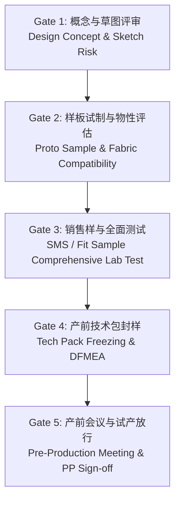

# QA 与产品设计研发 (PDD) 协同：设计阶段质量前置风控 (DFQ) 标准作业程序

> **Design for Quality (DFQ) SOP: Early QA Engagement in Product Design & Development**

---

## 一、 为什么质量必须在设计研发 (PDD) 阶段前置介入？

在纺织服装与家纺供应链中，相当一部分量产缺陷可以追溯到设计阶段：结构不合理、面辅料不兼容或未考虑可制造性。具体比例应以本企业 8D/退货根因库统计为准，不引用无出处的“行业百分比”。
- 传统的“后道抓质量”模式：设计做完 -> 工厂硬做 -> 大货爆出严重质量缺陷 -> 返修/延误/空运赔偿。
- **现代卓越 QA 模式（DFQ / Gatekeeper）**：在草图（Sketch）、样品制作（Proto / SMS）及技术包（Tech Pack）制定阶段即启动质量可行性评审，**从源头设计上消除制造隐患与法规红线**。

---

## 二、 PDD 研发阶段 QA 五级门禁评审机制 (Stage-Gate Review)

### 门禁详细输入、输出与质量评审准则

| 门禁阶段 (Gate) | 责任部门 | QA 核心任务与审核要点 | 关键输出交付物 | 驳回/红线条件 (Kill Criteria) |
| :--- | :--- | :--- | :--- | :--- |
| **Gate 1: 概念草图阶段** | Designer + QA | 1. 结构安全审核（童装是否含危险拉绳/硬质锐利装饰）； 2. 撞色拼接色牢度移色风险初判； 3. 复杂异形拼接的可缝制性评估。 | 《设计阶段质量风险评估表 (RAM)》 | 违背美线强制法规（如 2T–12 码风帽/颈部拉绳违反 16 CFR 1120.3、按紧身款豁免设计的儿童睡衣不满足 16 CFR 1615/1616 尺寸表）。 |
| **Gate 2: 初版样衣阶段 (Proto)** | Pattern Maker + QA + PDD | 1. 面料组织与缝线受力匹配； 2. 超薄/高弹织物的缝份止口宽度设计（防止接缝滑移）； 3. 关键辅料（拉链、按扣、魔术贴）强度与厚度匹配。 | 《初版样衣工艺评审报告 (Proto DFM)》 | 缝纫破洞 (Needle Cutting) 无法通过换针解决；洗后严重变形扭曲 >8%。 |
| **Gate 3: 试身与销售样 (Fit/SMS)** | Fit Model + QA + 3rd Party Lab | 1. 送检第三方实验室做全套物化性能测试； 2. 穿着拉伸受力测试（四针六线爆线测试、摩擦起毛球评估）； 3. 水洗保养标签指引（Care Label Recommendations）。 | 《实验室全套合规测试报告》、《水洗唛法规判定书》 | AATCC/ASTM 关键物化测试 Fail（如牢度 <3级、甲醛/pH超标、撕破强力过低）。 |
| **Gate 4: 技术包冻结 (Tech Pack)** | Tech Designer + QA Lead | 1. 尺寸公差表（Grading & Tolerance）合理性审核； 2. 明确针迹类型 (Stitch Type) 与针密度 (SPI)； 3. 辅料规格与环保限值 (RSL) 固化。 | 《受控版技术规格书 (Approved Tech Pack)》与《DFMEA 分析表》 | 尺寸公差过于苛刻且脱离面料缩水物理特性；辅料技术参数缺失。 |
| **Gate 5: 产前样封样 (PP Sample)** | Factory + Sourcing + QA | 1. 生产线实机制作样衣封样； 2. 大货用面料、辅料及包装材料 100% 真实匹配； 3. 召开产前技术交底会 (Pre-Production Meeting)。 | 《金样/封样标牌 (Golden Sample)》与《产前会 PPM 纪要》 | PP Sample 存在任何 Critical/Major 缺陷，整改直至二次送样合格方可量产。 |

---

## 三、 DFQ 实战攻坚：高风险设计场景排查与解决方案

### 1. 撞色拼接设计 (Color-Blocking Design)
- **典型风险**: 黑白、红白撞色在洗涤或汗渍状态下，深色染料渗移沾污浅色区域（AATCC 61 皂洗沾色、AATCC 107 耐水牢度失效）。
- **QA DFQ 介入策略**:
  1. **面料源头拦截**: 深色面料按 AATCC 61（对浅色面料实际纤维的沾色）与 AATCC 15/107 评定，撞色款沾色要求通常 ≥ 4 级（常规单色 3–3.5 级）；用“深色 + 浅色拼片成衣洗”验证真实串色，而不是只测单块面料；
  2. **工艺推荐**: 深色活性染料棉提高皂洗终点控制（多道高温皂洗 + 固色，以洗后残液色度与沾色等级判定终点），或改选高固着率染料组合；浅色面可改用低沾色倾向的纤维。洗涤时染料通过洗液转移，接缝里加嵌条无法阻断串色，不作为解决方案；
  3. **护理标签**: 加入 “Wash with like colors / Wash separately”“Do not soak” 等警示，但警示只能补充，不能替代牢度达标（FTC 423 要求护理指令有合理依据）。

### 2. 超薄/高密丝绸与高支棉接缝滑移 (Seam Slippage on Delicate/Fine Fabrics)
- **典型风险**: 高密缎纹床品或超薄雪纺在受力时接缝处纱线滑移开裂（ASTM D1683 或客户成品接缝方法；ASTM D434 已于 2004 年撤销）。标称 600TC 以上的床品须先核对纱支与是否按多股计数（FTC 与 ASTM D3775 按经纬纱根数计算，多股纱计为一根），避免虚标支数。
- **QA DFQ 介入策略**:
  1. **增加缝份**: 将 1/4"（0.6 cm）加宽至 3/8"（1.0 cm）或 1/2"（1.2 cm），并在 Tech Pack 中写明；
  2. **结构选择**: 床品优先采用来去缝（French seam）或包缝 + 平缝组合；雪纺采用来去缝或滚边；
  3. **针迹与密度**: 301 平缝本身不是滑移的根因，关键在 SPI、缝份、线张力与面料滑移阻力的组合；可选 516 五线安全缝（401 链缝 + 504 三线包缝），并通过 D1683 验证；
  4. **面料端**: 接缝滑移阻力不足时，优先与面料部调整柔软剂类型与用量、经纬密，而不是在缝内加热熔条（耐洗性和手感风险高）。

### 3. 功能性热压胶与复合面料剥离 (Bonded & Seam-Tape Outerwear)
- **典型风险**: 户外冲锋衣压胶条在机洗后脱胶起泡，静水压直接降至零。
- **QA DFQ 介入策略**:
  1. **膜与胶兼容性验证**: 在 Tech Pack 中指定由膜厂/胶带厂共同批准的胶带型号（如 PU 膜配 PU 胶带），禁止有硅油或 DWR 迁移的面料直接压胶；无氟 DWR 的表面能高于氟系，但同样须做胶带相容性验证；
  2. **工艺窗口由设备与胶带实测确定**: 热风压胶机的**风嘴设定温度通常为数百摄氏度**，真正控制的是胶层在压合点的实际温度（按胶带厂推荐的活化温度）、压轮压力与车速。必须用测温与剥离 DOE 确定窗口，不能把胶层活化温度当作设备设定值；
  3. **验收**: 按客户规定的洗涤次数测剥离强度（如 ≥ 客户值 N/25 mm）与接缝静水压，记录失效模式（胶失效 / 膜失效 / 面料失效）。

---

## 四、 面试高频问题与展示话术

> **面试官提问**：“设计部门 (PDD) 往往追求视觉美观与新颖款式，而 QA 追求稳定性和低风险，当两部门发生冲突时，你如何协调并推行 DFQ？”

### 卓越总监级应答逻辑：
1. **阐明理念**：“QA 的职责不是扼杀创意（Not a blocker, but an enabler），而是通过材料科学与工艺工程手段，**将前卫的设计安全、高质地转化为可量产的商业化商品**。”
2. **数据与事实说话**：“我不会主观反对设计，而是依托早期的 **RAM 风险评估矩阵与实验室极限破坏性测试数据**。例如，把拼色样衣洗 5 次后的串色实物和 2.0 级沾色报告放在设计师面前，并引用本品类历史上“串色”原因退货的实际占比与金额，而不是给一个拍脑袋的退货率。”
3. **给出‘替代性工程解决方案 (Alternative Solutions)’**：“当反对某个方案时，我总是带着 2-3 个替代方案去开会。比如撞色拼接掉色，我不会要求设计师放弃黑白拼色，而是联合面料部优化黑色面料的染料组合与皂洗终点，把对白色面的沾色提升到 4 级，并用拼色成衣洗验证；必要时把白色面换成低沾色倾向的纤维，既保留设计，又守住质量底线。”
4. **机制保障**：“推行 **DFQ 门禁打卡制度 (Stage-Gate Sign-off)**，将重大质量风险前置消灭在技术包冻结之前。”
