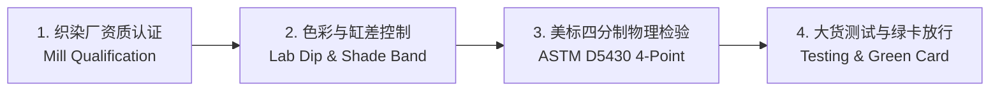
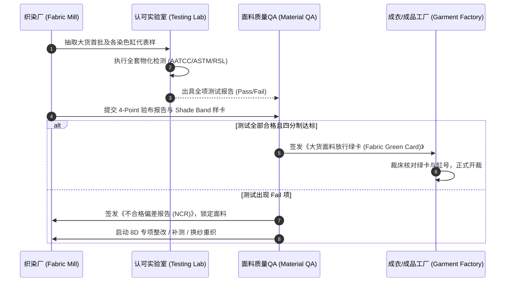

# QA 与面料原料部 (Raw Material) 协同：面料全生命周期风险前置拦截 SOP

> **Raw Material Quality Assurance SOP: Mill Qualification, 4-Point System, Shade Band & Fabric Release Green Card**

---

## 一、 面料质量在纺织服装中的关键地位

“面料是服装与家纺的灵魂”：色差、缩率、起球、强力、牢度等高频质量问题大多源自面料。面料原因在本企业 8D 与退货根因中的实际占比，应由 QA 每季度统计，作为资源分配依据。
面料部（Raw Material Department）关注新纤维开发、手感、成本与交期，而 **QA 的职责是建立严格的物化标准矩阵、色差控制边界以及量产前置拦截机制**，确保每一米进入成衣厂的面料都处于完全受控状态。

---

## 二、 QA 与面料部协同管控四大核心支柱



### 1. 织染厂技术与质量能力评估 (Mill Technical Qualification)
在面料供应商导入前，QA 联合面料部对织厂/染厂实施现场审核：
- **设备能力**: 染色电脑自动打料滴定系统、连续轧染/溢流染色机台温控精度、定型机超喂与幅宽自动调节装置。
- **实验室资质**: 是否具备经品牌或第三方认可的内建实验室（Lab Certification），是否配备标准对色灯箱（定期校准灯管计时器）、电子强力机、标准耐洗牢度机及恒温恒湿箱。
- **环保与合规**: 按客户要求核查 OEKO-TEX Standard 100 证书（核对证书范围与产品级别）、ZDHC MRSL 化学品清单符合性与废水测试、bluesign 认证（如适用）、排污许可，以及 UFLPA 所需的纱线/纤维来源文件。

---

### 2. 颜色审批与大货缸差色差管理 (Color Approval & Shade Band System)

```
        Light (浅限) <------ Master Standard (标样) ------> Dark (深限)
                                   │
                           Reddish / Greenish
                           Yellowish / Bluish (色相容差边界)
```

- **Lab Dip (打色小样) 审批**:
  - 按买手指定的主光源（通常 D65）及次光源（美国零售常用 CWF 或 LED 店铺光；TL84 多见于欧洲/亚洲零售；家居场景常加 Incandescent A）按 AATCC EP9 目视评定；
  - 仪器测色按 AATCC EP6：主光源 $\Delta E_{CMC(2:1)} \le 0.8$（或客户值），同色异谱指数 MI（D65 对次光源）按客户定义，常见 ≤ 0.5–0.8。全公司只保留一个 MI 判定值，写在客户颜色手册里，不要在不同文件中各写一个数。
- **Bulk Shade Band (大货缸差样条) 建立**:
  - 大货多缸染色时，染厂必须收集各缸具有代表性的布样，制作 **Shade Band（包含 Light-Center-Dark 极限容差样卡）**。
  - QA 签字封存 Shade Band 并分发至成衣裁剪车间，**裁床严格按缸号（Dye Lot）分床分包裁剪，严禁混缸缝制导致成衣阴阳色或段差**。

---

### 3. 美标四分制面料检验体系 (ASTM D5430 / 4-Point System)

#### (1) 扣分规则基准表 (Defect Penalty Points)
| 疵点长度 / 范围 (Size of Defect) | 扣分 (Penalty Points) |
| :--- | :---: |
| 疵点长度 $\le 3$ 英寸 (7.5 cm) | **1 分** |
| 3 英寸 < 疵点长度 $\le 6$ 英寸 (15 cm) | **2 分** |
| 6 英寸 < 疵点长度 $\le 9$ 英寸 (22.5 cm) | **3 分** |
| 疵点长度 $> 9$ 英寸 (22.5 cm) | **4 分** |
| 破洞/开口 ≤ 1 英寸 | **2 分** |
| 破洞/开口 > 1 英寸 | **4 分** |
| 连续性或全门幅疵点（连续折痕、边中色差、纬斜超限） | **每码扣 4 分**（同时按客户规定判定是否整卷降级） |

*注：在任何 1 延米/码内，最多累计扣分不得超过 4 分。*

#### (2) 四分制百平方码得分计算公式 (Points per 100 sq yd)
$$\text{Points / 100 sq yd} = \frac{\text{总扣分数 (Total Penalty Points)} \times 36 \times 100}{\text{检验总长度 (Inspected Yards)} \times \text{面料门幅英寸 (Cuttable Width in Inches)}}$$

#### (3) 判定合格允收标准 (Acceptance Criteria)
允收值没有统一的 ASTM 限值，由客户在合同中规定。美国零售商常见做法是同时设“单卷上限”和“批平均上限”，本库统一采用下列内部基准（客户要求更严时从严）：
- **高端/奢侈品类**：批平均 ≤ 20 分/100 平方码，单卷 ≤ 28 分；
- **常规成衣/家纺**：批平均 ≤ 28 分/100 平方码，单卷 ≤ 40 分；
- 超过单卷上限的卷不得开裁，须评级、退回或经客户书面让步；批平均超限则整批隔离评审。
- 抽验比例：每批至少 10% 卷数（且不少于客户规定卷数），高风险面料或新供应商加严至 20% 或全检。QCP 中的 IQC 判定值引用本条，不另设数值。

---

### 4. 面料大货放行绿卡机制 (Fabric Release Green Card Protocol)



---

## 三、 面料常见重大物化缺陷与 QA 根治方案库

| 面料缺陷类型 | 对应检测标准 | 失效机理深度分析 | QA 前置根治措施 |
| :--- | :--- | :--- | :--- |
| **分散染料热迁移导致色牢度衰减** | AATCC 61 / AATCC 8 / AATCC 107 | 涤纶（含涤/氨）染色后在高温定型或热处理中，分散染料向纤维表面及柔软剂、表面活性剂相中迁移；阳离子/非离子助剂与部分氨基硅油会加剧迁移。 | 1. 选用耐升华/低迁移的分散染料组合，染后充分还原清洗（以清洗液色度和摩擦牢度判定终点）；<br>2. 选用低热迁移柔软剂；尽量在染色前预定型，染后定型温度在保证尺寸稳定的前提下降低，并复测缩率。 |
| **纯棉高密面料撕破强力过低** | ASTM D1424 (Elmendorf) | 免烫树脂交联过度或酸性催化剂与高温焙烘造成纤维素降解；交联使纱线在撕裂三角区不能移动聚集，强力下降。 | 1. 控制树脂与催化剂用量、焙烘温度和时间，用强力保留率作工艺窗口指标；<br>2. 配合聚乙烯/硅类柔软剂提高纱线可移动性（同时复测接缝滑移，避免滑移恶化）；液氨整理可在同等免烫等级下改善强力保留，但须验证。 |
| **针织面料纬斜与螺旋扭曲** | AATCC 179 | 纱线残余扭矩（捻系数、捻向）、多路进纱造成的线圈纵行倾斜，以及定型时未矫正的纬斜。 | 1. 降低纱线活性捻度或采用 S/Z 捻交替喂纱；<br>2. 平幅定型时设定纬斜矫正，必要时预设反向斜度，并以洗后扭斜验证。 |
| **抗起球性能水洗后严重恶化** | ASTM D3512 / ASTM D4970 | 短纤长度不均、毛羽多、捻度偏低；高强纤维（涤纶、锦纶）形成的球不易脱落。 | 1. 纺纱指定精梳、紧密纺或赛络紧密纺，控制短绒率与捻系数；<br>2. 棉及纤维素纤维可烧毛 + 纤维素酶抛光；**涤纶、锦纶不适用纤维素酶**，靠烧毛/剪毛、低起球纤维或抗起球整理。 |

---

## 四、 面试高频考点与应对策略

> **面试官提问**：“如果大货交期非常紧张，面料测试报告中‘耐日光色牢度 (Light Fastness)’或‘水洗缩水率’轻微超标（Fail），面料部和业务催着开裁，你作为 QA 负责人如何决策与把控？”

### 卓越应答框架：
1. **分类研判风险属性（区分“法规安全红线”与“物理使用性能”）**：
   - **绝对红线不可退让**：若是涉及毒害物质（PFAS、铅、偶氮）或安全指标，**坚决零容忍，一票否决，绝不可让步开裁**。
2. **基于风险量化评估（Risk Assessment Matrix）**：
   - 若是水洗缩水率轻微超标（如标准要求 -3.0%，实测为 -4.2%）：
     - **首选：回到面料端返修**，如重新预缩（橡毯/毛毯预缩、松式烘干）后复测，使面料本身达标；
     - **成衣洗方案**：若款式允许，增加成衣洗预缩，并按洗后尺寸重新确认纸样；
     - **纸样放量只是让步手段，不是“修好了”**：放大纸样只能让洗后尺寸回到公差内，出厂尺寸会偏大，客户的 AATCC 135/150 缩率测试仍然 Fail。只有在客户书面接受“出厂尺寸偏大 + 缩率偏差”并评估护理标签依据后，才可作为特采执行。
   - 若是日晒牢度轻微超标（如客户要求 AATCC 16.3 曝光 40 AFU 后 4.0 级，实测 3.5 级）：
     - 评估产品使用场景（如果是室内家居内衣，日晒风险相对较低；如果是户外窗帘或沙发布，日晒是核心寿命指标）。
     - 若为高危品类，坚决要求染厂进行紫外线吸收剂后浸轧加固处理，复测合格后放行。
3. **闭环签批与免责管理**：
   - 任何工艺调整或特采放行（Concession / Deviation Release），必须出具完备的风险评估报告、补救验证记录，并由采购负责人及买手技术代表共同签署工程变更偏差单（Deviation Permit），决不让 QA 单独背负隐性责任。
