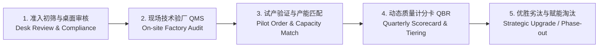

# QA 与采购供应链 (Sourcing) 协同：工厂技术验厂、供应商质量准入与绩效计分卡 SOP

> **Vendor Quality Management SOP: Technical Factory Audit, QMS Assessment, Vendor Scorecard & QBR**

---

## 一、 为什么 QA 必须深度协同 Sourcing (采购寻源)？

在现代全球化供应链中，采购往往优先看重**单价 (FOB Price)、产能 (Capacity) 和交期 (Lead Time)**，而 QA 必须充当**能力真实性校验器与风险刹车器**。
如果缺乏科学的技术验厂（Technical Audit）和动态供应商分级机制，盲目将高难订单下给低能力工厂，将导致后期爆发巨额返工费、空运费、索赔以及买手退店惩罚。

---

## 二、 供应商全生命周期质量治理体系 (Vendor Lifecycle Management)

---

## 三、 工厂技术质量审计标准模型 (QMS Audit Framework - 100分制)

QA 在对新工厂（服装缝制厂、家纺缝制与绗缝厂、织染厂）进行准入验厂时，严格按照以下 **八大核心模块** 进行打分评级：

| 审计模块 (Audit Module) | 权重 | 现场关键核查要点 (Critical Checkpoints) | 致命红线项 (Zero-Tolerance / Auto-Fail) |
| :--- | :---: | :--- | :--- |
| **1. 质量管理体系与组织 (QMS & Organization)** | 10% | 独立质检部门设立、质检配置（参考：每 15–25 名缝纫工配 1 名在线 QC，高难度款加密；以实际漏检率而非人数比判定是否足够）、质量培训记录、SOP 操作指导书覆盖率。 | 质检部门受制于生产车间无独立一票否决权。 |
| **2. 原材料检验与仓储 (IQC & Warehouse)** | 15% | 美标四分制验布机、对色灯箱（D65/TL84/CWF）、分缸管理（Shade Band）、松布区面积与温湿度防潮防霉防晒。 | 无验布机或无受控对色箱；面料直接露天堆放受潮。 |
| **3. 样板房与技术准备 (Sampling & Tech)** | 10% | CAD 样板系统、缩水率放板补偿算法、产前样 (PP) 封样留档管理、首件制作与技术交底能力。 | 无产前会议纪要直接开裁；未核对 Tech Pack 尺寸。 |
| **4. 裁床过程控制 (Cutting Control)** | 15% | 自动拉布机张力控制、裁片层数限制（厚料 ≤ 50层，薄料 ≤ 100层）、上下层对位抽检、对条对格菲票追溯。 | 上下层裁片偏差超过工厂 QCP 规定（本库基准 ±1.0 mm，厚料或客户另定）且未纠正。 |
| **5. 车缝与组装制程控制 (Sewing IPQC)** | 20% | 产线首件确认卡（每款开线必签）、工位巡检记录（2小时一次）、断针管理制度（以旧换新、断针记录本）、破坏性拉力抽检。 | **无断针回收管控流程；断针未拼凑完整即发新针。** |
| **6. 洗水、后整与包装 (Finishing & Packing)** | 10% | 熨烫温度压力控制、洗水残液 pH 中和检测、修线头清洁度、折叠对称与条码唛头准确性。 | 条码错位或外箱装箱清单混淆。 |
| **7. 检针与安全防护 (Needle Detection)** | 10% | 独立全封闭检针区、检针机班前/班中/班后测试卡核查记录（按客户灵敏度，常见 1.0–1.2 mm Fe 球；九点、多方向）、报警隔离箱双人双锁。 | **检针机损坏停用；检针区无物理隔离，混杂未检衣物。** |
| **8. 实验室与出货终检 (In-house Lab & Final AQL)** | 10% | 厂内常规物化测试能力（缩水/牢度/强力/拉力）、ANSI/ASQ Z1.4 AQL 出厂前终检独立报告归档。 | 终检报告伪造数据；AQL 拒收批次未经返工私自发货。 |

---

### 工厂审计等级评定与业务准入规则
- **Level A (≥ 85 分)**: **战略核心供应商 (Strategic Partner)**，优先分配高附加值、工艺复杂及大批量订单；可申请进入 DQA 自检计划，授权资格以 [SYS-003](case:SYS-003) 计分卡（Tier 1 或 Tier 2、无红线）与 [SYS-001](case:SYS-001) 的人员考核为准。DQA 自检放行仍有飞行稽核，不是免检。
- **Level B (70 - 84 分)**: **合格供应商 (Qualified Vendor)**，可承接常规订单；QA 派驻跟单巡检并限期 30 天内整改弱项（CAP）。
- **Level C (60 - 69 分)**: **条件限制供应商 (Conditional Vendor)**，仅限下达工艺简单小单；必须由第三方或驻厂 QA 实施 100% 尾期 AQL 检验方可放行。
- **Level D (< 60 分 或 触发致命红线)**: **不合格淘汰 (Disqualified)**，严禁导入采购池。

---

## 四、 供应商季度质量计分卡 (Vendor Scorecard & QBR)

计分卡模型、权重、目标值、红线与等级规则**统一以** [SYS-003 供应商动态质量计分卡](case:SYS-003) 为准，本 SOP 不另设第二套口径。要点：

| 维度 | 权重 | 数据口径 |
| :--- | :---: | :--- |
| FTR（首次终检合格率） | 35% | 以品牌 QA、第三方或飞行稽核的检验结果计算；DQA 自检结果只作对照 |
| 实验室首次通过率 | 20% | 按测试单计；**法规项不合格不扣分，直接触发红线评审** |
| 供应商责任质量退货率 | 15% | 经实物复核归因于制造缺陷的退货件数 / 发货件数；尺码偏好、页面信息、仓配原因不计入 |
| 8D 时效与有效性 | 10% | ICA 24 h、根因 7 天、效果验证按计划；措施失效扣分 |
| 现场稽核 / QMS | 10% | 准入审计与飞行稽核得分折算 |
| 文件与追溯完整性 | 10% | 测试报告、证书、批次追溯与 UFLPA 溯源文件按时、完整、可核查 |

所有维度采用线性插值计分，避免在某个阈值处断崖归零。

---

## 五、 产能与质量平衡：防止“爆单”引发的崩盘

Sourcing 在旺季常倾向于向少数低成本工厂过度集中订单，导致工厂**超负荷运转、私自外发（Unauthorized Subcontracting）**，这是美线质量崩盘的最大诱因。
- **QA 产能预警阈值公式**:
  $$\text{工厂负荷率 (Factory Load Rate)} = \frac{\text{下达订单总工时 (Committed Standard Allowed Minutes, SAM)}}{\text{工厂有效产能总工时 (Available Monthly Capacity)}} \times 100\%$$
- 有效产能按实际可用工时 × 历史效率计算（不是理论满产），并扣除已排的其他客户订单。
- **QA 决策机制**:
  - 负荷率 $> 85\%$（旺季连续 2 周以上）：黄色预警，Sourcing 追加订单前须评审产能与交期；
  - 负荷率 $> 95\%$：红色预警，原则上停止追加；如需追加，须经批准分流到已审核的副厂，并安排驻厂/飞行核查；
  - 负荷率 $> 100\%$ 意味着长时间加班或外发，本身就是私自外包的高风险信号，必须核查分包记录、工时与在制品去向；严禁未经审核的外协工厂参与生产。

---

## 六、 面试高频问题与实战应答

> **面试官提问**：“采购部门 (Sourcing) 想要引入一家价格极具优势但质量管理薄弱的工厂，而你验厂评估不及格，业务压力巨大，你作为质量负责人怎么破局？”

### 卓越回答技巧：
1. **原则清晰，不当单纯的‘阻拦者’**：“我理解 Sourcing 追求降本的商业目标，但作为 QA 负责人，必须对最终交付风险和品牌声誉负责，不能让暂时的成本红利演变为后期的天价索赔。”
2. **分级管控与阶梯式导入策略 (Risk-Tiered Onboarding)**：
   - 不搞‘一棍子打死’，出具详尽的《差距分析与纠正行动计划 (GAP Analysis & CAP)》，明确指出该工厂在断针管理、四分制检验和恒温压烫上的具体硬伤；
   - 设定‘整改缓冲期’：要求工厂在 15 天内针对高危红线完成软硬件整改，QA 进行二次复审；
3. **设置‘安全隔离网’**：
   - 试水阶段“先小后大、先易后难”：首期仅允许下达结构简单、非撞色、低风险的基础款订单（Pilot Order），限制订单量在总产能的 20% 以内；
   - 实施“加严检验与驻厂辅导”：由品牌派驻 Resident QA 在关键工序（裁床首件、车缝中段、尾期出货）实施 100% 旁站把关，直到该工厂连续 3 批大货 FTR 稳定在 95% 以上，方可正式放行进入合格供应商库。
